# Rust Software Renderer — Laboratorios 4, 5 y 6

Proyecto del curso **Gráficas por Computadora** — **Universidad del Valle de Guatemala (UVG)**, segundo ciclo 2026

Rasterizador por CPU escrito en Rust. Contiene el **Laboratorio 4: Carga de modelos OBJ** (contornos), sobre él el **Laboratorio 5: Filling triangles** (dos algoritmos de relleno, comparación de posiciones, benchmark y perfilado), una **vista interactiva** de la nave con cámara orbital, Z-buffer y sombreado y, sobre todo ello, el **Laboratorio 6: planetas y estrellas con shaders**: tres cuerpos celestes con fragment shaders procedurales sobre la misma esfera.

- [Laboratorio 6 — Planetas y estrellas con shaders](#laboratorio-6--planetas-y-estrellas-con-shaders)
- [Vista interactiva (opcional)](#vista-interactiva-de-la-nave-mejora-opcional)
- [Demostración en video: tres modos](#demostración-interactiva--tres-modos-de-rasterización)
- [Laboratorio 5 — Filling triangles](#laboratorio-5--filling-triangles)
- [Laboratorio 4 — Carga de modelos OBJ](#laboratorio-4--carga-de-modelos-obj)
- [Arquitectura](#arquitectura-implementada)
- [Cómo ejecutar y verificar](#cómo-ejecutar-el-proyecto)
- [Autor](#autor)

---

## Laboratorio 6 — Planetas y estrellas con shaders

Tres cuerpos celestes sobre **la misma esfera del docente** (`assets/models/sphere.obj`, copiada byte a byte: 98 vértices únicos y 192 triángulos). Toda la apariencia sale de **fragment shaders procedurales en CPU**. No hay texturas, imágenes, materiales externos ni modelos nuevos; los vértices nunca se mueven. Cada cuerpo tiene un símbolo exclusivo de la dirección artística Red-Black: la **corona** de la estrella, la **pica ♠** del planeta rocoso y el **rombo ♦** del gigante gaseoso. La guía técnica completa, con fórmulas, todos los parámetros, pruebas y rendimiento, está en [docs/laboratorio6.md](docs/laboratorio6.md).

| The King's Crown (estrella) | Crimson Entrance (rocoso) | House of Cards (gaseoso) |
|---|---|---|
| 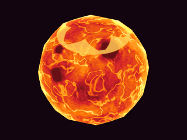 | 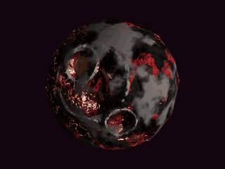 | 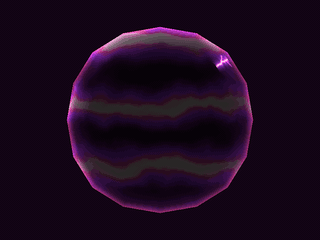 |

### Cómo ejecutar

Compila siempre en `--release`: los shaders se evalúan por fragmento en CPU.

```bash
cargo run --release -- --scene crown                  # The King's Crown
cargo run --release -- --scene entrance               # Crimson Entrance
cargo run --release -- --scene house                  # House of Cards
cargo run --release -- --scene entrance --mode wireframe     # la esfera compartida (192 triángulos)
cargo run --release -- --scene entrance --mode barycentric   # mismo shader con el relleno baricéntrico
cargo run --release -- --scene house --time 9.9 --screenshot vortice.png
cargo run --release -- --scene entrance --set cloud_coverage=0.7 --set bump_strength=2
cargo run --release -- --scene entrance --debug-view clouds  # none height materials clouds shadows normals night parallax
cargo run --release -- --scene crown --record 4 --fps 30 | ffmpeg -f rawvideo -pix_fmt rgb24 -s 800x600 -framerate 30 -i - corona.mp4
cargo run --release -- --benchmark-shaders            # sin ventana → docs/results/lab6/shader_benchmark.csv
```

Las escenas celestes usan `scanline` por defecto; `--mode` lo cambia y las teclas `1/2/3` también. Otras opciones:

| Opción | Efecto |
|---|---|
| `--time <s>` | Instante simulado inicial |
| `--freeze-time` | Detiene el tiempo |
| `--light-azimuth <grados>` | Azimut de la luz (por defecto −75) |
| `--light-elevation <grados>` | Elevación de la luz (por defecto 20) |
| `--view oblique\|top\|front\|side` | Preset de cámara |
| `--threads <n>` | Hilos del shader (por defecto, todos) |
| `--record <s> [--fps n] [--timeline material\|orbit\|light\|showcase]` | Fotogramas rgb24 por stdout, sin ventana |

`--obj` no se acepta con una escena celeste, porque la esfera es fija por regla.

| Tecla | Acción |
|---|---|
| `←` `→` `↑` `↓` | Orbitar e inclinar la cámara |
| `Q` / `E` | Zoom |
| `R` / `T` / `F` / `S` | Reiniciar, superior, frontal, lateral |
| `1` / `2` / `3` | Wireframe, baricéntrico, scanline |
| `TAB` | Siguiente cuerpo (se conservan cámara, tiempo y luz) |
| `SPACE` | Pausar el tiempo |
| `J` / `L`, `I` / `K` | Azimut y elevación de la luz |
| `N` | Siguiente vista de depuración |
| `[` / `]` | Parámetro principal: `corona_pulse_amount`, `cloud_coverage` o `vortex_strength` |
| `C` / `H` / `B` / `P` | Nubes, sombras de nubes, bump y parallax (Crimson Entrance) |
| `ESC` | Salir |

### The King's Crown — estrella de plasma regio

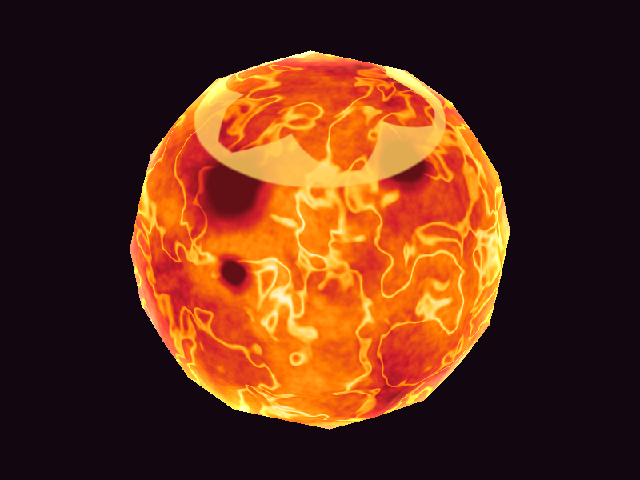

Estrella regia de plasma vivo con una diadema dorada y una corona que respira. Es emisiva: no depende de la luz externa.

**Patrones y cómo se combinan:**
- **Temperatura.** Una fBm sobre un dominio deformado (*domain warp*) que gira y avanza con el tiempo, más venas doradas (cruces por cero de otra fBm) y granulación fina. Pasa por una rampa vino → carmesí → naranja → oro → marfil.
- **Manchas.** Tres manchas con umbra y penumbra que derivan y respiran con fases distintas.
- **Corona.** Una corona de Fresnel en el limbo cuyo ancho pulsa.
- **Diadema.** Cinco puntas triangulares sobre el casquete norte.
- **Eclipse.** Uno cada 24 s, que oscurece el núcleo mientras la corona sigue ardiendo.
- **Bucles de plasma.** Tres surcos luminosos con ciclos propios: el plasma se concentra en un pie, un filamento curvo crece hasta el otro pie, arde casi blanco y se drena de vuelta a la superficie. Son trayectorias sobre la esfera, dentro de su silueta, no geometría.

| Parámetro | Por defecto | Rango | Cambio visual |
|---|---:|---|---|
| `plasma_scale` | 1.6 | 0.5 – 8 | Tamaño de las corrientes de plasma |
| `warp_strength` | 0.8 | 0 – 3 | Cuánto se retuercen las corrientes |
| `flow_speed` | 0.18 | 0 – 2 | Velocidad de advección del plasma |
| `spot_breath_period` | 9 | 1 – 60 | Segundos por respiración de una mancha |
| `corona_pulse_period` | 4 | 0.5 – 30 | Segundos por pulso de la corona |
| `corona_pulse_amount` | 0.35 | 0 – 1 | Amplitud del pulso del limbo |
| `crown_points` | 5 | 3 – 9 | Puntas de la diadema |
| `eclipse_period` | 24 | 4 – 120 | Segundos entre eclipses |
| `loop_period` | 9 | 3 – 60 | Segundos por ciclo de un bucle de plasma |
| `loop_size` | 0.6 | 0.15 – 0.9 | Tamaño de los arcos de plasma |

### Crimson Entrance — planeta volcánico de cráteres y picas

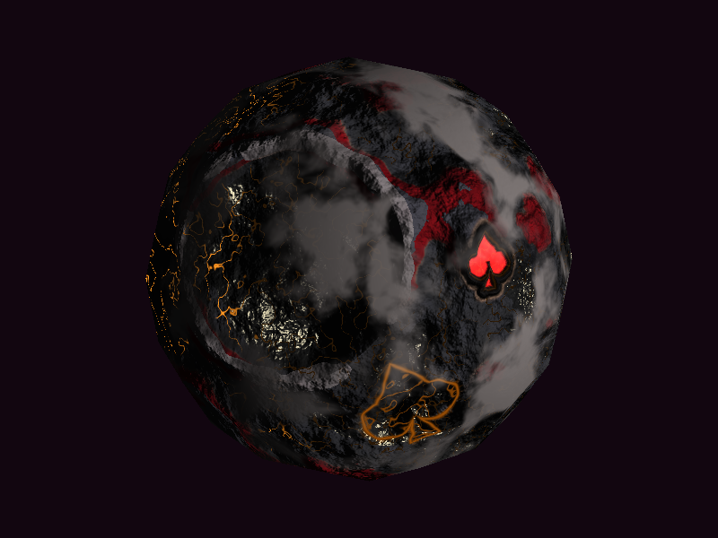

Planeta volcánico que se abre en cráteres y levanta mesetas en forma de pica ♠ desde su corteza.

**Patrones y cómo se combinan:**
- **Campo de altura.** Uno solo: una cuenca monumental, colinas de fBm y relieve fino.
- **Regiones.** El mismo campo se clasifica en seis: llanuras de obsidiana, basalto, tierras carmesí, mesetas de pizarra, bordes de ceniza y fisuras incandescentes.
- **Eventos sobre la altura.** Tres cráteres que se agrietan, se hunden, brillan con magma y se erosionan; y dos mesetas ♠ cuyo campo de distancia levanta la corteza. Al terminar cada ciclo reaparecen en otro lugar.
- **Pica grabada a fuego.** Mientras la meseta ♠ existe, el símbolo se marca primero con un contorno de lava, después su interior entero arde en rojo hiperintenso con vetas naranjas y un núcleo casi blanco en el apogeo, rodeado de roca carbonizada. Al enfriarse se rompe en parches y desaparece antes de migrar. Brilla de día y de noche y se transparenta a través de las nubes.
- **Nubes de ceniza.** Una capa independiente cuyas sombras siguen a la luz.
- **Iluminación.** El bump inclina la normal, el parallax desplaza las consultas según la vista, la obsidiana es vítrea y la roca mate, y las fisuras se encienden de noche.

| Parámetro | Por defecto | Rango | Cambio visual |
|---|---:|---|---|
| `crater_period` | 12 | 2 – 60 | Segundos por ciclo de cráter |
| `spade_height` | 0.6 | 0 – 1 | Altura de la meseta ♠ en su apogeo |
| `brand_glow` | 1 | 0 – 3 | Intensidad de la pica incandescente |
| `cloud_coverage` | 0.45 | 0 – 1 | Fracción del cielo cubierta por nubes |
| `cloud_altitude` | 0.07 | 0 – 0.3 | Desplazamiento de las sombras respecto a las nubes |
| `bump_strength` | 0.8 | 0 – 4 | Intensidad del relieve iluminado |
| `shininess` | 24 | 2 – 256 | Concentración del brillo de la obsidiana |
| `night_glow` | 1 | 0 – 3 | Brillo nocturno de fisuras y magma |
| `parallax_scale` | 0.06 | 0 – 0.25 | Profundidad aparente del relieve |

### House of Cards — gigante gaseoso de tormentas en rombo

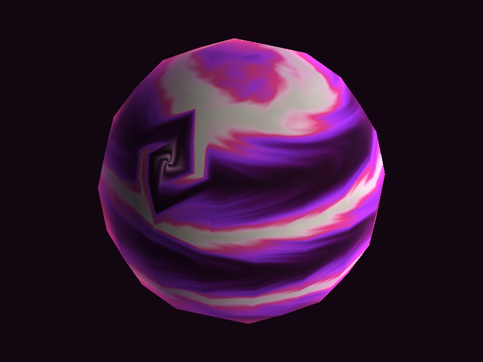

Gigante gaseoso violeta donde la circulación atmosférica se organiza en rombos ♦ que nacen, culminan y se disuelven.

**Patrones y cómo se combinan:**
- **Bandas.** Seis bandas de latitud onduladas por fBm, con transiciones líquidas en una rampa violeta, magenta y perla, más un tinte vino y filamentos.
- **Vientos diferenciales.** Una rotación de la dirección de muestreo que depende de la latitud, así que las bandas vecinas se deslizan.
- **Vórtice ♦.** El dominio se advecta a lo largo de los contornos de la norma L1 (un rombo) en el plano tangente del centro de la tormenta. Las bandas vecinas se enrollan en espirales romboidales con un núcleo luminoso, y en cada ciclo la tormenta migra.
- **Halo.** Un halo atmosférico de Fresnel en el limbo.

| Parámetro | Por defecto | Rango | Cambio visual |
|---|---:|---|---|
| `band_count` | 6 | 3 – 14 | Número de bandas |
| `band_warp` | 0.25 | 0 – 1.5 | Ondulación de los bordes de banda |
| `differential_wind` | 0.06 | 0 – 1.5 | Deslizamiento entre latitudes |
| `vortex_strength` | 6 | 0 – 8 | Cuánto se enrollan las bandas en el rombo |
| `vortex_radius` | 0.45 | 0.1 – 0.5 | Tamaño de la tormenta ♦ |
| `vortex_period` | 18 | 4 – 90 | Segundos entre migraciones |
| `rim_strength` | 0.6 | 0 – 2 | Halo violeta y magenta del limbo |

La esfera compartida en wireframe es la misma para los tres cuerpos:

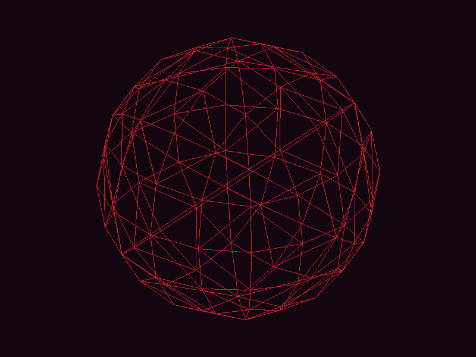

### Efectos solicitados

| Efecto | Nombre | Cuerpo | Archivo y función | Evidencia | Explicación | Parámetro → efecto visual |
|---|---|---|---|---|---|---|
| E01 | Material animado | The King's Crown | `src/celestial/crown.rs::Frame::temperature`, `Frame::spots`, `Frame::corona`, `eclipse_strength` | [video](docs/videos/lab6/01-kings-crown-material.mp4) · [GIF](docs/videos/lab6/01-kings-crown-material.gif) | Con cámara, luz y malla fijas, las corrientes cambian de forma, las manchas respiran, la corona pulsa y llega el eclipse; no es una rotación de la esfera | `corona_pulse_period`: segundos por pulso del limbo |
| E02 | Día y noche | Crimson Entrance | `src/celestial/entrance/mod.rs::Frame::night_factor`, `Frame::emission` | [video](docs/videos/lab6/07-entrance-day-night-light.mp4) · [GIF](docs/videos/lab6/07-entrance-day-night-light.gif) | Las fisuras y el magma son un término emisivo que sube de 0.12 a `night_glow` solo en el lado nocturno; con el tiempo congelado, solo gira la luz | `night_glow`: brillo nocturno de la red de fisuras |
| E03 | Respuestas a la luz | Crimson Entrance | `src/celestial/entrance/mod.rs::Frame::reflect_light`, `terrain.rs::TerrainMaterial::response` | [video](docs/videos/lab6/08-entrance-lighting-responses.mp4) · [regiones](docs/screenshots/lab6/08-entrance-materials.png) | La obsidiana tiene brillo Blinn-Phong que depende de la vista, la roca es mate, la ceniza tiene *wrap* y las fisuras son emisivas, todo según la clase de altura | `shininess`: tamaño del brillo vítreo |
| E04 | Nubes procedurales | Crimson Entrance | `src/celestial/entrance/clouds.rs::CloudLayer::mask` | [video](docs/videos/lab6/09-entrance-clouds-drift.mp4) · [coberturas](docs/screenshots/lab6/06-entrance-cloud-coverage.png) | Máscara de fBm sobre un dominio que gira y evoluciona, sobre la misma esfera, con un terreno inmóvil | `cloud_coverage`: fracción cubierta |
| E05 | Vórtice localizado | House of Cards | `src/celestial/house.rs::Storm::warp`, `contour_param`, `contour_point` | [video](docs/videos/lab6/03-house-of-cards-vortex.mp4) · [apagado y encendido](docs/screenshots/lab6/09-house-vortex-off-on.png) | Las bandas se enrollan a lo largo de los contornos ♦ de la norma L1; fuera del rombo la imagen es idéntica | `vortex_strength`: circulación del núcleo |
| E06 | Bump mapping | Crimson Entrance | `src/celestial/entrance/mod.rs::Frame::shading_normal`, `src/shading/lighting.rs::bump_normal` | [video](docs/videos/lab6/05-entrance-bump-light.mp4) · [apagado y encendido](docs/screenshots/lab6/05-entrance-bump-off-on.png) | El gradiente del campo de altura (diferencias centrales en el marco tangente) inclina la normal de iluminación; no se mueve ningún vértice | `bump_strength`: relieve más marcado |
| E07 | Parallax | Crimson Entrance | `src/celestial/entrance/mod.rs::Frame::parallax_direction`, `src/shading/lighting.rs::parallax_shift` | [video](docs/videos/lab6/06-entrance-parallax-orbit.mp4) · [GIF](docs/videos/lab6/06-entrance-parallax-orbit.gif) | Búsqueda escalonada con bisección sobre la altura macro a lo largo de la vista. Con el tiempo congelado y la cámara orbitando, la pica y los bordes se desplazan (el video va sin nubes y con `parallax_scale` = 0.12 de demostración) | `parallax_scale`: profundidad aparente |
| E08 | Sombras de nubes | Crimson Entrance | `src/celestial/entrance/clouds.rs::CloudLayer::shadow`, `src/shading/lighting.rs::shell_exit` | [video](docs/videos/lab6/04-entrance-cloud-shadows-light.mp4) · [máscaras](docs/screenshots/lab6/07-entrance-cloud-shadow-masks.png) | La sombra es la máscara de nubes muestreada donde el rayo hacia la luz sale de la capa; no tiene desplazamiento en el punto subsolar y se estira hacia el terminador | `cloud_altitude`: separación entre sombra y nube |

Los ocho efectos están implementados, probados y con evidencia. Los videos de bump, parallax y respuestas a la luz se grabaron con `--set clouds=0`, para aislar cada efecto. Más montajes: [cráteres y picas en el tiempo](docs/videos/lab6/02-crimson-entrance-events.mp4) y [nubes sobre el terreno inmóvil](docs/videos/lab6/09-entrance-clouds-drift.gif). Los videos se regeneran con [`docs/videos/lab6/encode.sh`](docs/videos/lab6/encode.sh) `all`.

### Puntos reclamados

| Criterio | Puntos | Evidencia principal |
|---|---:|---|
| B01 Estrella procedural propia | 10 | Captura y video de The King's Crown |
| B02 Planeta rocoso con regiones diferenciadas | 10 | Captura de Crimson Entrance y montaje de regiones |
| B03 Gigante gaseoso con bandas | 10 | Captura y video de House of Cards |
| B04 Diseño visual | 20 | Tres paletas Red-Black, tres técnicas distintas y símbolos exclusivos |
| B05 Entrega | 10 | Este README, la guía técnica y los comandos |
| E01–E08 Efectos adicionales | 90 | Tabla anterior |
| **Total disponible** | **150** | Nota máxima registrable: 100 |

### Limitaciones

- La silueta es poligonal (malla de 98 vértices únicos): no se modifican vértices.
- Cráteres, picas y cuencas son relieve **aparente** (bump, parallax y sombreado), no geometría.
- El parallax es una aproximación escalonada que se atenúa cerca del limbo.
- El anillo de cartas ♦, el halo exterior y la cámara perspectiva quedan para el proyecto final.
- Crimson Entrance es el shader más costoso: 1.4 s por cuadro con 1 hilo y 0.27 s con 20, unos 4 cuadros por segundo en la ventana ([benchmark](docs/results/lab6/shader_benchmark.csv)).

### Video y pruebas

- **Videos:** H.264 con `h264_nvenc`, el primer codificador que pasó la prueba funcional en esta máquina (`libx264` no está instalado). Los MP4 van a 30 fps; los GIF se generan desde el mismo intermedio FFV1 sin pérdida, a 8 fps.
- **Pruebas:** `cargo test` ejecuta **360 pruebas**: las 207 de los laboratorios 4 y 5 y de la vista interactiva, más 153 del Laboratorio 6, entre ellas el oráculo de 21 *hashes* que congela la nave y sus tres modos.

---

## Laboratorio 5 — Filling triangles

### Objetivo

Según las instrucciones del Ing. Dennis, la función `triangle` que dibuja los tres bordes debía ampliarse para **generar también los fragmentos del interior**, con **dos algoritmos independientes** (coordenadas baricéntricas y líneas horizontales), conservando la opción de contorno, comparando las **posiciones** producidas por ambos, midiendo solo la rasterización en modo optimizado y usando un perfilador.

### Los tres modos

```rust
#[derive(Clone, Copy)]
pub enum TriangleMode {
    Wireframe,          // Lab 4: triangle() → 3 × line()
    FilledBarycentric,  // bounding box + pesos baricéntricos en (x+0.5, y+0.5)
    FilledScanline,     // intersecciones por fila + spans horizontales
}
```

El modo se pasa a la etapa de rasterización (`rasterize_with_mode(triangles, mode, bounds)`); el ensamblaje de primitivas y el procesamiento de fragmentos no cambian. `rasterize(triangles)` y `render(...)` del Laboratorio 4 siguen existiendo como wrappers del modo wireframe.

### Resultado: la misma escena en los tres modos

Escena controlada de siete triángulos (pequeño, grande, borde horizontal, borde vertical, dos que comparten una diagonal con colores distintos, uno recortado por la ventana), generada con `cargo run --release -- --scene triangles --mode <modo> --screenshot ...`.

| Wireframe | FilledBarycentric | FilledScanline |
|---|---|---|
| 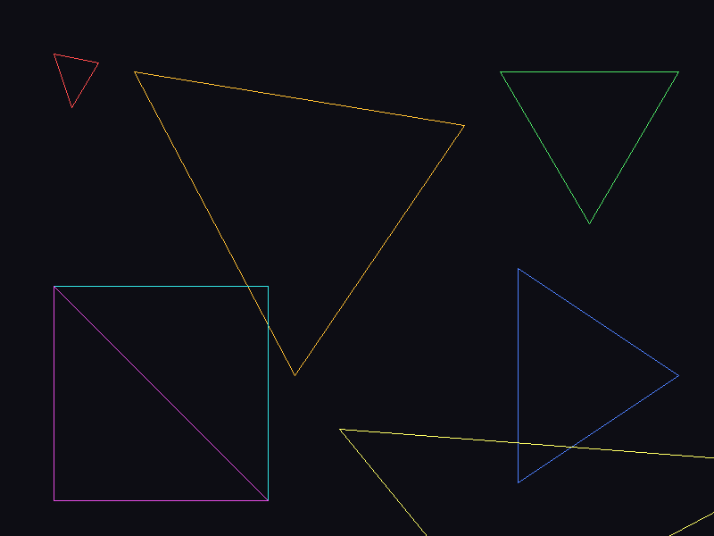 |  | 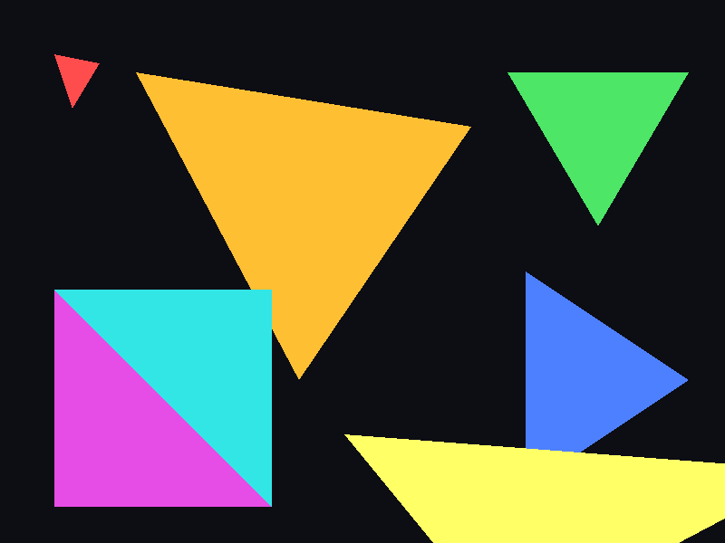 |

Las dos imágenes rellenas son píxel a píxel idénticas porque ambos algoritmos cubren exactamente los mismos centros. La diagonal compartida (cian/magenta) no tiene huecos ni solapes.

### Fundamento matemático

Centro del píxel `(x, y)`: `P = (x + 0.5, y + 0.5)`; `y` crece hacia abajo. Función de arista:

```text
E(A, B, P) = (Px - Ax)·(By - Ay) - (Py - Ay)·(Bx - Ax)      area2 = E(A, B, C)
```

- Si `area2 < 0` se intercambian B y C solo localmente, así **invertir el orden de los vértices no hace desaparecer el triángulo**. Si `area2 == 0` no se divide: triángulo degenerado, cero fragmentos.
- **Regla top-left** para empates (`E == 0`): la arista `A→B` acepta el punto si baja (`By > Ay`) o si es horizontal hacia la izquierda (`By == Ay` y `Bx < Ax`). Con ella dos triángulos adyacentes cubren cada centro de su arista común exactamente una vez.

**Baricéntrico** (`src/rasterization/barycentric.rs`): bounding box recortado al framebuffer; para cada centro se calculan `w_a = E(B,C,P)/area2`, `w_b = E(C,A,P)/area2`, `w_c = E(A,B,P)/area2` y se emite un fragmento si los tres pasan la regla de borde.

**Scanline** (`src/rasterization/scanline.rs`): por cada fila `sy = y + 0.5` se intersectan las aristas no horizontales con intervalo **semiabierto** `[min_y, max_y)` (un vértice sobre una fila se cuenta una vez); una arista horizontal sobre la fila decide la fila completa; el span `[xl, xr]` se recorre directamente y solo los píxeles de los extremos se clasifican con `E`. No recorre el bounding box ni llama al algoritmo baricéntrico (una prueba lee el código fuente para asegurarlo).

### Comparación de posiciones, no de imágenes

Para cada caso se comparan los conjuntos de pares `(x, y)` de ambos algoritmos y se verifica que no hay duplicados dentro de un triángulo ni píxeles fuera del framebuffer; al fallar, la prueba lista `only_in_barycentric` y `only_in_scanline`.

| Caso | Vértices | Resultado |
|---|---|---|
| T01 pequeño | (10,10) (18,12) (12,20) | idéntico |
| T02 grande | (10,10) (90,20) (40,85) | idéntico |
| T03 borde horizontal | (10,20) (70,20) (40,75) | idéntico |
| T04 borde vertical | (20,10) (20,80) (75,40) | idéntico |
| T05 orden inverso | T02 con C y B intercambiados | idéntico a T02 |
| T06 parcialmente fuera | (-15,20) (50,15) (40,115) | idéntico, todo dentro de 100×100 |
| T07 colineal | (10,10) (30,30) (50,50) | vacío en ambos |
| T08 vértice repetido | (20,20) (20,20) (60,50) | vacío en ambos |
| T09 vértices sobre centros | (10.5,10.5) (60.5,10.5) (10.5,60.5) | idéntico, 1275 píxeles |

Además: 300 triángulos pseudoaleatorios con semilla fija en cuatro viewports, las seis permutaciones de vértices, triángulos minúsculos, recorte por los cuatro bordes, coordenadas de 1e7, viewports de 0×0 y 1×1, NaN/inf, y la nave completa (708 caras: 173 500 fragmentos idénticos en ambos rellenos). Sin discrepancias.

### Benchmark (`cargo run --release -- --benchmark-triangles`)

Sin ventana. Se mide únicamente la generación de fragmentos (`rasterize_with_mode`, incluida la creación y almacenamiento del `Vec<Fragment>`) con `std::time::Instant` y `std::hint::black_box`; la carga de 207 triángulos se construye antes del cronómetro y se verifica la paridad de cobertura antes de medir. 10 rondas de calentamiento y **7 rondas medidas × 100 iteraciones por modo**, alternando modos; se reporta la **mediana**. Datos crudos: `docs/results/lab5/benchmark_raw.csv`; resumen derivado: `docs/results/lab5/benchmark_summary.csv`.

Entorno: Intel Core i7-13650HX, Fedora 43, rustc 1.97.0, release, 2026-10-21.

| Modo | Triángulos | Fragmentos / iteración | Mediana por iteración | Mín–máx por iteración | ns / fragmento |
|---|---:|---:|---:|---:|---:|
| FilledBarycentric | 207 | 858 033 | **13.95 ms** | 13.82–14.58 ms | 16.3 |
| FilledScanline | 207 | 858 033 | **5.26 ms** | 5.13–6.05 ms | 6.1 |

Ambos generan los mismos 858 033 fragmentos; scanline fue 2.65× más rápido en esta carga.

### Perfilado

No había `cargo-flamegraph`, `perf` ni `valgrind`; `samply` requiere cambiar `perf_event_paranoid` con sudo, lo que no se hizo. Se usó un **perfilador por muestreo de pilas** sin privilegios (`eu-stack` de elfutils cada ~10 ms sobre el modo `--benchmark-triangles --profile`), script y evidencia en `docs/profiles/`:

| Modo | Muestras | Marco hoja dominante | `memcpy` (extend del `Vec`) | Otros |
|---|---:|---|---:|---|
| barycentric | 356 | `fill_barycentric` 87.1 % | 11.8 % | realloc/malloc < 1 % |
| scanline | 375 | `fill_scanline` 76.5 % | 18.1 % | `ceil` 2.9 %, realloc/free ≈ 2 % |

Lectura: el baricéntrico gasta casi todo el tiempo evaluando tres funciones de arista en cada centro del bounding box, incluidos los que caen fuera; scanline casi no hace trabajo por píxel interior y por eso pesa más la copia de fragmentos al vector acumulado (`memcpy`) y el `ceil`/`floor` de los rangos, que son el siguiente cuello de botella. El crecimiento del `Vec` es visible pero menor al 3 % en ambos. Los porcentajes son proporción de muestras, no tiempo absoluto. Detalle en [docs/laboratorio5.md](docs/laboratorio5.md).

### Checklist Lab 5

- [x] R01 `Wireframe` reutiliza las tres llamadas a `line` (pruebas de regresión).
- [x] R02 `FilledBarycentric` independiente con bounding box y pesos.
- [x] R03 `FilledScanline` independiente, fila por fila.
- [x] R04 `TriangleMode` en `rasterize`, sin tocar ensamblaje ni fragment shader.
- [x] R05 Evaluación en centros `(x+0.5, y+0.5)`.
- [x] R06 Orden inverso y área cero manejados.
- [x] R07 Aristas horizontales y vértices sobre filas con regla consistente.
- [x] R08 Casos pequeño/grande, horizontal/vertical, inverso, recortado, colineal.
- [x] R09 Comparación de coordenadas `(x, y)` entre algoritmos.
- [x] R10 Medición solo de fragmentos, release, `Instant`, repeticiones y medianas.
- [x] R11 Conteo de fragmentos por algoritmo.
- [x] R12 Perfilador con evidencia real (muestreo de pilas).
- [x] R13 Una imagen por modo.
- [x] R14 Tiempos, perfil y explicación documentados.

---

## Vista interactiva de la nave (mejora opcional)

No es un requisito de los laboratorios: es una ampliación posterior al Lab 5 para explorar el OBJ real desde cualquier ángulo con los **mismos tres algoritmos**. Todo sigue en CPU: cámara orbital ortográfica propia, Z-buffer en el framebuffer y sombreado plano por cara. Raylib solo presenta la textura.

```bash
cargo run --release -- --scene ship --interactive --mode wireframe
cargo run --release -- --scene ship --interactive --mode barycentric
cargo run --release -- --scene ship --interactive --mode scanline
```

| Tecla | Acción |
|---|---|
| `←` `→` / `↑` `↓` | Orbitar / inclinar (según el tiempo entre cuadros) |
| `Q` / `E` | Alejar / acercar |
| `1` `2` `3` | Wireframe / baricéntrico / scanline, sin reiniciar la cámara |
| `R` | Restaurar vista inicial y zoom |
| `T` / `F` / `S` | Vista superior / frontal / lateral |

Misma vista oblicua (`--interactive --view oblique`) en los tres modos:

| Wireframe | FilledBarycentric | FilledScanline |
|---|---|---|
| 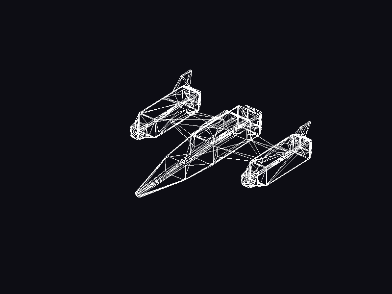 |  | 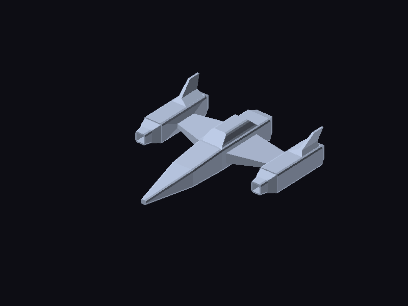 |

`--view oblique|top|front|side` fija el preset inicial (también sirve sin `--interactive` para capturas reproducibles con `--screenshot`). Los colores son un **sombreado calculado** a partir de la normal de cada cara y una luz direccional fija, no los materiales de Blender. La proyección es ortográfica (sin perspectiva) y el wireframe dibuja todas las aristas. Los dos rellenos siguen siendo independientes y producen la misma imagen con profundidad. Detalles, módulos y límites: [docs/interactive-views.md](docs/interactive-views.md).

---

## Demostración interactiva — Tres modos de rasterización

Además de las pruebas de cobertura y rendimiento, el renderizador permite explorar la nave espacial desde diferentes perspectivas mediante una cámara orbital implementada sobre nuestro pipeline de rasterización por CPU.

Los videos son salida real del programa, no capturas de escritorio ni animaciones externas. Cada fotograma lo produce `render_interactive` (el mismo que usa la ventana con `--interactive`) a partir del OBJ de 708 triángulos, moviendo la misma `OrbitCamera` por una trayectoria fija y suavizada: vista superior → oblicua → rotación horizontal → lateral → frontal → acercamiento → alejamiento → regreso a la oblicua. FFmpeg solo codifica los fotogramas del framebuffer a H.264 y añade el título y el nombre de cada fase. Todos los videos comparten modelo, resolución (800×600), 30 FPS, duración (32 s) y recorrido de cámara, así que se pueden comparar fotograma a fotograma.

### Wireframe

`triangle()` del Lab 4 dibuja cada cara con tres llamadas a `line()` (Bresenham) y los fragmentos se escriben sin prueba de profundidad: por eso se ven a la vez las aristas delanteras y posteriores del fuselaje, las alas y los motores. En la ventana: `--mode wireframe` o tecla `1`.

<a href="docs/videos/lab5/01-wireframe-interactive.mp4">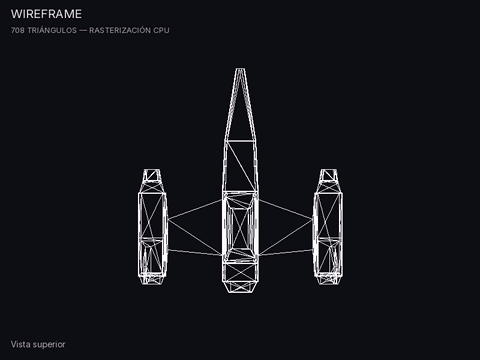</a>

▶ [Ver el video wireframe](docs/videos/lab5/01-wireframe-interactive.mp4) (MP4 H.264, 800×600, 30 FPS, 32 s, 11,9 MB). La animación de arriba es el mismo video en GIF a 480×360 y 15 FPS (6,1 MB).

### FilledBarycentric

Cada triángulo se recorre dentro de su caja delimitadora recortada a la pantalla. En el centro de cada píxel se evalúan las tres funciones de arista con la regla top-left, y los pesos baricéntricos interpolan la profundidad que decide el Z-buffer. El color es el sombreado plano por cara (normal del modelo y luz direccional fija), así que las caras posteriores quedan ocultas por las delanteras en todos los ángulos. En la ventana: `--mode barycentric` o tecla `2`.

<a href="docs/videos/lab5/02-barycentric-interactive.mp4">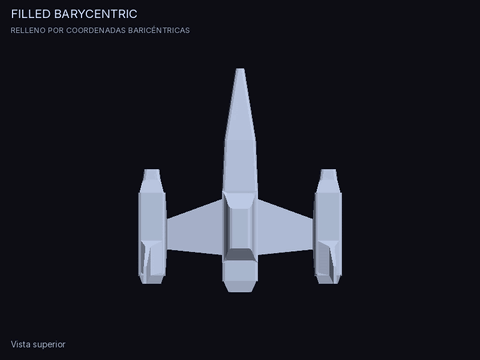</a>

▶ [Ver el video baricéntrico](docs/videos/lab5/02-barycentric-interactive.mp4) (MP4 H.264, 800×600, 30 FPS, 32 s, 1,8 MB). La animación de arriba es el mismo video en GIF a 480×360 y 15 FPS (3,2 MB).

### FilledScanline

El triángulo se recorre fila por fila: en cada línea de centros de píxel se calcula dónde la cruzan las aristas y se escribe el tramo horizontal completo. Solo los píxeles de los extremos se clasifican con la misma regla top-left. No llama al código baricéntrico y la profundidad se interpola con un plano en lugar de pesos. Con la misma cámara, los 960 fotogramas del framebuffer salieron idénticos byte a byte a los del video baricéntrico antes de codificarse (0 píxeles distintos), así que la equivalencia se comprobó con los datos y no solo a la vista. En la ventana: `--mode scanline` o tecla `3`.

<a href="docs/videos/lab5/03-scanline-interactive.mp4">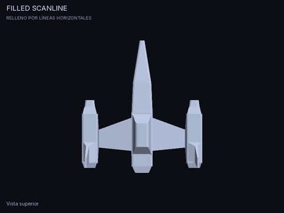</a>

▶ [Ver el video scanline](docs/videos/lab5/03-scanline-interactive.mp4) (MP4 H.264, 800×600, 30 FPS, 32 s, 1,8 MB). La animación de arriba es el mismo video en GIF a 480×360 y 15 FPS (3,2 MB).

### Galería y reproducción

| Modo | Video MP4 | Tamaño | Animación GIF | Tamaño |
|---|---|---|---|---|
| Wireframe | [01-wireframe-interactive.mp4](docs/videos/lab5/01-wireframe-interactive.mp4) | 11,9 MB | [01-wireframe-interactive.gif](docs/videos/lab5/01-wireframe-interactive.gif) | 6,1 MB |
| FilledBarycentric | [02-barycentric-interactive.mp4](docs/videos/lab5/02-barycentric-interactive.mp4) | 1,8 MB | [02-barycentric-interactive.gif](docs/videos/lab5/02-barycentric-interactive.gif) | 3,2 MB |
| FilledScanline | [03-scanline-interactive.mp4](docs/videos/lab5/03-scanline-interactive.mp4) | 1,8 MB | [03-scanline-interactive.gif](docs/videos/lab5/03-scanline-interactive.gif) | 3,2 MB |

Los tres son H.264 High, yuv420p, 800×600, 30 FPS y 960 fotogramas, con `faststart` para reproducción progresiva en el navegador. El wireframe pesa más porque sus líneas de un píxel cambian en cada fotograma y no se comprimen como las superficies lisas. Los GIF son conversiones directas de esos MP4 (480×360, 15 FPS, 64 colores, en bucle) para que el recorrido se vea animado en GitHub, que no reproduce MP4 dentro de la página.

Para recorrer las mismas vistas a mano en la ventana:

```bash
cargo run --release -- --scene ship --interactive --mode scanline
```

`T` vista superior, `R` vista oblicua inicial, `←` `→` rotación horizontal, `↑` `↓` inclinación, `S` lateral, `F` frontal, `E` acercar, `Q` alejar. `1` `2` `3` cambian de modo sin mover la cámara.

---

## Laboratorio 4 — Carga de modelos OBJ

### Objetivo

Según las instrucciones del Ing. Dennis, en esta parte del proyecto debíamos:

1. **Cargar un modelo desde un archivo `.obj`.**
2. **Recorrer todos los triángulos del modelo.**
3. **Obtener los vértices correspondientes a partir de sus índices.**
4. **Dibujar cada triángulo usando nuestra función `triangle(...)`.**
5. **Mostrar el modelo aproximadamente centrado en la ventana.**
6. **Mantenerlo completamente visible y con tamaño razonable.**
7. **No utilizar funciones automáticas de Raylib para cargar y dibujar modelos 3D.**

### Resultado

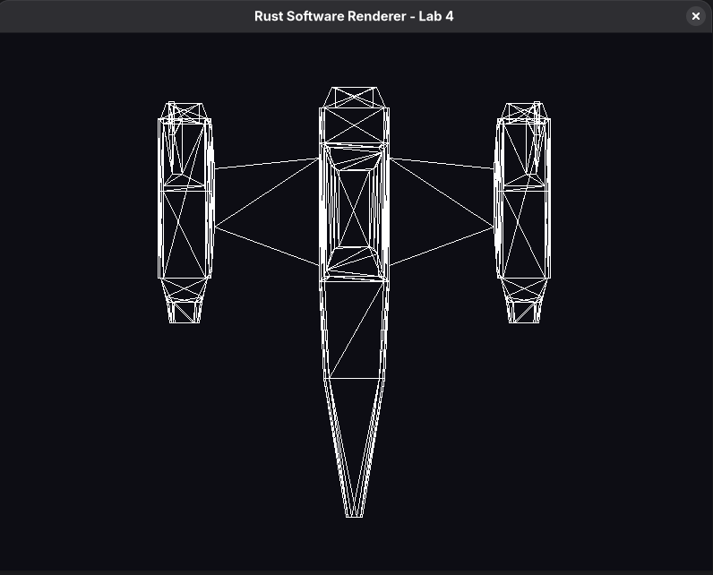

*Captura de la ventana del programa (`NaveBimotor`, vista superior X/Z, 708 triángulos dibujados como contornos).*

### Modelo utilizado

- **Archivo:** `assets/models/Laboratorio3.obj`
- **Modelo:** nave espacial triangulada (`NaveBimotor`, exportada desde Blender)
- **Conteos verificados:** 356 vértices, 2124 índices, 708 triángulos

Estos datos fueron validados en el cargador y en las pruebas automatizadas.

### Checklist Lab 4

- [x] El proyecto **compila y se ejecuta** correctamente.
- [x] El archivo **OBJ se carga correctamente** con un parser propio (líneas `v` y `f`, índices base 1 → base 0, formato `v/vt/vn` admitido, errores con número de línea).
- [x] Se **recorren todos los triángulos** y se obtienen sus **tres vértices por índices**.
- [x] Cada triángulo se dibuja con nuestra función **`triangle(...)`**, que reutiliza **`line(...)`** (Bresenham propio).
- [x] El modelo aparece **centrado**, con **tamaño razonable** y **completamente visible** (vista plana X/Z, escala uniforme, margen del 10 %).
- [x] **No se utilizaron** funciones automáticas de Raylib (`LoadModel`, `DrawModel`, `DrawMesh`, `DrawLine`, `DrawTriangle`); Raylib solo crea la ventana y presenta la textura del framebuffer CPU.
- [x] El repositorio contiene el OBJ, este `README.md` y la captura incrustada.

### Decisiones de diseño

- **Cargador OBJ propio**: lee `v` y `f`, ignora `vt`, `vn`, `mtllib`, `usemtl`, `o`, `s`, y extrae el índice de posición antes del primer `/`.
- **Geometría indexada**: `Mesh { vertices, indices }` separa *dónde están los puntos* de *cómo están conectados*; `expand_vertices` produce un `Vertex` por esquina de cara, en orden, para el ensamblaje por ternas.
- **Mapeo simple a pantalla**: el enunciado permite usar componentes del modelo con escala y traslación. Se eligió el plano X/Z (la nave es larga en Z y ancha en X); el bounding box proyectado se centra y se escala uniformemente. No hay perspectiva ni cámara.
- **Pipeline de cuatro etapas** como en las lecciones: `vertex_shader` → `primitive_assembly` → `rasterize` → `fragment_shader` → `framebuffer.point`.

Detalle en [docs/laboratorio4.md](docs/laboratorio4.md).

---

## Qué estamos construyendo

```text
Archivo OBJ / escena
   ↓
Vértices + índices
   ↓
Triángulos (primitive_assembly)
   ↓
Fragmentos: contorno (line) o interior (barycentric / scanline)
   ↓
Framebuffer CPU
   ↓
Pantalla (textura Raylib)
```

## Arquitectura implementada

```text
rust-software-renderer/
├── assets/models/Laboratorio3.obj          nave triangulada del Lab 3
├── assets/models/sphere.obj                esfera del docente, compartida por los tres cuerpos del Lab 6
├── docs/
│   ├── laboratorio4.md                     guía técnica Lab 4
│   ├── laboratorio5.md                     guía técnica Lab 5
│   ├── laboratorio6.md                     guía técnica Lab 6: shaders, fórmulas, parámetros, pruebas
│   ├── screenshots/lab6/                   01..04 cuerpos y esfera; 05..09 montajes de efectos
│   ├── videos/lab6/                        MP4 y GIF de los ocho efectos; encode.sh los regenera
│   ├── results/lab6/                       shader_benchmark.csv
│   ├── screenshots/lab4/                   final_render.png, 01-nave-wireframe.png
│   ├── screenshots/lab5/                   01..03 escena sintética; 04..06 nave oblicua interactiva
│   ├── interactive-views.md                cámara orbital, Z-buffer y sombreado (opcional)
│   ├── videos/lab5/                        videos demostrativos MP4 de la vista interactiva y sus GIF animados
│   ├── results/lab5/                       benchmark_raw.csv, benchmark_summary.csv
│   └── profiles/                           lab5-stack-sampler.sh, muestras y resúmenes
├── src/
│   ├── main.rs                             punto de entrada → app::run()
│   ├── app.rs                              ventana, teclado, CLI (--obj, --screenshot, --mode, --scene, --interactive, --view, --benchmark-triangles, --profile, --help) y despacho del Lab 6
│   ├── config.rs                           resolución, FPS, ruta del modelo, plano de vista, margen
│   ├── lib.rs
│   ├── geometry/                           Mesh, Vertex, demo.rs (escena de triángulos)
│   ├── io/obj.rs                           cargador OBJ propio
│   ├── pipeline/
│   │   ├── uniforms.rs, vertex_shader.rs   etapa 1
│   │   ├── screen_mapping.rs               vista plana XY/XZ (Lab 4) y proyección orbital (opcional)
│   │   ├── orbit_camera.rs                 cámara orbital ortográfica y presets (opcional)
│   │   ├── face_shading.rs                 sombreado plano por cara (opcional)
│   │   ├── primitive.rs                    etapa 2
│   │   ├── rasterizer.rs                   etapa 3: rasterize (wireframe) y rasterize_with_mode
│   │   ├── fragment_shader.rs              etapa 4
│   │   ├── render.rs                       render (Lab 4), render_with_mode (Lab 5), render_interactive
│   │   ├── surface.rs                      Lab 6: SurfaceSample, ShaderUniforms, NormalSource
│   │   └── shaded.rs                       Lab 6: render_shaded (culling, interpolación, shader en hilos, Z-buffer)
│   ├── rasterization/
│   │   ├── line.rs, triangle.rs            Lab 4: Bresenham y contorno de tres líneas
│   │   ├── mode.rs                         TriangleMode
│   │   ├── coverage.rs                     función de arista, orientación, regla top-left, rangos de centros, interpolation_weights (Lab 6)
│   │   ├── barycentric.rs                  relleno baricéntrico
│   │   └── scanline.rs                     relleno por scanline
│   ├── rendering/                          Fragment, Framebuffer (CPU, con Z-buffer opcional), Presenter (textura Raylib)
│   ├── benchmark/                          carga de trabajo, cronómetro, medianas, CSV, perfilado; shaders.rs (Lab 6)
│   ├── shading/                            Lab 6: math, noise, cycle, sdf (♠ ♦), sphere, lighting
│   └── celestial/                          Lab 6: cuerpos, parámetros, escena, CLI, visor, líneas de tiempo, grabación
│       ├── crown.rs                        The King's Crown
│       ├── entrance/                       Crimson Entrance: terrain, events, clouds
│       └── house.rs                        House of Cards
└── tests/                                  53 archivos de pruebas de integración + fixture
```

Raylib se usa únicamente para la ventana, los tipos `Vector2`/`Vector3`/`Matrix` y para presentar la textura final. Toda la rasterización es código propio.

## Cómo ejecutar el proyecto

Requisitos: Rust estable (probado con 1.97), Cargo y el crate `raylib = "5.5"` (en Fedora 43 compiló sin paquetes adicionales).

```bash
cargo run                                                     # Lab 4: nave en wireframe
cargo run --release -- --mode barycentric                     # nave rellena
cargo run --release -- --scene triangles --mode wireframe     # escena de comparación
cargo run --release -- --scene triangles --mode barycentric
cargo run --release -- --scene triangles --mode scanline
cargo run --release -- --scene triangles --mode scanline --screenshot captura.png
cargo run -- --obj ruta/otro_modelo.obj                       # otro OBJ triangulado
cargo run --release -- --scene ship --interactive --mode scanline   # vista interactiva (opcional)
cargo run --release -- --view top --mode barycentric --screenshot top.png
cargo run --release -- --benchmark-triangles                  # benchmark sin ventana → docs/results/lab5/*.csv
docs/profiles/lab5-stack-sampler.sh scanline 1000 /tmp/perfil # perfilado por muestreo de pilas
cargo run --release -- --scene crown                          # Lab 6: The King's Crown
cargo run --release -- --scene entrance                       # Lab 6: Crimson Entrance
cargo run --release -- --scene house                          # Lab 6: House of Cards
cargo run --release -- --benchmark-shaders                    # Lab 6: benchmark de shaders → docs/results/lab6
```

Una ruta inexistente, un OBJ inválido o un argumento desconocido terminan con mensaje de error y código de salida 1.

### Pruebas y validación

```bash
cargo test                                   # 360 pruebas (156 de los Labs 4-5 + 51 de la vista interactiva + 153 del Lab 6)
cargo fmt --check
cargo check
cargo clippy --all-targets -- -D warnings
cargo build --release
```

Las pruebas cubren: configuración, malla e índices, parser OBJ, integración con la nave real, framebuffer, líneas, triángulos, shader de vértices, ensamblaje, mapeo a pantalla, pipeline, contratos del Lab 4, política de cobertura, baricéntrico, scanline, paridad T01–T09, estrés determinista, despacho de modos, escena, benchmark, perfilado, contratos finales del Lab 5 y, para la vista opcional, cámara orbital, proyección, controles, profundidad, Z-buffer, sombreado, presets y regresión. El Laboratorio 6 añade el oráculo de la nave (21 *hashes*), la esfera del docente, la interpolación, la etapa sombreada, el ruido y las SDF, la iluminación, cada cuerpo y cada efecto, la CLI, las líneas de tiempo, el benchmark de shaders, los contratos finales y la coherencia de esta documentación.

## Restricciones respetadas

- **No** se usa carga ni dibujo automático de modelos 3D de Raylib.
- **No** se agregó perspectiva 3D ni texturas. El Z-buffer y el sombreado plano existen solo en la vista interactiva opcional; `cargo run`, `--scene triangles`, el benchmark y el perfil del Lab 5 no los usan.
- **No** se agregaron crates adicionales: solo `raylib` y la biblioteca estándar.
- El Laboratorio 4 permanece intacto: `cargo run` sin argumentos sigue mostrando la nave en wireframe y sus 91 pruebas originales siguen pasando.
- Laboratorio 6: los tres cuerpos usan la misma `sphere.obj` del docente sin modificar. No se cargan imágenes, texturas ni materiales y no se agregaron modelos ni *crates*. Ninguna prueba existente se modificó, y la nave, sus tres modos, la cámara y el Z-buffer conservan su salida bit a bit (oráculo dorado).

## Autor

**Vernel Josue Hernández Cáceres** — Carné 24584

Universidad del Valle de Guatemala (UVG) — Gráficas por Computadora — 2026
