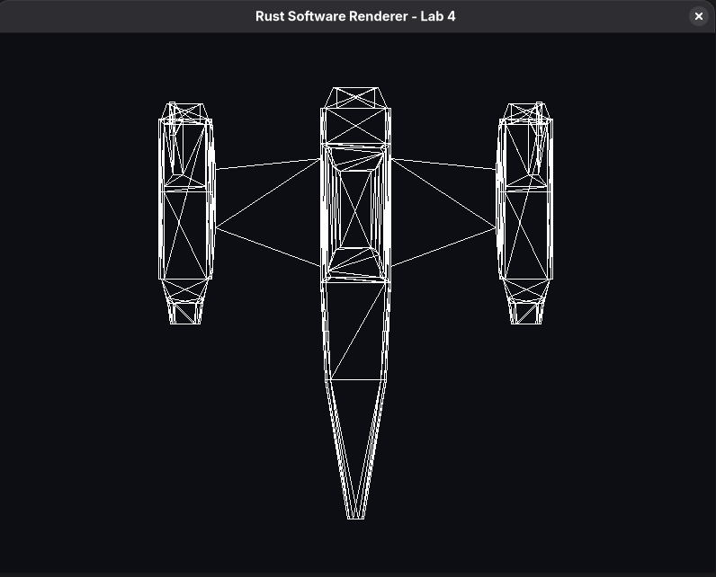

# Rust Software Renderer — Laboratorio 4: Carga de modelos OBJ

Proyecto del curso **Gráficas por Computadora** — **Universidad del Valle de Guatemala (UVG)**, segundo ciclo 2026

---

## Descripción

Este repositorio contiene la implementación del **Laboratorio 4: Carga de modelos**, cuyo objetivo consiste en **cargar un archivo OBJ y dibujar todos sus triángulos en pantalla** utilizando nuestro **propio proceso de renderizado**, sin delegar la carga y dibujo automático del modelo a Raylib.

En esta etapa, el resultado esperado es una representación **simple y funcional** del modelo:

- cargando el archivo `.obj`,
- interpretando sus vértices e índices,
- recorriendo todos sus triángulos,
- dibujando cada triángulo con la función `triangle(...)`,
- y mostrando el modelo **aproximadamente centrado, completamente visible y con un tamaño razonable**.

---

## Objetivo del laboratorio

Según las instrucciones del Ing. Dennis, en esta parte del proyecto debíamos:

1. **Cargar un modelo desde un archivo `.obj`.**
2. **Recorrer todos los triángulos del modelo.**
3. **Obtener los vértices correspondientes a partir de sus índices.**
4. **Dibujar cada triángulo usando nuestra función `triangle(...)`.**
5. **Mostrar el modelo aproximadamente centrado en la ventana.**
6. **Mantenerlo completamente visible y con tamaño razonable.**
7. **No utilizar funciones automáticas de Raylib para cargar y dibujar modelos 3D.**

---

## Resultado final

El modelo se renderiza exitosamente en pantalla como **wireframe** (contorno de triángulos), utilizando nuestro pipeline de rasterización por CPU.

### Render final obtenido



*Captura de la ventana del programa (`NaveBimotor`, vista superior X/Z, 708 triángulos dibujados como contornos).*

---

## Cumplimiento de criterios del laboratorio

### Checklist de cumplimiento

- [x] El proyecto **compila y se ejecuta** correctamente.
- [x] El archivo **OBJ se carga correctamente**.
- [x] Se **recorren todos los triángulos** del modelo.
- [x] Se obtienen los **tres vértices de cada triángulo** a partir de sus índices.
- [x] Cada triángulo se dibuja utilizando nuestra función **`triangle(...)`**.
- [x] El modelo aparece **aproximadamente centrado**.
- [x] El modelo tiene un **tamaño razonable**.
- [x] El modelo está **completamente visible**.
- [x] La representación corresponde a nuestro **propio proceso de dibujo**.
- [x] **No se utilizaron** funciones automáticas de Raylib para cargar y dibujar el modelo 3D.
- [x] El repositorio contiene:
  - [x] el archivo OBJ utilizado,
  - [x] un `README.md`,
  - [x] una captura `.png` con el resultado final.
- [x] La captura está incluida directamente en este `README.md`.

---

## Modelo utilizado

Para esta entrega se utilizó el archivo OBJ generado en el laboratorio previo:

- **Archivo:** `assets/models/Laboratorio3.obj`
- **Modelo:** nave espacial triangulada (`NaveBimotor`, exportada desde Blender)
- **Conteos verificados:**
  - **356 vértices**
  - **2124 índices**
  - **708 triángulos**

Estos datos fueron validados en el cargador y también durante las pruebas automatizadas.

---

## Qué estamos construyendo

El proceso general del laboratorio puede resumirse así:

```text
Archivo OBJ
   ↓
Vértices + índices
   ↓
Recuperación de triángulos
   ↓
Dibujo de líneas
   ↓
Dibujo de triángulos
   ↓
Generación de fragmentos
   ↓
Framebuffer
   ↓
Pantalla
```

Este laboratorio representa nuestro **primer modelo completo dibujado por nuestro propio renderer**, todavía de forma simple, pero con una arquitectura preparada para seguir evolucionando en laboratorios posteriores.

---

## Arquitectura implementada

La solución se construyó con una **arquitectura modular por responsabilidades**, para que cada parte del renderer tenga una función clara y reutilizable.

### Estructura general

```text
rust-software-renderer/
├── assets/
│   └── models/
│       └── Laboratorio3.obj
├── docs/
│   ├── laboratorio4.md
│   └── screenshots/
│       └── lab4/
│           ├── final_render.png
│           └── 01-nave-wireframe.png
├── src/
│   ├── app.rs
│   ├── config.rs
│   ├── lib.rs
│   ├── main.rs
│   ├── geometry/
│   │   ├── mesh.rs
│   │   ├── mod.rs
│   │   └── vertex.rs
│   ├── io/
│   │   ├── mod.rs
│   │   └── obj.rs
│   ├── pipeline/
│   │   ├── fragment_shader.rs
│   │   ├── mod.rs
│   │   ├── primitive.rs
│   │   ├── rasterizer.rs
│   │   ├── render.rs
│   │   ├── screen_mapping.rs
│   │   ├── uniforms.rs
│   │   └── vertex_shader.rs
│   ├── rasterization/
│   │   ├── line.rs
│   │   ├── mod.rs
│   │   └── triangle.rs
│   └── rendering/
│       ├── framebuffer.rs
│       ├── fragment.rs
│       ├── mod.rs
│       └── presenter.rs
└── tests/
    ├── fixtures/cube_triangulated.obj
    ├── error_path_tests.rs
    ├── foundation_tests.rs
    ├── framebuffer_tests.rs
    ├── line_tests.rs
    ├── mesh_tests.rs
    ├── obj_loader_tests.rs
    ├── obj_model_integration_tests.rs
    ├── pipeline_tests.rs
    ├── primitive_tests.rs
    ├── render_contract_tests.rs
    ├── screen_mapping_tests.rs
    ├── ship_render_tests.rs
    ├── vertex_shader_tests.rs
    └── wireframe_tests.rs
```

---

## Responsabilidad de cada capa

### `geometry/`
Contiene la representación de la geometría del modelo:

- `mesh.rs`: estructura indexada del modelo (`vertices` + `indices`) y su expansión a vértices por cara
- `vertex.rs`: definición del vértice renderizable (posición original, posición transformada y color)

### `io/`
Se encarga de leer e interpretar el archivo OBJ:

- `obj.rs`: parser propio para líneas `v` y `f`
- convierte índices OBJ (base 1) a índices Rust (base 0)
- valida caras trianguladas y rangos de índices, con errores que indican la línea

### `pipeline/`
Orquesta el flujo de renderizado:

- `uniforms.rs`: parámetros compartidos (matriz de modelo)
- `vertex_shader.rs`: transforma vértices
- `screen_mapping.rs`: escala y centra el modelo
- `primitive.rs`: ensambla triángulos
- `rasterizer.rs`: coordina la rasterización
- `fragment_shader.rs`: define el color final del fragmento
- `render.rs`: ejecuta las cuatro etapas en orden y escribe al framebuffer

### `rasterization/`
Contiene los algoritmos propios de dibujo:

- `line.rs`: rasterización de líneas (Bresenham)
- `triangle.rs`: construcción del triángulo a partir de tres líneas

### `rendering/`
Maneja la representación final en memoria y su presentación:

- `fragment.rs`: estructura de fragmento
- `framebuffer.rs`: framebuffer propio y escritura de píxeles
- `presenter.rs`: sube el framebuffer como textura a la ventana de Raylib

### `app.rs` y `main.rs`
Coordinan la ejecución de la aplicación y la presentación en ventana usando Raylib.

---

## Decisiones de diseño e implementación

Durante este laboratorio tomamos varias decisiones importantes para cumplir con el objetivo y mantener una arquitectura sólida.

### 1. Cargador OBJ propio
Siguiendo el enfoque enseñado por el Ing. Dennis, implementamos un **parser OBJ simplificado propio** que:

- lee líneas `v`,
- lee líneas `f`,
- ignora temporalmente otros registros no necesarios (`vt`, `vn`, `mtllib`, `usemtl`, `o`, `s`),
- extrae únicamente el índice de posición cuando aparecen formatos como `v/vt/vn`.

Esto nos permitió comprender y controlar completamente la carga del modelo.

### 2. Geometría indexada
El archivo OBJ se almacena internamente como una **malla indexada**, conservando:

- una lista de vértices,
- una lista plana de índices.

Esto mantiene una separación clara entre:

- **dónde están los puntos** (vértices),
- **cómo están conectados** (caras/índices).

### 3. Reutilización de `line()` y `triangle()`
El laboratorio pedía explícitamente reutilizar las herramientas ya construidas. Por ello:

- no escribimos un “nuevo” motor de dibujo para el modelo,
- sino que usamos la función `triangle(...)`,
- y esta, a su vez, reutiliza `line(...)`.

Esto respeta el propósito académico del ejercicio.

### 4. Mapeo simple a pantalla
El propio enunciado aclara que **todavía no hemos aprendido proyección 3D correcta**. Por eso, se permite construir una representación 2D simple usando directamente componentes del modelo y aplicando:

- **escala**,
- **traslación**,
- **centrado**.

En nuestra implementación se eligió una vista plana del plano **X/Z** del modelo (vista superior): la nave es larga en Z y ancha en X, por lo que esa es su silueta más reconocible. El bounding box proyectado se centra en la ventana y se escala de forma uniforme con un margen del 10 %. No hay perspectiva ni cámara.

### 5. Raylib solo para ventana y presentación
Raylib se utilizó únicamente para:

- crear la ventana,
- manejar el contexto gráfico,
- presentar en pantalla la textura final del framebuffer.

**No se utilizaron** funciones como carga y dibujo automático del modelo 3D (`LoadModel`, `DrawModel`, `DrawMesh`, `DrawLine`, `DrawTriangle`), ya que el objetivo era mostrar nuestro propio proceso de renderizado.

---

## Cómo adaptamos lo enseñado por el Ing. Dennis

El material del Ing. Dennis sirvió como base conceptual y técnica del laboratorio. A partir de él, implementamos y adaptamos las siguientes ideas:

### Conceptos tomados directamente del material del curso
- uso de **vértices** como posiciones del modelo,
- reutilización de la función **`line`**,
- construcción de triángulos mediante **`triangle`**,
- comprensión del formato **OBJ** a través de:
  - líneas `v`,
  - líneas `f`,
  - triangulación de caras,
  - conversión de índices base 1 → base 0,
- noción de **pipeline**:
  - procesamiento de vértices,
  - ensamblaje de primitivas,
  - rasterización,
  - procesamiento de fragmentos.

### Adaptaciones realizadas para este laboratorio
Sobre esa base, llevamos el ejercicio a una implementación más robusta y modular:

- separamos responsabilidades en módulos,
- creamos un `Mesh` indexado explícito,
- introdujimos validaciones y manejo de errores,
- implementamos un framebuffer propio,
- agregamos pruebas unitarias e integración,
- añadimos un sistema de centrado y escalado del modelo,
- y documentamos el proceso completo para dejar la solución lista para crecer en el siguiente laboratorio.

En otras palabras, **no nos limitamos a un ejemplo mínimo**, sino que convertimos las ideas del curso en una base real y mantenible para el renderer.

---

## Flujo de renderizado implementado

El pipeline ejecutado en este laboratorio sigue esta secuencia:

1. **Carga del archivo OBJ**
   - lectura del archivo,
   - parseo de vértices,
   - parseo de caras trianguladas,
   - validación de índices.

2. **Construcción de la malla**
   - almacenamiento de vértices e índices.

3. **Expansión a triángulos**
   - recuperación de las ternas de índices,
   - obtención de los tres vértices correspondientes.

4. **Transformación y ajuste a pantalla**
   - escalado,
   - centrado,
   - proyección simple a 2D.

5. **Rasterización**
   - `triangle(...)` llama a `line(...)` tres veces,
   - se generan fragmentos para los bordes.

6. **Escritura al framebuffer**
   - se colorean los píxeles en memoria.

7. **Presentación final**
   - el framebuffer se presenta en la ventana usando Raylib.

---

## Evidencia técnica de funcionamiento

### Resultado del modelo cargado
Durante la ejecución se verifica que el archivo se procesa correctamente; el programa imprime los conteos reales de la carga:

```text
Loaded .../assets/models/Laboratorio3.obj: 356 vertices, 2124 indices, 708 triangles
Rendered 708 triangles into 79934 fragments (XZ view, 800x600 @ 60 FPS)
```

### Resultado visual observado
La nave:

- aparece completa,
- está centrada,
- tiene tamaño apropiado,
- no se sale de la ventana,
- y todos sus triángulos son visibles mediante contornos.

### Validación automatizada
El proyecto incluye **91 pruebas** (`cargo test`) para:

- configuración base,
- invariantes de malla,
- parser OBJ (archivo válido, caras no triangulares, índices inválidos, registros ignorados, archivo inexistente),
- integración del modelo real (356 / 2124 / 708 y bounding box),
- framebuffer,
- líneas,
- triángulos,
- shader de vértices,
- ensamblaje de primitivas,
- mapeo a pantalla,
- pipeline,
- render de la nave sin ventana,
- contratos de render,
- rutas de error.

---

## Cómo ejecutar el proyecto

### Requisitos
- Rust estable (probado con 1.97)
- Cargo
- Raylib (a través del crate `raylib = "5.5"` configurado en el proyecto; en Fedora 43 compiló sin instalar paquetes adicionales)

### Ejecución
```bash
cargo run
```

Opciones adicionales:

```bash
cargo run -- --obj ruta/otro_modelo.obj      # renderizar otro OBJ triangulado
cargo run -- --screenshot captura.png        # guardar el primer frame de la ventana y salir
```

Una ruta inexistente o un OBJ inválido terminan con un mensaje de error y código de salida 1; nunca se muestra un modelo sustituto.

### Pruebas
```bash
cargo test
```

### Verificación adicional
```bash
cargo fmt --check
cargo check
cargo clippy --all-targets -- -D warnings
```

---

## Salida esperada

Al ejecutar `cargo run`, debe abrirse una ventana similar a la mostrada en la captura final, con:

- fondo oscuro,
- contornos blancos,
- la nave centrada,
- todos sus triángulos visibles.

Documentación técnica detallada del cargador, la conversión de índices, el pipeline y el encuadre: [docs/laboratorio4.md](docs/laboratorio4.md).

---

## Restricciones respetadas

Durante la implementación se respetaron las restricciones del laboratorio:

- **No** se utilizó carga automática de modelos 3D de Raylib.
- **No** se utilizó dibujo automático del modelo 3D de Raylib.
- **No** se implementó todavía relleno de triángulos.
- **No** se agregó z-buffer.
- **No** se agregaron texturas.
- **No** se agregó iluminación.
- **No** se implementó perspectiva 3D completa.
- **No** se adelantó trabajo correspondiente al Laboratorio 5.

---

## Conclusión

Este Laboratorio 4 cumple con los criterios exigidos por el curso:

- carga un archivo OBJ real,
- interpreta correctamente sus vértices e índices,
- recorre y dibuja todos sus triángulos,
- usa nuestras funciones previas de rasterización,
- muestra el modelo centrado y completamente visible,
- y documenta el proceso con evidencia visual en el README.

Además, la solución no solo cumple funcionalmente con la entrega, sino que deja una **base sólida, modular y extensible** para continuar con el siguiente paso del proyecto: **el Laboratorio 5**, donde se trabajará el relleno de triángulos.

---

## Autor

**Vernel Josue**

Universidad del Valle de Guatemala (UVG) — Gráficas por Computadora — 2026
