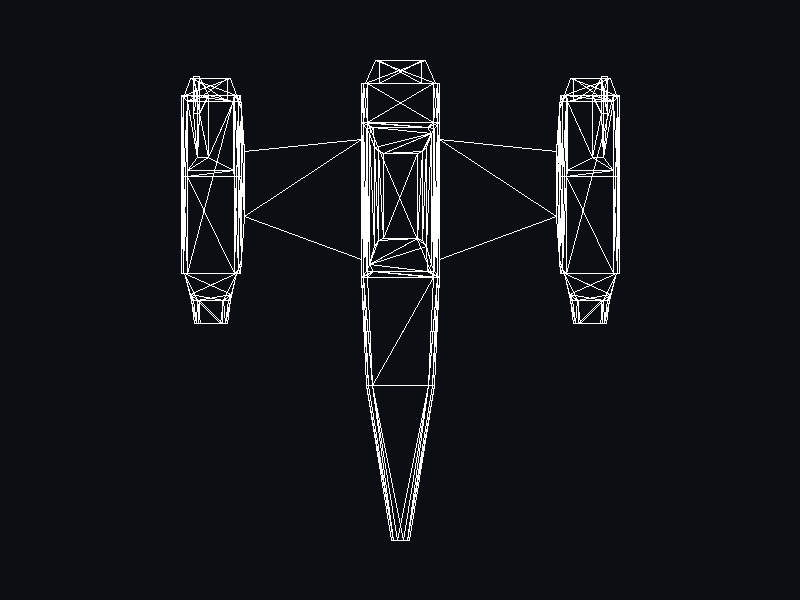

# Rust Software Renderer — Laboratorio 4

Rasterizador por CPU escrito en Rust para el curso de Gráficas por Computadora
(Universidad del Valle de Guatemala). Esta rama (`lab4/obj-wireframe`) resuelve
el **Laboratorio 4: carga y dibujo de un modelo OBJ**.



*Captura de la ventana real del programa (`NaveBimotor`, vista superior X/Z,
708 triángulos dibujados como contornos).*

## Qué hace

1. Lee `assets/models/Laboratorio3.obj` con un cargador propio (registros `v` y
   `f`, índices base 1 → base 0, caras `i/t/n` admitidas, errores con número de
   línea).
2. Expande los 2124 índices del modelo en vértices por cara y ensambla los 708
   triángulos originales.
3. Dibuja cada triángulo con `triangle`, que llama tres veces a `line`
   (Bresenham propio), generando fragmentos.
4. Escribe los fragmentos en un framebuffer en CPU y lo presenta como una
   textura en una ventana Raylib de 800×600.

Raylib solo se usa para la ventana, los tipos `Vector2`/`Vector3`/`Matrix` y
para mostrar la textura final. No se usa `LoadModel`, `DrawModel`, `DrawMesh`,
`DrawLine` ni `DrawTriangle`.

## Ejecutar

Requisitos: Rust estable (probado con 1.97) y las librerías de desarrollo de
X11/OpenGL que necesita `raylib` (en Fedora 43 el proyecto compiló sin instalar
paquetes adicionales).

```bash
cargo run                      # abre la ventana con la nave
cargo run --release            # misma imagen, binario optimizado
cargo run -- --obj ruta.obj    # otro OBJ triangulado
cargo run -- --screenshot captura.png   # guarda el primer frame de la ventana y sale
```

Al iniciar imprime los conteos reales de la carga, por ejemplo:

```text
Loaded .../assets/models/Laboratorio3.obj: 356 vertices, 2124 indices, 708 triangles
Rendered 708 triangles into 79934 fragments (XZ view, 800x600 @ 60 FPS)
```

Una ruta inexistente o un OBJ inválido terminan con un mensaje de error y código
de salida 1; nunca se muestra un modelo sustituto.

## Verificar

```bash
cargo fmt --check
cargo check
cargo test
cargo clippy --all-targets -- -D warnings
```

`cargo test` ejecuta 91 pruebas (parser OBJ, malla, líneas, triángulos, shader
de vértices, ensamblaje, mapeo a pantalla, framebuffer, pipeline completo,
render de la nave sin ventana, contratos y rutas de error). La captura del
README se generó con `cargo run --release -- --screenshot docs/screenshots/lab4/01-nave-wireframe.png`,
que guarda el contenido de la ventana del programa.

## Estructura

```text
src/
├── main.rs              punto de entrada → app::run()
├── app.rs               ventana, carga del OBJ, ciclo de render, --obj/--screenshot
├── config.rs            resolución, FPS, ruta del modelo, plano de vista, margen
├── geometry/            Mesh (posiciones + índices validados), Vertex
├── io/obj.rs            cargador OBJ propio (v, f) con errores por línea
├── pipeline/
│   ├── uniforms.rs      matriz de modelo
│   ├── vertex_shader.rs etapa 1: transformación por matriz 4×4
│   ├── screen_mapping.rs vista plana XY/XZ, centrado y escala uniforme
│   ├── primitive.rs     etapa 2: ternas → triángulos
│   ├── rasterizer.rs    etapa 3: triangle por cada primitiva
│   ├── fragment_shader.rs etapa 4: color del fragmento (passthrough)
│   └── render.rs        coordina las cuatro etapas y escribe al framebuffer
├── rasterization/       line (Bresenham) y triangle (3 líneas)
└── rendering/           Fragment, Framebuffer (CPU) y Presenter (textura Raylib)
assets/models/Laboratorio3.obj   nave triangulada exportada desde Blender
docs/laboratorio4.md             explicación técnica detallada
tests/                           pruebas de integración por módulo
```

Detalles del cargador, la conversión de índices, el pipeline y el encuadre:
[docs/laboratorio4.md](docs/laboratorio4.md).

## Vista y proyección

Se dibuja una vista plana (ortográfica) del plano X/Z del modelo: la nave es
larga en Z y ancha en X, así que esa es su silueta más reconocible. El bounding
box proyectado se centra en la ventana y se escala de forma uniforme para ocupar
el área con un margen del 10 %. No hay perspectiva ni cámara; eso corresponde a
etapas posteriores del curso.

## Límites del Laboratorio 4

Solo contornos (wireframe): sin relleno de triángulos, sin eliminación de caras
ocultas, sin z-buffer, texturas, iluminación ni perspectiva. El Laboratorio 5
(relleno baricéntrico y por scanline, comparación y mediciones) es trabajo
futuro en otra rama; no está implementado aquí.
