# RED-BLACK UNIVERSE — SPACE TRAVEL

**Proyecto 3 de Gráficas por Computadora** — Universidad del Valle de Guatemala (UVG), segundo ciclo 2026

*Un sistema solar de naipes, neón y plasma, dibujado píxel a píxel por un rasterizador por CPU escrito en Rust.* Una estrella con corona, cinco planetas y una nave que se pilota a mano. Este repositorio también contiene los laboratorios que lo hicieron posible: el **Laboratorio 4** (carga de OBJ), el **Laboratorio 5** (relleno de triángulos) y el **Laboratorio 6** (planetas y estrellas con shaders).

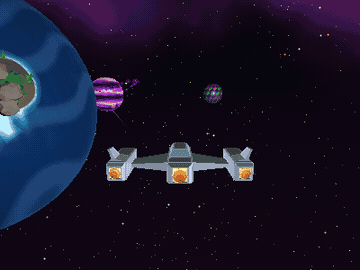

*Captura real del framebuffer de CPU. La nave cae en la órbita de Clover Haven, la rodea sin tocar una tecla y escapa por la tangente con `SPACE`.*

| Ficha técnica | |
|---|---|
| Cuerpos | 1 estrella + 5 planetas (Crimson Entrance, Clover Haven, Neon Hearts, House of Cards y Joker) |
| Nave | `NaveBimotor` del Laboratorio 3 (Blender), con propulsores, luces automáticas y sonido procedural |
| Render | Rasterizador por CPU propio, con Z-buffer, sombreado por fragmento, LOD y descarte. raylib solo abre la ventana, lee la entrada, presenta el framebuffer y reproduce el audio |
| Física | Paso fijo de 1/240 s, gravedad ablandada, colisión por barrido, captura orbital con histéresis |
| Pruebas | 1033 pruebas automatizadas verdes (`cargo test`), más `fmt`, `clippy -D warnings` y `diff --check` |

**Índice:** [Universo](#el-universo-red-black) · [Galería](#galería) · [Sistema solar](#el-sistema-solar) · [Nave](#la-nave) · [Vuelo](#vuelo-gravedad-captura-y-escape) · [Controles](#controles) · [Ambiente](#ambiente-cielo-cometas-agua-luces-y-sonido) · [Bajo el capó](#bajo-el-capó) · [Ejecutar](#instalación-y-ejecución) · [Rúbrica](#rúbrica-oficial-y-puntos-reclamados) · [Estado final](#estado-final-del-proyecto) · [Autoría](#autor-y-contribuciones) · [Video](#video-de-demostración) · [Laboratorio 6](#laboratorio-6--planetas-y-estrellas-con-shaders) · [Camino al Proyecto 3](#camino-al-proyecto-3--sistema-solar-navegable) · [Vista interactiva](#vista-interactiva-de-la-nave-mejora-opcional) · [Tres modos](#demostración-interactiva--tres-modos-de-rasterización) · [Laboratorio 5](#laboratorio-5--filling-triangles) · [Laboratorio 4](#laboratorio-4--carga-de-modelos-obj) · [Arquitectura](#arquitectura-implementada) · [Autor](#autor)

---

## Proyecto 3 — Space Travel

### El universo Red-Black

Red-Black es un universo de casino cósmico. Cada cuerpo celeste es una carta o una ficha de la mesa:

- **El rey:** la estrella lleva corona.
- **Los palos:** un planeta es un trébol que flota en el mar, otro es un corazón de neón y otro es un castillo de naipes con su anillo de cartas.
- **El comodín:** el Joker cierra el sistema.

La paleta nace del rojo y el negro de la baraja, y cada planeta suma su color: verde de trébol, magenta de neón, rombos rojos y el arlequín del Joker.

**Inspiración artística:** baraja francesa, letreros de neón de casino y paisajes low-poly. Todo es geometría propia generada por código sobre la esfera del docente.

La arquitectura, las fórmulas y los parámetros están en [docs/project3.md](docs/project3.md). Los requisitos habilitantes R1–R5 están en [docs/project3_delivery_contract.md](docs/project3_delivery_contract.md).

### Galería

Todas las imágenes son salidas reales del framebuffer de CPU, sin retoques. La 15 es una captura de la ventana del visor interactivo (`--screenshot`).

| | |
|---|---|
| 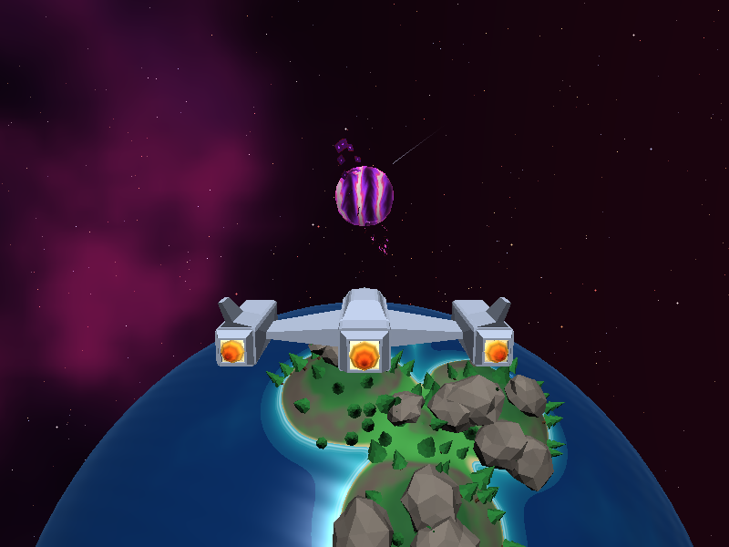 **01** Clover Haven de cerca | 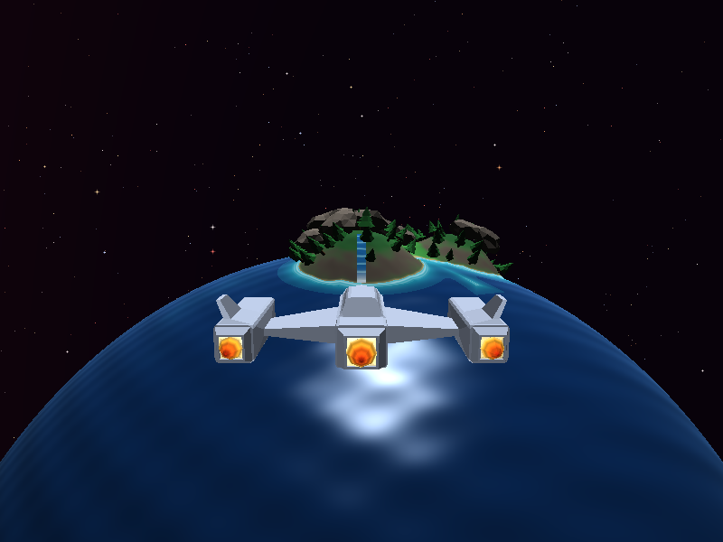 **02** Montaña y cascada |
| 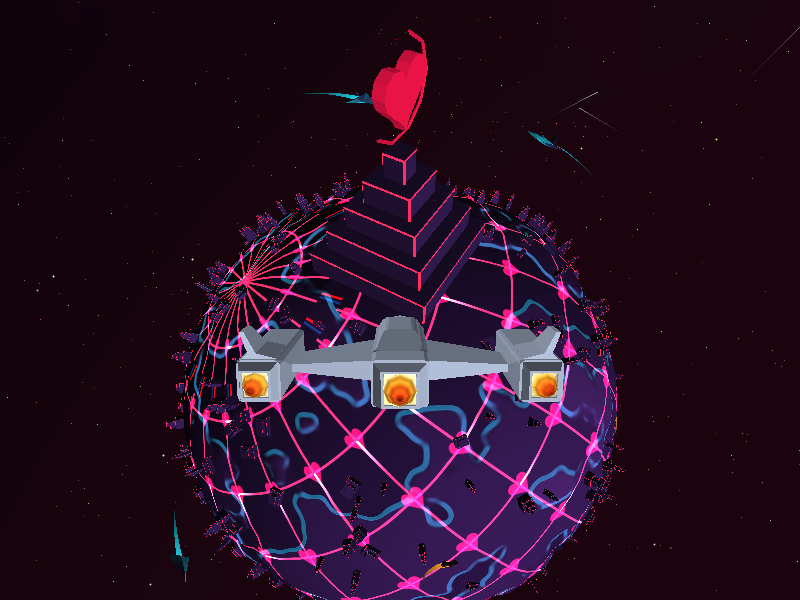 **03** Pirámide y ciudad de Neon Hearts | 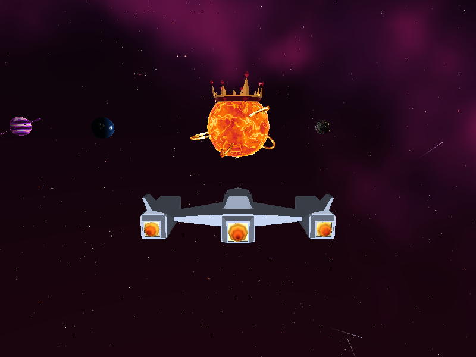 **04** El sistema con la nave |
| 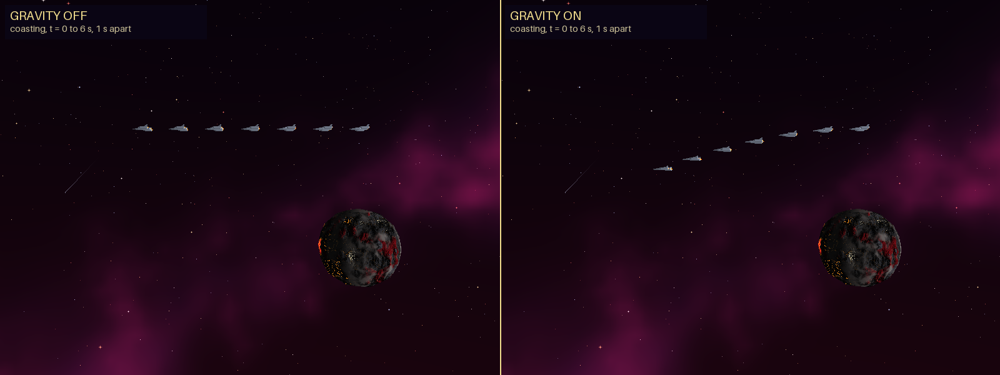 **05** Deriva sin gravedad (recta) y con gravedad (curva) | 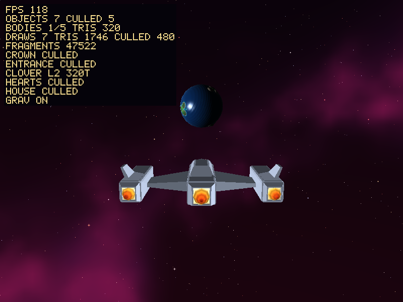 **06** HUD: descarte, triángulos y LOD por planeta |
| 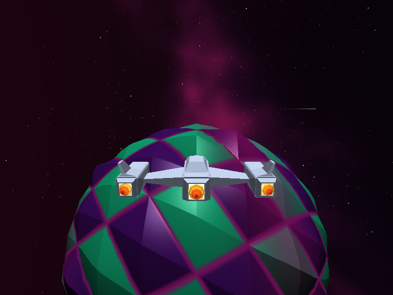 **07** El Joker, quinto planeta | 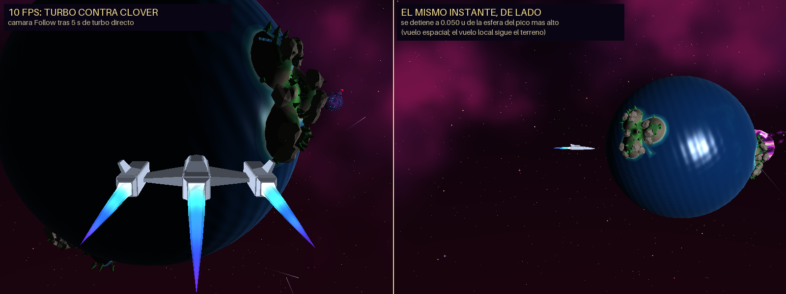 **08** Colisión a 10 FPS: la nave se detiene a 0.050 u |
| 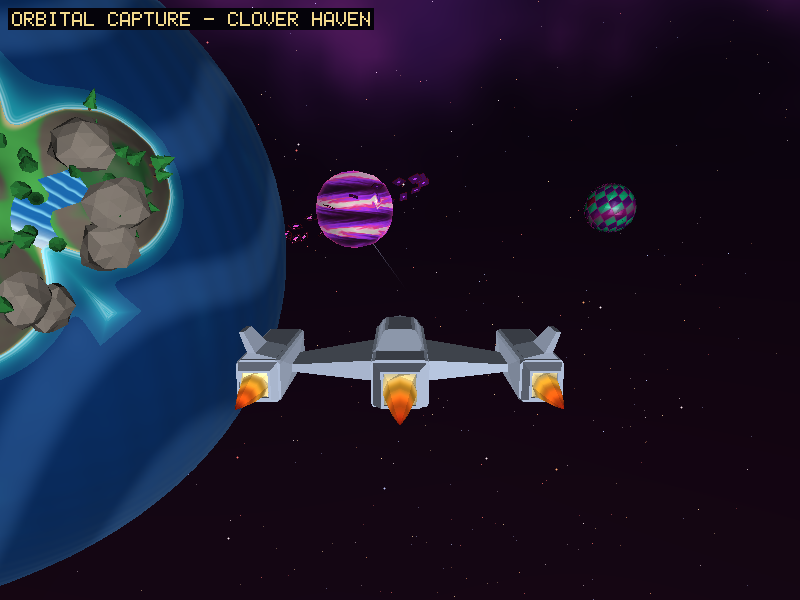 **09** Captura orbital en Clover Haven | 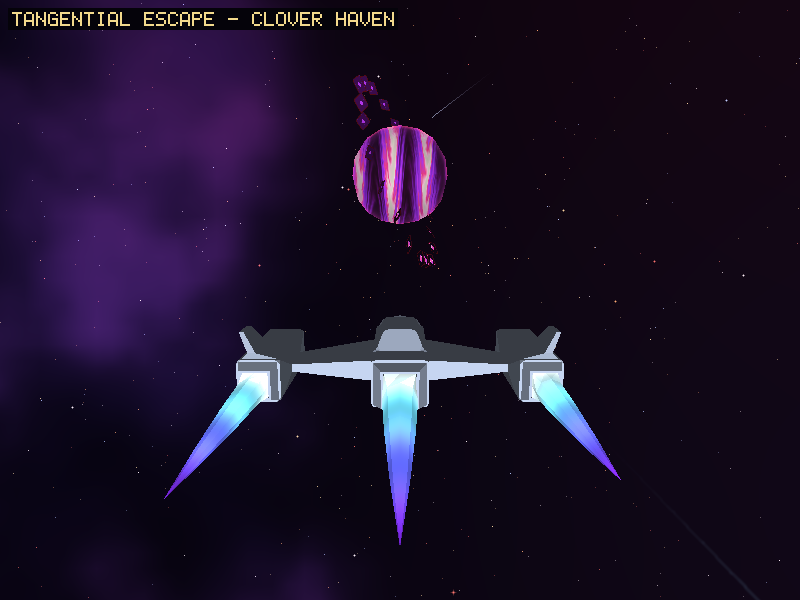 **10** Escape tangencial con velocidad de la luz |
| 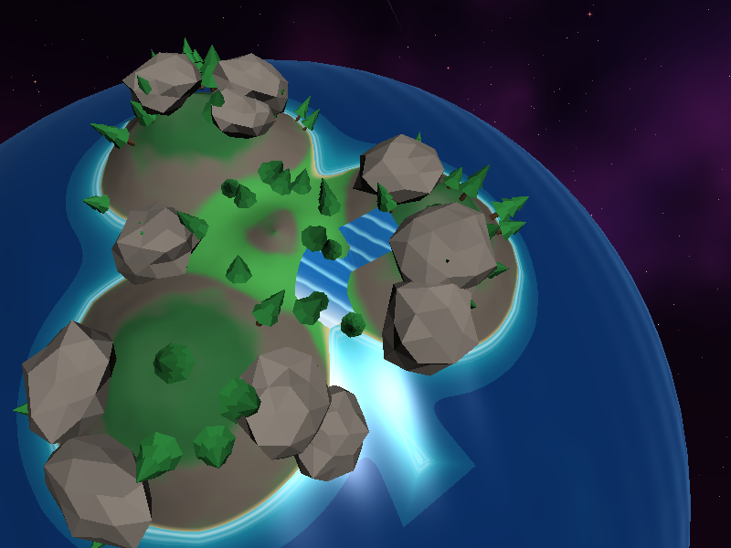 **11** Una de las tres cascadas monumentales | 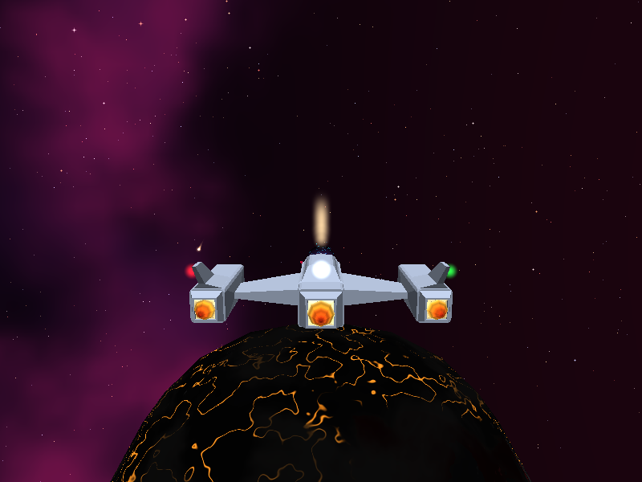 **12** Luces automáticas a la sombra de un planeta |
| 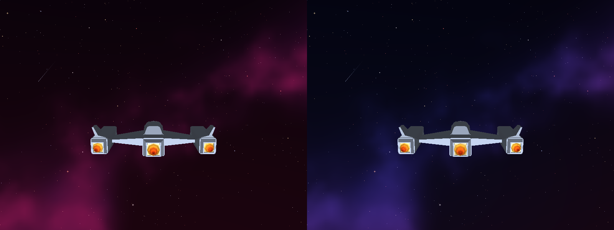 **13** El cielo a t = 0 s (púrpura) y t = 45 s (azul) | 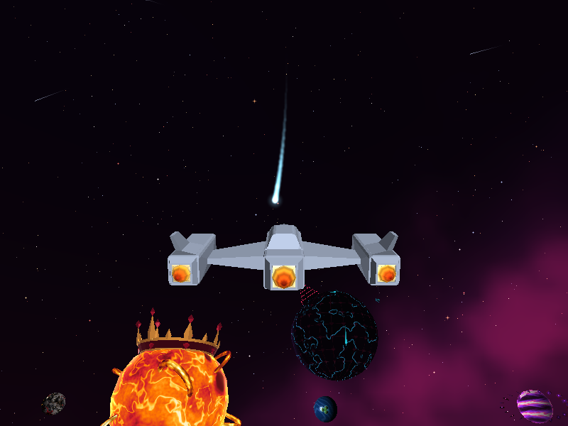 **14** Un cometa cruza el sistema |
| 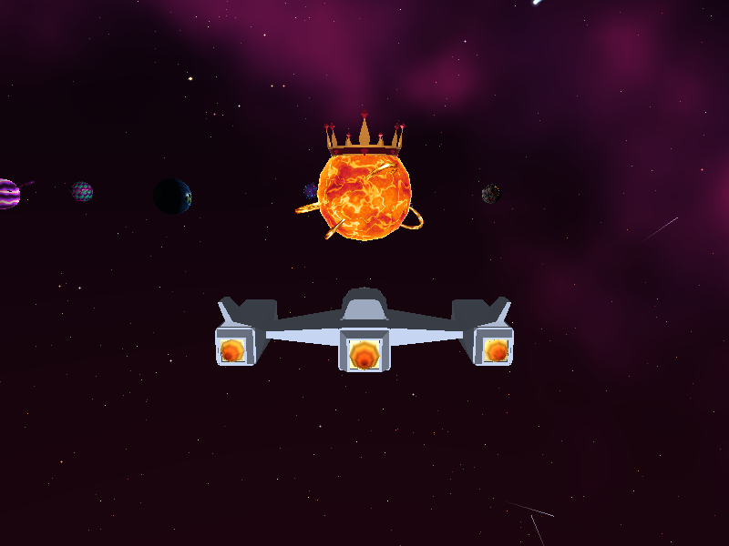 **15** Ventana del visor interactivo al iniciar | |

**Animaciones** (GIF, framebuffer de CPU):

| | | |
|---|---|---|
| 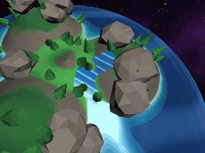 Cascada monumental | 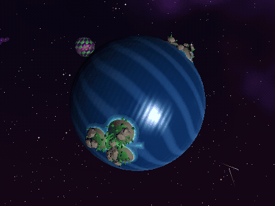 Océano y oleaje de Clover Haven | 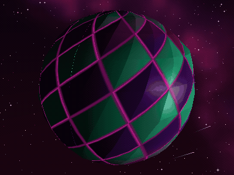 Joker |
| 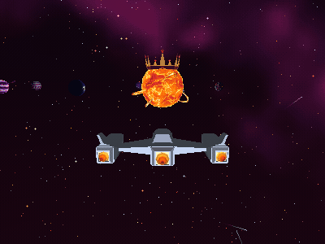 Cielo púrpura → azul | 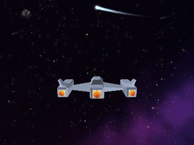 Cometa | 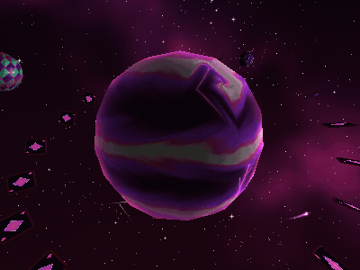 House of Cards y su anillo |
| 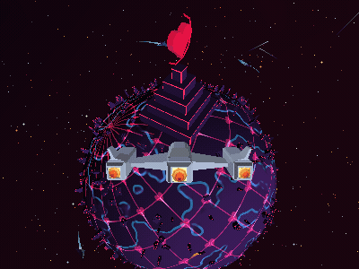 Neon Hearts | 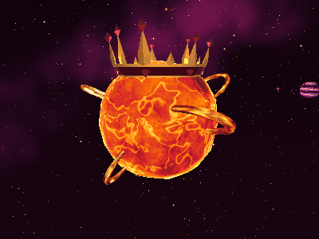 The King's Crown | 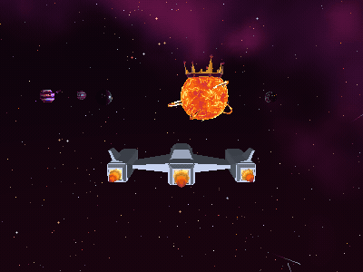 Propulsores: crucero, luz y apagado |

Cómo se generó cada imagen: [docs/results/project3/media_expansion.md](docs/results/project3/media_expansion.md).

### El sistema solar

La nave es la unidad de medida: su radio envolvente es 0.319 u. Los planetas miden de 3 a 6 radios de nave y la estrella de 3 a 5 radios del planeta mayor (`ScaleProfile`). Las órbitas mantienen al menos 3 u entre las cáscaras de los vecinos (`OrbitLayout`).

| Cuerpo | Radio (u) | Órbita (u) | Velocidad (u/s) | Qué lo distingue |
|---|---:|---:|---:|---|
| **The King's Crown** (estrella) | 5.40 | — | — | Plasma vivo con venas doradas, manchas, eclipse y bucles de plasma; corona regia y lazos de plasma externos |
| **Crimson Entrance** | 1.10 | 14.0 | 1.00 | Mundo volcánico de basalto y grietas de magma cuya corteza se hunde en cráteres-pica ♠; *bump* procedural |
| **Clover Haven** | 1.45 | 21.0 | 0.90 | Isla-trébol de cuatro montañas en un océano con olas, espuma y oleaje. Tiene árboles, rocas, 4 cascadas clásicas y 3 monumentales |
| **Neon Hearts** | 1.30 | 29.5 | 0.85 | Rejilla neón con *glitch*, pirámide-corazón, ciudad, naves neón y motos de luz con estelas |
| **House of Cards** | 1.75 | 40.0 | 0.75 | Gigante gaseoso de tormentas en rombo con un anillo de 20 cartas que giran y se mecen |
| **Joker** | 1.60 | 49.0 | 0.70 | Relieve propio de rombos facetados y asimétricos y shader de arlequín: esmeralda y púrpura, ola burdeos-magenta, *glitch* y crestas magenta |
| **Ace Crystal** | — | — | — | Diseño aprobado por el autor y **no implementado** en esta entrega (ver [Estado final](#estado-final-del-proyecto)) |

Las órbitas son circulares y en forma cerrada: la posición depende solo del tiempo simulado, a cualquier FPS. Cada planeta gira además sobre su eje, y todo lo que lleva encima gira con él: árboles, cascadas, ciudad y cartas.

### La nave

- **Modelo:** `NaveBimotor`, la nave original del Laboratorio 3, modelada en Blender y cargada sin modificar.
- **Propulsores:** tres toberas con llama naranja en crucero. Con `SPACE` pasan a una llama azul de postcombustión (velocidad de la luz, hasta 8× con rampa) y se apagan con suavidad al soltar.
- **Luces automáticas:** cuando un planeta tapa la estrella, la nave enciende sus luces con una penumbra suave:
  - luz roja en la punta izquierda y verde en la derecha;
  - estrobo blanco en la cola, 0.12 s cada segundo;
  - un haz cálido delante de la nariz.

  Al sol se apagan solas (captura 12).
- **Vuelo inercial:** empuje, frenado de los amortiguadores (`X`) y giro suavizado, con la misma física a 10, 30, 60 o 144 FPS.

### Vuelo: gravedad, captura y escape

- **Gravedad (`G`):** cada planeta atrae con una inversa del cuadrado ablandada. La atracción no supera un cuarto del empuje, así que la nave siempre puede escapar.
- **Captura orbital:** con la gravedad encendida, la nave queda en órbita asistida si cumple tres condiciones durante 0.25 s:
  - entra lenta en la cáscara de captura de un planeta (hasta 1.25× la velocidad de crucero respecto a él);
  - no se aleja;
  - se mantiene así.

  El HUD muestra `GRAVITY APPROACH` y luego `ORBITAL CAPTURE - <planeta>`. La órbita lleva la nave a lo largo de su nariz a una altura fija que `E`/`Q` ajustan dentro de la banda, y acompaña al planeta mientras este se mueve.
- **Escape tangencial (`SPACE`):** la nave sale por la tangente de su órbita, con la velocidad del planeta más al menos 1.1 veces la velocidad de escape de esa altura. Mientras se mantiene `SPACE`, empuja a velocidad de la luz y la distancia solo crece.
- **Histéresis:** el planeta que soltó la nave no puede recapturarla hasta que salga de una cáscara de suelta más amplia.
- **House of Cards:** su órbita asistida queda por encima del anillo de cartas, incluso con `Q`.
- **Vuelo local (`L`):** desde el espacio, rodea el planeta más cercano siguiendo el terreno exacto. Desde una captura, cambia a exploración local sin deriva.
- **Viaje rápido (`F1`–`F5`):** lleva la nave junto a cada planeta y termina cualquier captura.

Fórmulas y estados: [docs/project3.md](docs/project3.md#captura-orbital-y-escape-tangencial-srcsolarcapturers).

### Controles

| Entrada | Acción |
|---|---|
| Ratón, `W` `A` `S` `D` | Orientar la nave; avanzar, retroceder y desplazarse de lado (aceleración y frenado progresivos) |
| `SPACE` (mantener) | Velocidad de la luz en vuelo espacial; **escape tangencial** desde una captura orbital |
| `E` / `Q` | Subir / bajar. En vuelo local cambian la distancia al suelo, y en captura, la altura de la órbita |
| `L` | Entrar o salir del vuelo local. Desde una captura, pasar a exploración local |
| `F1` `F2` `F3` `F4` `F5` | Viaje rápido a Crimson Entrance, Clover Haven, Neon Hearts, House of Cards y Joker |
| `G` | Gravedad (y con ella la captura orbital) encendida / apagada |
| `M` | Sonido encendido / apagado |
| `X` | Amortiguadores inerciales |
| `C` | Descarte fuera de la vista |
| `H` | HUD con contadores |
| `V` | Cámara Follow ↔ cámara Orbit |
| `P` | Pausa de órbitas y materiales |
| `TAB`, `ESC` | Capturar o liberar el ratón; `ESC` con el ratón libre sale |

### Ambiente: cielo, cometas, agua, luces y sonido

- **Cielo animado:** la nebulosa pintada pasa de púrpura a azul y vuelve en 90 s. El cambio avanza en una onda que barre el cielo, así que nunca cambia todo de golpe (captura 13). Las escenas de los laboratorios conservan su cielo fijo.
- **Cometas:** tres cometas recorren elipses alrededor de la estrella. Su cola apunta lejos de ella, se dibujan detrás del Z-buffer y se omiten fuera del cuadro (captura 14).
- **Agua y cascadas:** el océano de Clover Haven combina dos trenes de olas, espuma que rueda hacia la costa y bandas de oleaje que cruzan el mar abierto.
  - **Cascadas clásicas:** cuatro, una por montaña.
  - **Cascadas monumentales:** tres, el triple de anchas, que nacen más arriba en otra ladera y bajan por el gradiente hasta el mar.
  - **Recuento:** 4 + 3 = 7 cascadas, todas con agua que fluye.
- **Iluminación:** la estrella ilumina cada planeta desde su posición real (día y noche), y la corona y el plasma brillan solos. La nave enciende sus luces en la sombra.
- **Audio procedural:** no hay archivos de sonido. Al iniciar, el programa sintetiza tres sonidos:
  - el rumor de los propulsores, que sube con el empuje;
  - el silbido de la velocidad de la luz;
  - un barrido ascendente al escapar de una órbita.

  Suenan por el dispositivo de audio de raylib y `M` los silencia. Sin dispositivo de audio, el visor avisa y sigue en silencio.

### Bajo el capó

| Tema | Resumen | Detalle |
|---|---|---|
| **Arquitectura B** | Lista plana de cuerpos con datos validados (`SystemSpec` → `ScaleProfile` → `OrbitLayout`) y adjuntos por planeta. Sin ECS ni motor externo | [project3.md §1–2](docs/project3.md) |
| **Pipeline CPU** | Vértices → ensamblaje de triángulos → rasterización *scanline* con Z-buffer → sombreado por fragmento en lotes paralelos → framebuffer | [Arquitectura](#arquitectura-implementada) |
| **Shaders** | Un material propio por cuerpo: plasma, lava, gas en rombos, trébol con agua, rejilla neón y arlequín. Más cascadas, cartas, llamas, lazos de plasma, neón de naves y cielo | [Laboratorio 6](#laboratorio-6--planetas-y-estrellas-con-shaders) |
| **Geometría procedural** | Icosferas deformadas por campos de altura con semilla. Árboles, rocas, edificios, pirámide, naves y cascadas generados por código y horneados por sectores | [project3.md §3](docs/project3.md) |
| **LOD** | Niveles 2–5 (320–20 480 triángulos) según el radio proyectado, con histéresis | [benchmark_final.md](docs/results/project3/benchmark_final.md) |
| **Descarte** | Esfera envolvente contra el frustum antes de rasterizar, y horizonte para lo que queda detrás del planeta | Captura 06 |
| **Colisiones** | Barrido por subpaso contra la esfera del relieve más alto, en el marco móvil de cada planeta. Conserva 0.05 u de margen de 10 a 144 FPS | Captura 08; [gravity_evidence.md](docs/results/project3/gravity_evidence.md) |
| **Rendimiento** | Medido a 800×600 con todos los núcleos; el peor escenario forzado tarda 92.9 ms por cuadro | [benchmark_final.md](docs/results/project3/benchmark_final.md) |

**Decisiones de arquitectura:**

- **Una sola escena:** las escenas históricas de los laboratorios quedan intactas, y cada mejora nueva se activa solo en el sistema del Proyecto 3. Así ocurre con el cielo animado, los cometas, las luces y la captura.
- **Captura orbital:** reutiliza los controladores de vuelo local y espacial en lugar de duplicar física.
- **Efectos ligeros:** los cometas y las luces se dibujan después del Z-buffer, sin tocar el rasterizador.
- **Audio:** se sintetiza en memoria para no añadir archivos ni *crates*.

### Pruebas automatizadas

`cargo test --release` corre **1033 pruebas** y todas pasan. Cada mejora de la expansión tiene su suite:

| Suite | Qué cubre |
|---|---|
| `p3_joker_planet_tests` | Relieve y shader del Joker |
| `p3_collision_moving_target_tests` | Colisión a 10–144 FPS |
| `p3_sky_cycle_tests` | Cielo animado |
| `p3_comet_tests` | Cometas |
| `p3_orbital_capture_tests` | Los cinco planetas, vuelta completa, anillo, escape, recaptura, FPS, cámara, viaje rápido, `G` y `L` |
| `p3_monumental_waterfall_tests` | Cascadas monumentales y oleaje |
| `p3_ship_lights_tests` | Luces automáticas |
| `p3_audio_tests` | Audio procedural |

Los oráculos de cuadro (FNV-1a) fijan la salida exacta de cada escenario. Los de los laboratorios no cambiaron. La lista completa de suites y los comandos de validación están en [project3_final_validation.md](docs/project3_final_validation.md).

### Instalación y ejecución

Requisitos: Rust estable (probado con 1.97) y Cargo. El crate `raylib = "5.5"` compila sin paquetes adicionales en Fedora 43.

```bash
cargo run --release -- --scene solar                       # pilotar la nave (cámara Follow)
cargo run --release -- --scene solar --camera orbit        # el sistema completo desde la cámara orbital
cargo run --release -- --scene solar --record 56 --fps 30 --timeline final-tour | ffmpeg -f rawvideo -pix_fmt rgb24 -s 800x600 -framerate 30 -i - recorrido.mp4
cargo test --release                                       # todas las pruebas
```

### Rúbrica oficial y puntos reclamados

La tabla sale de las filas `VERIFICADO` de [docs/project3_rubric_claims.md](docs/project3_rubric_claims.md), y cada fila tiene su suite, su comando y su captura.

| Rubro | Seguro | Dónde verlo |
|---|---:|---|
| Planetas (5 de 5, sin la estrella) | 50 | Capturas 01–04 y 07 |
| Tipos de modelo sobre la superficie (árboles, rocas, edificios neón, pirámide) | 20 | Capturas 01–03 |
| Distribución procedural con semilla y ruido | 10 | [Semillas 7 y 8](docs/results/project3/geometry/seed_7_vs_8.png) |
| Posición y orientación sobre la superficie al girar | 5 | [Orientación al girar](docs/results/project3/geometry/orientation_spin.png) |
| Shaders propios distinguibles (4) | 24 | Capturas 01–04 y 07; Laboratorio 6 |
| Shader animado | 8 | GIF del océano, de la cascada y del Joker |
| Mapeo de normales (normal del campo y *bump* procedural) | 4 de 8 | [Bump apagado / encendido](docs/results/project3/geometry/normals_bump_0_1.png) |
| Deformación de la geometría con ruido | 10 | [Relieve plano / con campo](docs/results/project3/geometry/relief_flat_vs_field.png) |
| Subdivisión procedural antes de rasterizar | 10 | [Niveles 2 y 5](docs/results/project3/geometry/subdivision_l2_l5.png) |
| Vuelo local alrededor de un planeta | 8 | Recorrido histórico; captura 09 |
| Aceleración, frenado y giro progresivos | 8 | Recorrido histórico; GIF de propulsores |
| Atracción gravitatoria | 10 | Captura 05 |
| Colisión con los planetas | 4 | Captura 08 |
| Descarte fuera de la vista | 7 | Captura 06; [benchmark](docs/results/project3/benchmark_final.md) |
| Niveles de detalle según la distancia | 8 | Captura 06; [benchmark](docs/results/project3/benchmark_final.md) |
| Coherencia visual (juicio docente) | 3 de 5 | Galería |
| Claridad de la experiencia (juicio docente) | 3 de 5 | HUD, controles y este README |

- **Totales:** 192 puntos seguros y 200 condicionados, sobre el máximo de 200 del menú.
- **Planetas:** el menú cuenta como máximo cinco, y la estrella no cuenta.
- **Ningún total está garantizado:** cada rubro suma solo si el profesor lo acepta en la demostración, y la nota es min(100, puntos aceptados).

### Evidencias

- **Capturas y animaciones:** la [galería](#galería) y [media_expansion.md](docs/results/project3/media_expansion.md), que explica cómo se generó cada una.
- **Colisión y gravedad:** [gravity_evidence.md](docs/results/project3/gravity_evidence.md).
- **Rendimiento:** [benchmark_final.md](docs/results/project3/benchmark_final.md).
- **Reescalado:** la evaluación del reescalado propuesto está en [project3_rescale_evaluation.md](docs/project3_rescale_evaluation.md).
- **Validación:** el registro de validación y las suites están en [project3_final_validation.md](docs/project3_final_validation.md).
- **Recorridos históricos:** conservados como evidencia; ninguno es el video final de esta expansión.
  - [Recorrido final de la versión de cuatro planetas](docs/videos/project3/01-final-tour.mp4): 56 s, 800×600 y 30 fps, en un solo plano sin viaje rápido ni cortes ([GIF](docs/videos/project3/01-final-tour.gif)).
  - [Recorrido provisional](docs/videos/project3/00-provisional-tour.mp4).

### Limitaciones

- **Colisión con el anillo de cartas:** las cartas de House of Cards no tienen colisión propia. La nave choca con el planeta y su relieve, no con cada carta. La órbita asistida sí queda por encima del anillo.
- **Forma de colisión en vuelo espacial:** es la esfera del relieve más alto; el vuelo local sigue el terreno exacto.
- **Escenas pesadas:** el escenario medido más lento tarda 92.9 ms por cuadro con todos los núcleos a 800×600 (relieve rasante con el nivel 5 forzado, solo para comparar). Con el nivel elegido por distancia, la misma vista tarda 82.8 ms.
- **FPS del HUD en la captura 06:** es 1 / tiempo de `render_frame`, sin la presentación de la ventana.
- **Audio:** se comprobó que el dispositivo se abre y que los tres sonidos se cargan en el visor. Lo que se oye depende del equipo, y las pruebas automáticas cubren la síntesis, no la reproducción.

### Estado final del proyecto

| Parte | Estado |
|---|---|
| Cinco planetas, estrella, nave, propulsores, gravedad, colisión, vuelo local, viaje rápido, LOD y descarte | Implementado y probado |
| Expansión: Joker, corrección de colisión a bajo FPS, cielo animado, cometas, captura orbital y escape tangencial, cascadas monumentales y oleaje, luces automáticas, audio procedural | Implementado y probado |
| Ace Crystal (sexto planeta) | **No ejecutado.** El diseño está aprobado, pero un sexto cuerpo movería la disposición, el punto de aparición y todos los oráculos a horas de la entrega, y el menú ya cuenta como máximo cinco planetas |
| Reescalado mayor de planetas y estrella | **No aplicado.** Se evaluó con la regla del `OrbitLayout`: las órbitas pasarían de 14–49 u a unas 27–86 u, y cruzar el sistema a crucero tomaría ~1 min. Sería un cambio controlado de `ScaleProfile`, pero rompe todos los oráculos y el recorrido grabado ([evaluación](docs/project3_rescale_evaluation.md)) |
| Video final de la entrega | Lo grabará el autor ([Video de demostración](#video-de-demostración)) |

### Autor y contribuciones

**Proyecto individual.** Lo desarrolló un único integrante, **Vernel Josue Hernández Cáceres** (carné 24584). No hay equipo ni otros colaboradores humanos, así que todas las responsabilidades del proyecto son suyas:

| Integrante | Carné | Contribuciones |
|---|---|---|
| Vernel Josue Hernández Cáceres | 24584 | Todas (proyecto individual), detalladas en la lista |

- diseño conceptual del universo Red-Black y diseño artístico de la estrella y los planetas;
- modelado de la nave original (`NaveBimotor`, Laboratorio 3, en Blender);
- definición de la arquitectura del software (arquitectura B);
- desarrollo e integración del rasterizador por CPU, los shaders procedurales, la geometría y los efectos visuales;
- simulación orbital, física de navegación, gravedad, captura orbital y colisiones;
- diseño de los controles, del vuelo y del sonido;
- pruebas, validación, optimización y documentación;
- preparación de la demostración final.

Todos los commits del repositorio están hechos con la identidad Git del autor (`Junjey123-mx`) y no tienen coautores. La asistencia de herramientas de IA se declara más abajo: no convierte a la herramienta en integrante ni en coautora, y la responsabilidad académica del trabajo es del autor.

### Recursos y herramientas

- **raylib 5.5** (crate `raylib`): solo ventana, teclado, ratón, presentación del framebuffer como textura y dispositivo de audio. No se usa para dibujo 3D, cámaras, shaders de GPU ni física.
- **`assets/models/sphere.obj`:** esfera del docente, sin modificar, compartida por los cuerpos.
- **`assets/models/Laboratorio3.obj`:** la nave `NaveBimotor` del Laboratorio 3, exportada desde Blender, sin modificar.
- **Geometría y sonido propios:** árboles, rocas, edificios, pirámide-corazón, naves neón, motos de luz, estelas, cascadas y cometas se generan por código, igual que los tres sonidos. No se cargan modelos, texturas ni audios de terceros.
- **ffmpeg:** codifica los videos y los GIF. El programa no lo usa.
- **Python con Pillow:** compone y convierte las imágenes de la documentación. El programa no lo usa.
- No hay otros *crates*.

### Declaración de asistencia de IA

Este proyecto se desarrolló con asistencia de inteligencia artificial: **Claude Code (Anthropic)** se usó como asistente de programación para:

- proponer la arquitectura;
- escribir e iterar el código y las pruebas;
- guionizar y grabar los recorridos;
- generar las capturas y animaciones y ejecutar mediciones;
- redactar documentación, incluida esta sección.

No todo el código se escribió a mano: buena parte del código, las pruebas y la documentación la generó el asistente siguiendo instrucciones del autor. El autor dirigió el trabajo, fijó el alcance, el diseño artístico y las decisiones de arquitectura, y revisa el resultado antes de publicarlo. Los commits se hacen con su identidad.

---

## Video de demostración

El video definitivo lo graba el autor: un recorrido por el universo Red-Black que muestra los cinco planetas, la captura orbital con el escape tangencial, las cascadas, el cielo animado, los cometas, las luces y el sonido de la nave.

> **VIDEO FINAL — PENDIENTE DE INCORPORACIÓN POR EL AUTOR.**

<!--
Instrucciones para el autor, al tener el video:
1. Sustituir el marcador de arriba por la miniatura del video enlazada a su dirección pública:
   - URL del video: la dirección pública definitiva (YouTube, Drive, etc.).
   - Miniatura: una captura real del video guardada en docs/screenshots/project3/, usada como imagen del enlace.
2. Añadir debajo una descripción breve del recorrido (duración, resolución, orden de los planetas y mecánicas mostradas).
3. No borrar los recorridos históricos de la sección Evidencias.
-->

Hasta entonces, los recorridos de la sección [Evidencias](#evidencias) son material histórico de versiones anteriores y no sustituyen a este video.

---

## Laboratorio 6 — Planetas y estrellas con shaders

Tres cuerpos celestes sobre **la misma esfera del docente** (`assets/models/sphere.obj`, copiada byte a byte: 98 vértices únicos y 192 triángulos). Toda la apariencia sale de **fragment shaders procedurales en CPU**. No hay texturas, imágenes, materiales externos ni modelos nuevos; los vértices nunca se mueven. Los planetas tienen un símbolo exclusivo de la dirección artística Red-Black: la **pica ♠** del planeta rocoso y el **rombo ♦** del gigante gaseoso. La estrella no lleva ninguna figura dibujada. La guía técnica completa, con fórmulas, todos los parámetros, pruebas y rendimiento, está en [docs/laboratorio6.md](docs/laboratorio6.md).

| The King's Crown (estrella) | Crimson Entrance (rocoso) | House of Cards (gaseoso) |
|---|---|---|
| 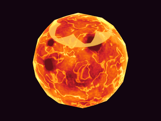 | 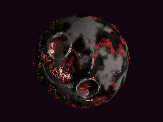 | 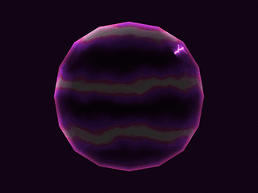 |

Los GIF son la vista rápida, a 8 fps. Los videos completos son MP4 H.264 a 800×600 y 30 fps, grabados sin ventana con el mismo renderer:

| Video | Qué muestra |
|---|---|
| ▶ [The King's Crown](docs/videos/lab6/01-kings-crown-material.mp4) · 24 s | Con la cámara fija, los bucles de plasma nacen, arden y se reabsorben en tres zonas distintas del disco y en momentos distintos. Las manchas respiran, la corona pulsa y a los 20 s llega el eclipse |
| ▶ [Los dos hemisferios de la estrella](docs/videos/lab6/10-kings-crown-hemispheres.mp4) · 24 s · [GIF](docs/videos/lab6/10-kings-crown-hemispheres.gif) | El mismo instante desde dos cámaras fijas: los bucles también recorren el hemisferio oculto desde la vista inicial |
| ▶ [Crimson Entrance](docs/videos/lab6/02-crimson-entrance-events.mp4) · 30 s | Desde t = 27 s, tres cráteres-pica (mediano, pequeño y grande) se fracturan, se hunden, arden, se enfrían y se cierran por turnos. Dos de ellos coexisten en fases distintas |
| ▶ [House of Cards](docs/videos/lab6/03-house-of-cards-vortex.mp4) · 36 s | Un cuarto de vuelta de cámara desde la vista lateral descubre el ciclo completo de las tormentas ♦ mediana, pequeña y grande, con sus rayos neón |

### Cómo ejecutar

Compila siempre en `--release`: los shaders se evalúan por fragmento en CPU.

```bash
cargo run --release -- --scene crown                  # The King's Crown
cargo run --release -- --scene entrance               # Crimson Entrance
cargo run --release -- --scene house                  # House of Cards
cargo run --release -- --scene entrance --mode wireframe     # la esfera compartida (192 triángulos)
cargo run --release -- --scene entrance --mode barycentric   # mismo shader con el relleno baricéntrico
cargo run --release -- --scene house --time 9.9 --screenshot vortice.png
cargo run --release -- --scene entrance --set cloud_coverage=0.7 --set bump_strength=2
cargo run --release -- --scene entrance --set spade_crater_count=1  # un cráter-pica a la vez (por defecto, 2)
cargo run --release -- --scene house --set vortex_count=1           # solo la tormenta grande (por defecto, 3)
cargo run --release -- --scene crown --set plasma_loop_count=2      # dos ranuras de bucles (por defecto, 6)
cargo run --release -- --scene entrance --debug-view clouds  # none height materials clouds shadows normals night parallax
cargo run --release -- --scene crown --record 4 --fps 30 | ffmpeg -f rawvideo -pix_fmt rgb24 -s 800x600 -framerate 30 -i - corona.mp4
cargo run --release -- --benchmark-shaders            # sin ventana → docs/results/lab6/shader_benchmark.csv
```

Las escenas celestes usan `scanline` por defecto; `--mode` lo cambia y las teclas `1/2/3` también. Otras opciones:

| Opción | Efecto |
|---|---|
| `--time <s>` | Instante simulado inicial |
| `--freeze-time` | Detiene el tiempo |
| `--light-azimuth <grados>` | Azimut de la luz (por defecto −75) |
| `--light-elevation <grados>` | Elevación de la luz (por defecto 20) |
| `--view oblique\|top\|front\|side` | Preset de cámara |
| `--threads <n>` | Hilos del shader (por defecto, todos) |
| `--record <s> [--fps n] [--timeline material\|orbit\|light\|showcase]` | Fotogramas rgb24 por stdout, sin ventana |

`--obj` no se acepta con una escena celeste, porque la esfera es fija por regla.

| Tecla | Acción |
|---|---|
| `←` `→` `↑` `↓` | Orbitar e inclinar la cámara |
| `Q` / `E` | Zoom |
| `R` / `T` / `F` / `S` | Reiniciar, superior, frontal, lateral |
| `1` / `2` / `3` | Wireframe, baricéntrico, scanline |
| `TAB` | Siguiente cuerpo (se conservan cámara, tiempo y luz) |
| `SPACE` | Pausar el tiempo |
| `J` / `L`, `I` / `K` | Azimut y elevación de la luz |
| `N` | Siguiente vista de depuración |
| `[` / `]` | Parámetro principal: `corona_pulse_amount`, `cloud_coverage` o `vortex_strength` |
| `C` / `H` / `B` / `P` | Nubes, sombras de nubes, bump y parallax (Crimson Entrance) |
| `ESC` | Salir |

### The King's Crown — estrella de plasma regio

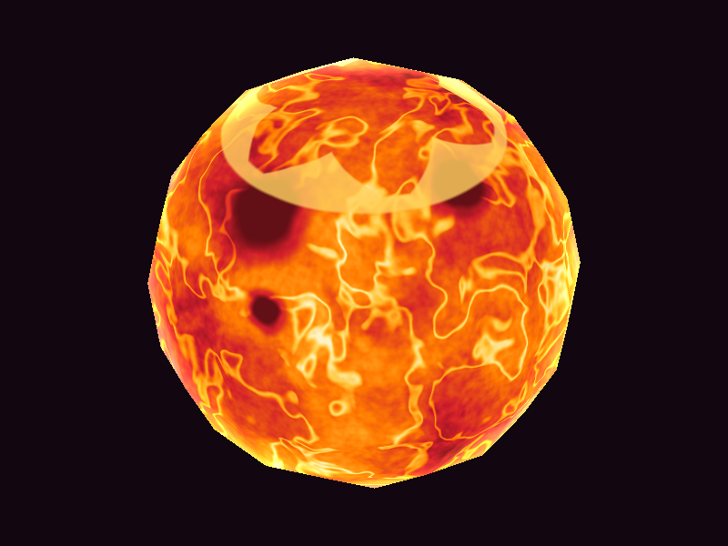

Estrella regia de plasma vivo con una corona que respira. Es emisiva: no depende de la luz externa.

**Patrones y cómo se combinan:**
- **Temperatura.** Una fBm sobre un dominio deformado (*domain warp*) que gira y avanza con el tiempo, más venas doradas (cruces por cero de otra fBm) y granulación fina. Pasa por una rampa vino → carmesí → naranja → oro → marfil.
- **Manchas.** Tres manchas con umbra y penumbra que derivan y respiran con fases distintas.
- **Corona.** Una corona de Fresnel en el limbo, dentro de la silueta, cuyo ancho pulsa.
- **Eclipse.** Uno cada 24 s, que oscurece el núcleo mientras la corona sigue ardiendo.
- **Bucles de plasma.** Hasta seis surcos luminosos con ciclos propios: el plasma se concentra en un pie, un filamento curvo crece hasta el otro pie, arde casi blanco y se drena de vuelta a la superficie. Cada ranura tiene su región:
  - tres rodean el disco visible desde la cámara inicial (arriba, abajo a la izquierda y abajo a la derecha);
  - las otras tres están en el hemisferio opuesto.

  Cada ranura tiene su periodo (de 9 a 17.2 s) y su fase, así que nunca coinciden las seis en su máximo. En cada ciclo cambian el lugar dentro de la región, el tamaño, el brillo y el grosor. Son trayectorias sobre la esfera, no geometría, y no hay ninguna figura dibujada.

| Parámetro | Por defecto | Rango | Cambio visual |
|---|---:|---|---|
| `plasma_scale` | 1.6 | 0.5 – 8 | Tamaño de las corrientes de plasma |
| `warp_strength` | 0.8 | 0 – 3 | Cuánto se retuercen las corrientes |
| `flow_speed` | 0.18 | 0 – 2 | Velocidad de advección del plasma |
| `spot_breath_period` | 9 | 1 – 60 | Segundos por respiración de una mancha |
| `corona_pulse_period` | 4 | 0.5 – 30 | Segundos por pulso de la corona |
| `corona_pulse_amount` | 0.35 | 0 – 1 | Amplitud del pulso del limbo |
| `eclipse_period` | 24 | 4 – 120 | Segundos entre eclipses |
| `plasma_loop_count` | 6 | 2 – 6 | Ranuras de bucles en uso, la mitad en cada hemisferio |
| `loop_period` | 9 | 3 – 60 | Segundos por ciclo del bucle más rápido |
| `loop_size` | 0.6 | 0.15 – 0.9 | Tamaño de los arcos de plasma |

### Crimson Entrance — planeta volcánico de cráteres-pica

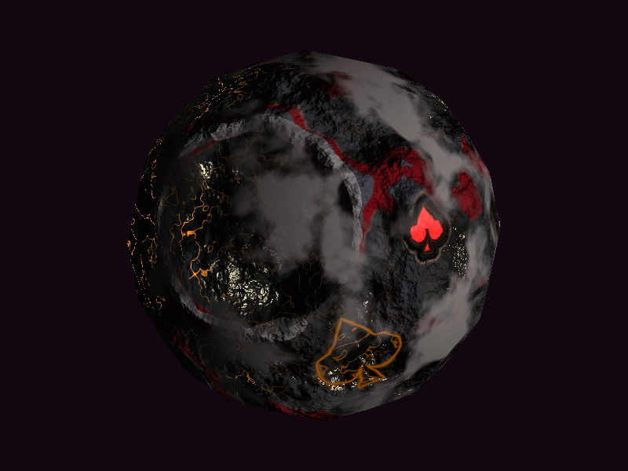

Mundo de basalto, obsidiana, ceniza y costras carmesí, atravesado por grietas de magma. Cada cierto tiempo la corteza se hunde en forma de pica ♠ y deja al descubierto un núcleo al rojo vivo, que se enfría antes de que la superficie vuelva a cerrarse; después la pica reaparece en otra zona. Dos picas de tamaños distintos pueden estar abiertas a la vez, en fases distintas.

**Patrones y cómo se combinan:**
- **Campo de altura.** Uno solo: una cuenca monumental, colinas de fBm y relieve fino.
- **Regiones.** El mismo campo se clasifica en siete, por orden de importancia visual:
  - la lava de los cráteres-pica;
  - la roca volcánica negra y gris (obsidiana vítrea, basalto y pizarra), que domina el planeta;
  - las tierras carmesí mate;
  - los bordes de ceniza, con costra ocre en las transiciones;
  - las fisuras ámbar.
- **Cráter-pica.** Es el único fenómeno geológico, con tres ranuras (grande, mediana y pequeña) desfasadas un tercio de un ciclo de 21 s. La SDF de la pica fractura la corteza, la hunde en una cuenca con forma de ♠ y, ya con la profundidad máxima, enciende su fondo en rojo hiperintenso con un núcleo casi blanco. Después se enfría por parches y la altura vuelve a la base.
  - **Coexistencia.** Nace un cráter cada 7 s y cada uno vive 12.6 s, así que dos coexisten 5.6 s de cada 7. Mientras uno arde, el siguiente se fractura y se hunde, y nunca llegan juntos al brillo máximo.
  - **Separación.** Los cráteres abiertos nunca se solapan y una zona recién cerrada no se reutiliza enseguida. Cuando puede, el nuevo se abre a menos de 100° del que sigue abierto, para que una misma cámara vea los dos.
  - **Uno a la vez.** Con `spade_crater_count = 1` se abren solo los eventos pares de la misma secuencia.

  La lava brilla igual de día y de noche y las nubes se aclaran un poco sobre el cráter. Detalles y mediciones en [docs/lab6-crimson-refinement.md](docs/lab6-crimson-refinement.md).
- **Nubes de ceniza.** Una capa independiente cuyas sombras siguen a la luz.
- **Iluminación.** El bump inclina la normal, el parallax desplaza las consultas según la vista, la obsidiana es vítrea y la roca mate, y las fisuras se encienden de noche.

| Parámetro | Por defecto | Rango | Cambio visual |
|---|---:|---|---|
| `spade_crater_count` | 2 | 1 – 2 | Cráteres-pica abiertos a la vez |
| `event_period` | 21 | 6 – 90 | Segundos por ciclo de cráter-pica |
| `event_size` | 0.5 | 0.15 – 0.9 | Tamaño del cráter-pica grande |
| `lava_glow` | 1 | 0 – 3 | Intensidad de la lava de la pica |
| `cloud_coverage` | 0.45 | 0 – 1 | Fracción del cielo cubierta por nubes |
| `cloud_altitude` | 0.07 | 0 – 0.3 | Desplazamiento de las sombras respecto a las nubes |
| `bump_strength` | 0.8 | 0 – 4 | Intensidad del relieve iluminado |
| `shininess` | 40 | 2 – 256 | Concentración del brillo de la obsidiana |
| `night_glow` | 1 | 0 – 3 | Brillo nocturno de las fisuras |
| `parallax_scale` | 0.06 | 0 – 0.25 | Profundidad aparente del relieve |

### House of Cards — gigante gaseoso de tormentas en rombo

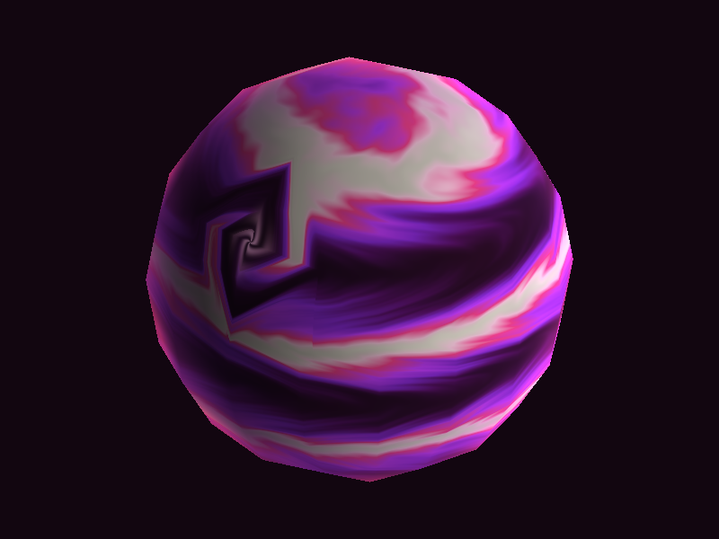

Gigante gaseoso violeta donde la circulación atmosférica se organiza en hasta tres rombos ♦ que nacen, culminan, se disuelven y vuelven a formarse en otra región.

**Patrones y cómo se combinan:**
- **Bandas.** Seis bandas de latitud onduladas por fBm, con transiciones líquidas en una rampa violeta, magenta y perla, más un tinte vino y filamentos.
- **Vientos diferenciales.** Una rotación de la dirección de muestreo que depende de la latitud, así que las bandas vecinas se deslizan.
- **Vórtices ♦.** El dominio se advecta a lo largo de los contornos de la norma L1 (un rombo) en el plano tangente del centro de cada tormenta. Las bandas vecinas se enrollan en espirales romboidales con un núcleo luminoso.
- **Tres tormentas.** Una grande, una mediana (un anticiclón que gira al revés) y una pequeña.
  - **Fases.** Nacen con un tercio de periodo de diferencia (6 s), así que nunca coinciden dos apogeos y siempre hay dos o tres en el cielo.
  - **Regiones.** La grande se forma frente a la cámara inicial; la mediana y la pequeña recorren la franja de latitudes hasta 45°, a menudo en el otro hemisferio, y se descubren al orbitar la cámara.
  - **Migración.** Los rombos nunca se solapan. Al terminar su ciclo, cada tormenta se disuelve y reaparece al menos un radio más lejos, y su centro no se mueve mientras es visible.
- **Halo.** Un halo atmosférico de Fresnel en el limbo.
- **Relámpagos neón.** Rayos dentados con dos ramas, de núcleo pálido y halo violeta o rosa neón, que destellan y se apagan en fracciones de segundo.
  - Cada tormenta tiene su propio canal, con su ritmo: cae solo dentro de su rombo, más a menudo cerca del apogeo, y se enrosca con el remolino.
  - Otros dos canales saltan de vez en cuando entre las bandas.

  Se suman como emisión, sin tocar las bandas ni los rombos.

| Parámetro | Por defecto | Rango | Cambio visual |
|---|---:|---|---|
| `band_count` | 6 | 3 – 14 | Número de bandas |
| `band_warp` | 0.25 | 0 – 1.5 | Ondulación de los bordes de banda |
| `differential_wind` | 0.06 | 0 – 1.5 | Deslizamiento entre latitudes |
| `vortex_count` | 3 | 1 – 3 | Tormentas ♦ en uso: grande, + mediana, + pequeña |
| `vortex_strength` | 6 | 0 – 8 | Cuánto se enrollan las bandas en el rombo grande |
| `secondary_strength` | 4.5 | 0 – 8 | Circulación de las tormentas mediana y pequeña |
| `vortex_radius` | 0.45 | 0.1 – 0.5 | Tamaño de la tormenta ♦ grande |
| `vortex_period` | 18 | 4 – 90 | Segundos por ciclo de una tormenta (desfasadas un tercio) |
| `rim_strength` | 0.6 | 0 – 2 | Halo violeta y magenta del limbo |
| `lightning_rate` | 1 | 0 – 3 | Frecuencia de los relámpagos |
| `lightning_intensity` | 1.4 | 0 – 3 | Brillo de los relámpagos |

La esfera compartida en wireframe es la misma para los tres cuerpos:

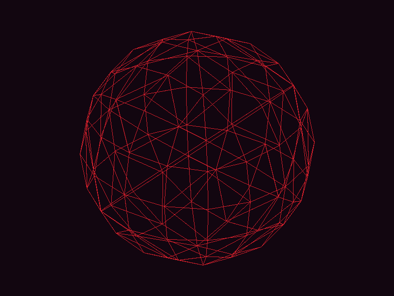

### Efectos solicitados

| Efecto | Nombre | Cuerpo | Archivo y función | Evidencia | Explicación | Parámetro → efecto visual |
|---|---|---|---|---|---|---|
| E01 | Material animado | The King's Crown | `src/celestial/crown.rs::Frame::temperature`, `Frame::spots`, `Frame::corona`, `eclipse_strength` | [video](docs/videos/lab6/01-kings-crown-material.mp4) · [GIF](docs/videos/lab6/01-kings-crown-material.gif) | Con cámara, luz y malla fijas, las corrientes cambian de forma, las manchas respiran, la corona pulsa y llega el eclipse; no es una rotación de la esfera | `corona_pulse_period`: segundos por pulso del limbo |
| E02 | Día y noche | Crimson Entrance | `src/celestial/entrance/mod.rs::Frame::night_factor`, `Frame::emission` | [video](docs/videos/lab6/07-entrance-day-night-light.mp4) · [GIF](docs/videos/lab6/07-entrance-day-night-light.gif) | Las fisuras son un término emisivo que sube de 0.12 a `night_glow` solo en el lado nocturno; con el tiempo congelado, solo gira la luz | `night_glow`: brillo nocturno de la red de fisuras |
| E03 | Respuestas a la luz | Crimson Entrance | `src/celestial/entrance/mod.rs::Frame::reflect_light`, `terrain.rs::TerrainMaterial::response` | [video](docs/videos/lab6/08-entrance-lighting-responses.mp4) · [regiones](docs/screenshots/lab6/08-entrance-materials.png) | La obsidiana tiene brillo Blinn-Phong que depende de la vista, la roca es mate, la ceniza tiene *wrap* y las fisuras son emisivas, todo según la clase de altura | `shininess`: tamaño del brillo vítreo |
| E04 | Nubes procedurales | Crimson Entrance | `src/celestial/entrance/clouds.rs::CloudLayer::mask` | [video](docs/videos/lab6/09-entrance-clouds-drift.mp4) · [coberturas](docs/screenshots/lab6/06-entrance-cloud-coverage.png) | Máscara de fBm sobre un dominio que gira y evoluciona, sobre la misma esfera, con un terreno inmóvil | `cloud_coverage`: fracción cubierta |
| E05 | Vórtice localizado | House of Cards | `src/celestial/house.rs::Storm::warp`, `Frame::vortex_warp`, `contour_param`, `contour_point` | [video](docs/videos/lab6/03-house-of-cards-vortex.mp4) · [apagado y encendido](docs/screenshots/lab6/09-house-vortex-off-on.png) | Las bandas se enrollan a lo largo de los contornos ♦ de la norma L1 de cada tormenta; fuera de los rombos la imagen es idéntica | `vortex_strength`: circulación del núcleo de la tormenta grande |
| E06 | Bump mapping | Crimson Entrance | `src/celestial/entrance/mod.rs::Frame::shading_normal`, `src/shading/lighting.rs::bump_normal` | [video](docs/videos/lab6/05-entrance-bump-light.mp4) · [apagado y encendido](docs/screenshots/lab6/05-entrance-bump-off-on.png) | El gradiente del campo de altura (diferencias hacia delante en el marco tangente, desde la altura ya calculada) inclina la normal de iluminación; no se mueve ningún vértice | `bump_strength`: relieve más marcado |
| E07 | Parallax | Crimson Entrance | `src/celestial/entrance/mod.rs::Frame::parallax_direction`, `src/shading/lighting.rs::parallax_shift` | [video](docs/videos/lab6/06-entrance-parallax-orbit.mp4) · [GIF](docs/videos/lab6/06-entrance-parallax-orbit.gif) | Búsqueda escalonada con bisección sobre la altura macro a lo largo de la vista. Con el tiempo congelado y la cámara orbitando, la pica y los bordes se desplazan (el video va sin nubes y con `parallax_scale` = 0.12 de demostración) | `parallax_scale`: profundidad aparente |
| E08 | Sombras de nubes | Crimson Entrance | `src/celestial/entrance/clouds.rs::CloudLayer::shadow`, `src/shading/lighting.rs::shell_exit` | [video](docs/videos/lab6/04-entrance-cloud-shadows-light.mp4) · [máscaras](docs/screenshots/lab6/07-entrance-cloud-shadow-masks.png) | La sombra es la máscara de nubes muestreada donde el rayo hacia la luz sale de la capa; no tiene desplazamiento en el punto subsolar y se estira hacia el terminador | `cloud_altitude`: separación entre sombra y nube |

Los ocho efectos están implementados y cada uno tiene pruebas automáticas y evidencia grabada (la relación entre pruebas y criterios está en la [guía técnica](docs/laboratorio6.md)). Los videos de bump, parallax y respuestas a la luz se grabaron con `--set clouds=0`, para aislar cada efecto. Más montajes: [cráteres-pica en el tiempo](docs/videos/lab6/02-crimson-entrance-events.mp4) y [nubes sobre el terreno inmóvil](docs/videos/lab6/09-entrance-clouds-drift.gif). Los videos se regeneran con [`docs/videos/lab6/encode.sh`](docs/videos/lab6/encode.sh) `all` y los montajes 05-09 con `encode.sh stills`. El script verifica cada archivo antes de reemplazar el anterior.

### Puntos reclamados

| Criterio | Puntos | Evidencia principal |
|---|---:|---|
| B01 Estrella procedural propia | 10 | Captura y video de The King's Crown |
| B02 Planeta rocoso con regiones diferenciadas | 10 | Captura de Crimson Entrance y montaje de regiones |
| B03 Gigante gaseoso con bandas | 10 | Captura y video de House of Cards |
| B04 Diseño visual | 20 | Tres paletas Red-Black, tres técnicas distintas y símbolos exclusivos |
| B05 Entrega | 10 | Este README, la guía técnica y los comandos |
| E01–E08 Efectos adicionales | 90 | Tabla anterior |
| **Total disponible** | **150** | Nota máxima registrable: 100 |

### Limitaciones

- La silueta es poligonal (malla de 98 vértices únicos): no se modifican vértices.
- Los cráteres-pica y las cuencas son relieve **aparente** (bump, parallax y sombreado), no geometría.
- El parallax es una aproximación escalonada que se atenúa cerca del limbo.
- El anillo de cartas ♦, el halo exterior y la cámara perspectiva quedan para el proyecto final.
- Crimson Entrance es el shader más costoso. En la versión final tarda 0.7 s por cuadro con 1 hilo y 65 ms con 20, unos 15 cuadros por segundo; antes del reajuste eran 1.76 s y 0.24 s, unos 4 cuadros por segundo ([mediciones](docs/results/lab6/crimson_refinement_benchmark.csv)). Con 20 hilos, The King's Crown tarda 29 ms y House of Cards 16 ms. Son medianas de tres ejecuciones de `--benchmark-shaders` (2026-11-06); detalles en la [guía técnica](docs/laboratorio6.md).

### Video y pruebas

- **Videos:** H.264 con `h264_nvenc`, el primer codificador que pasó la prueba funcional en esta máquina (`libx264` no está instalado). Los MP4 van a 30 fps; los GIF se generan desde el mismo intermedio FFV1 sin pérdida, a 8 fps (5 fps el de los dos hemisferios). Antes de reemplazar un archivo, `encode.sh` comprueba su códec, tamaño y fotogramas y lo decodifica completo.
- **Pruebas:** `cargo test` ejecuta **402 pruebas**: las 207 de los laboratorios 4 y 5 y de la vista interactiva, más 195 del Laboratorio 6, entre ellas el oráculo de 21 *hashes* que congela la nave y sus tres modos.

---

## Camino al Proyecto 3 — Sistema solar navegable

Etapa preparatoria del proyecto final, **no la entrega del Proyecto 3** (su rúbrica aún no existe). La escena nueva `--scene solar` reúne The King's Crown, Crimson Entrance y House of Cards del Laboratorio 6 con la nave del Laboratorio 4: órbitas, cámara en perspectiva, pilotaje con teclado y ratón, vuelo local alrededor de los planetas, un cielo Red-Black (nebulosa vino y magenta, estrellas de colores y cometas), viaje rápido, una corona real, un anillo de cartas de diamantes y propulsores animados, todo con el mismo rasterizador en CPU. Las escenas anteriores no cambian y sus imágenes siguen congeladas por oráculos. La guía completa (arquitectura, convenciones, las siete guías del curso frente a lo implementado, mediciones y límites) está en [docs/preproyecto3.md](docs/preproyecto3.md).

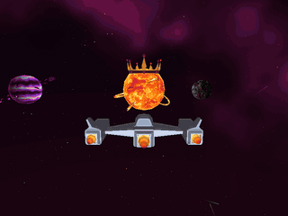

▶ [Video completo](docs/videos/preproject3/01-solar-flight.mp4) · 22 s, 800×600, 30 fps: aproximación con una ráfaga de velocidad de la luz, vuelo local sobre Crimson Entrance, warp y vuelo sobre House of Cards, y el sistema completo desde la cámara orbital.

| Sistema en órbita | Cámara Follow | Vuelo local | Cielo Red-Black | Viaje rápido |
|---|---|---|---|---|
| 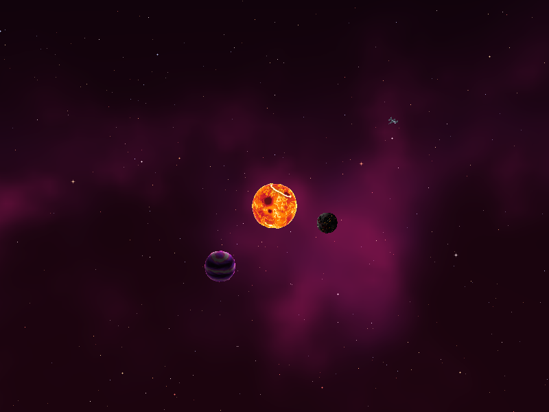 | 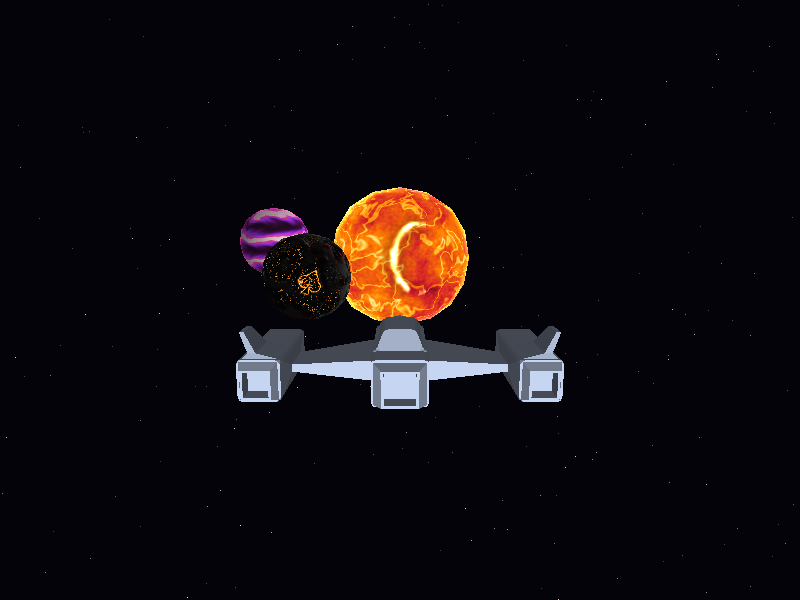 | 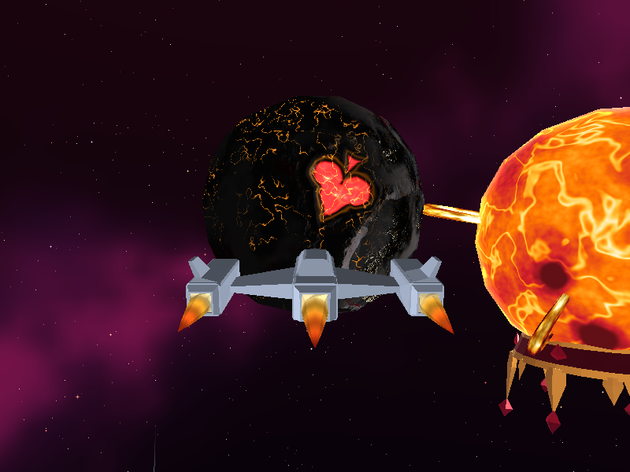 | 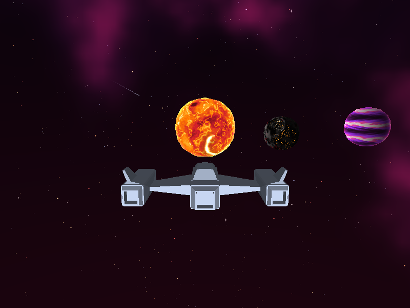 | 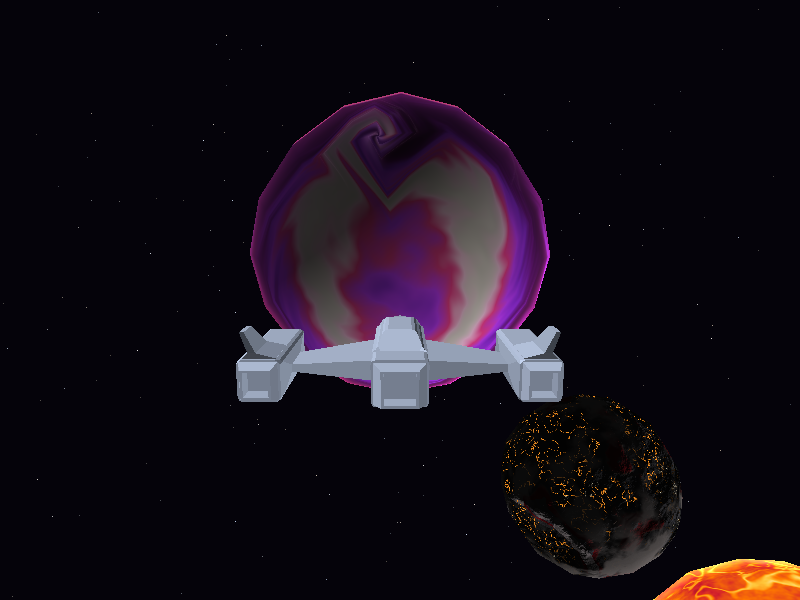 |

| Corona real y lazos | Anillo de diamantes | Postquemador |
|---|---|---|
| 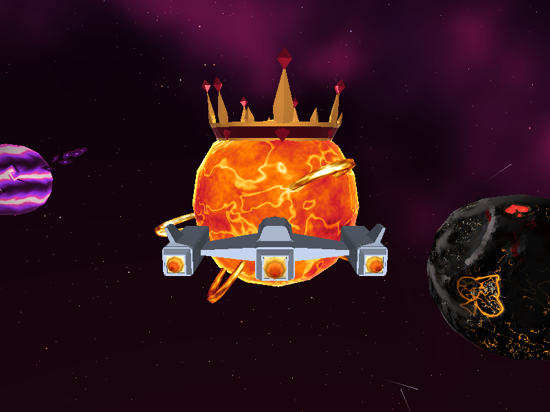 | 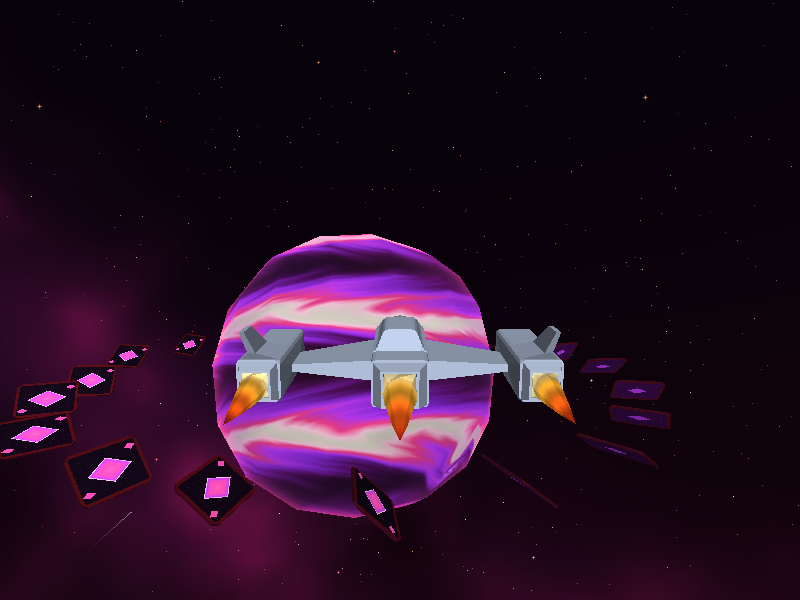 | 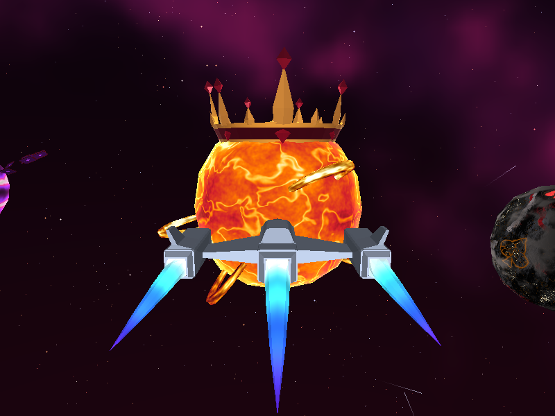 |

```bash
cargo run --release -- --scene solar                       # cámara detrás de la nave
cargo run --release -- --scene solar --camera orbit        # cámara orbital ortográfica
cargo run --release -- --scene solar --set entrance.cloud_coverage=0.7 --nebula 0.5
cargo run --release -- --scene solar --mouse-sensitivity 0.002 --invert-mouse
cargo run --release -- --scene solar --record 22 --fps 30 --timeline flight | ffmpeg -f rawvideo -pix_fmt rgb24 -s 800x600 -framerate 30 -i - vuelo.mp4
cargo run --release -- --benchmark-solar                   # escenarios A-J -> docs/results/preproject3
```

| Entrada | Acción |
|---|---|
| Ratón | Yaw y pitch de la nave, con la nariz limitada a ±80° (con el rig Orbit, orbitar e inclinar la cámara) |
| `W` / `S`, `A` / `D` | Avanzar / retroceder; desplazamiento lateral |
| `SPACE` (mantener) | Velocidad de la luz con rampa hasta ×8 y postquemador azul, solo en vuelo espacial |
| `L` | Vuelo local sobre el planeta más cercano: arcos a distancia constante que siguen su órbita |
| `E` / `Q` | Alejarse / acercarse al planeta en vuelo local (zoom en el rig Orbit) |
| `F1` `F2` `F3` | Warp junto a la posición actual de cada cuerpo |
| `V` | Cámara Follow ↔ cámara Orbit |
| `TAB`, `ESC` | Capturar o liberar el ratón; `ESC` con el ratón libre sale |
| `P`, `1` `2` `3` | Pausa de órbitas y materiales; modo de rasterización |

**Cómo funciona.**
- **Escena:** una esfera cargada una vez se dibuja como varias instancias con su transformación y su material. La luz y el ojo se giran al espacio de cada objeto, así que los patrones procedurales quedan pegados al cuerpo cuando gira.
- **Cuadro:** se limpia una sola vez, el cielo escribe solo color y todos los objetos comparten la profundidad.
- **Cielo:** la nebulosa se pinta una vez en un mapa de 256×128 con la paleta del mundo Red-Black y se muestrea cada 8 píxeles. Las estrellas tienen cinco clases espectrales, con cruces y destellos para las más brillantes, y hay doce cometas tenues. Todo sale de una sola semilla.
- **Órbitas:** Crimson Entrance a 3.0 y House of Cards a 6.2. Medidas con radios efectivos (estrella con corona 1.98, gigante con anillo 1.66), quedan 0.5 y 1.0 unidades libres entre vecinos.
- **Lazos de plasma:** seis arcos de geometría real salen de The King's Crown, se arquean en el espacio y vuelven a entrar. Giran con la estrella, respetan la profundidad y laten con hebras, grano y nudos que fluyen de un pie al otro; cuestan entre 0.2 y 0.7 ms por cuadro ([detalle](docs/preproyecto3.md#10-lazos-de-plasma-externos-de-the-kings-crown)).
- **Corona real:** una banda de oro con siete puntas, puntas menores y gemas rubí (532 triángulos) se asienta sobre la estrella junto a los lazos. Gira con ella y respeta la profundidad.
- **Anillo de diamantes:** 20 cartas con una sola malla compartida orbitan House of Cards en un plano inclinado. Cada una tiene fase, radio y balanceo propios a partir de una semilla, y se detienen con la pausa.
- **Propulsores:** tres llamas de geometría real salen de las toberas de la nave. Son naranjas en reposo, crecen con el empuje y con el turbo pasan a azul cian ([detalle](docs/preproyecto3.md#11-corona-real-anillo-de-cartas-propulsores-y-pilotaje-moderno)).
- **Perspectiva:** recorta contra el plano cercano antes de dividir, interpola de forma correcta en perspectiva y da a Fresnel, especular y parallax la dirección al ojo de cada fragmento.
- **Nave:** usa una base `forward/up` girada con Rodrigues. El vuelo local recorre círculos máximos y acompaña el desplazamiento orbital, sin gravedad ni colisiones.

**Rendimiento** (CPU, 800×600, 20 hilos; [método y A/B](docs/results/preproject3/README.md); medido al cierre del Gate, antes del cielo Red-Black, que añade unos 2 ms por cuadro): unos 16 ms con el sistema y la nave a la vista, 20 ms cerca de Crimson Entrance y 52 ms en el vuelo más bajo sobre ella, que es el peor caso. Dos optimizaciones medidas se adoptaron:
- sombrear todo el cuadro con un solo grupo de hilos, que da un −26 % en la vista del sistema con imágenes idénticas ([estudio](docs/results/preproject3/thread_scheduler_study.md));
- descartar los cuerpos fuera de cámara.

La calidad adaptativa es opcional (`--solar-quality adaptive`). `cargo test` suma 241 pruebas nuevas, entre ellas los oráculos de los cuerpos del Laboratorio 6, y los medios se regeneran con [`docs/videos/preproject3/encode.sh`](docs/videos/preproject3/encode.sh).

---

## Laboratorio 5 — Filling triangles

### Objetivo

Según las instrucciones del Ing. Dennis, la función `triangle` que dibuja los tres bordes debía ampliarse para **generar también los fragmentos del interior**, con **dos algoritmos independientes** (coordenadas baricéntricas y líneas horizontales), conservando la opción de contorno, comparando las **posiciones** producidas por ambos, midiendo solo la rasterización en modo optimizado y usando un perfilador.

### Los tres modos

```rust
#[derive(Clone, Copy)]
pub enum TriangleMode {
    Wireframe,          // Lab 4: triangle() → 3 × line()
    FilledBarycentric,  // bounding box + pesos baricéntricos en (x+0.5, y+0.5)
    FilledScanline,     // intersecciones por fila + spans horizontales
}
```

El modo se pasa a la etapa de rasterización (`rasterize_with_mode(triangles, mode, bounds)`); el ensamblaje de primitivas y el procesamiento de fragmentos no cambian. `rasterize(triangles)` y `render(...)` del Laboratorio 4 siguen existiendo como wrappers del modo wireframe.

### Resultado: la misma escena en los tres modos

Escena controlada de siete triángulos (pequeño, grande, borde horizontal, borde vertical, dos que comparten una diagonal con colores distintos, uno recortado por la ventana), generada con `cargo run --release -- --scene triangles --mode <modo> --screenshot ...`.

| Wireframe | FilledBarycentric | FilledScanline |
|---|---|---|
| 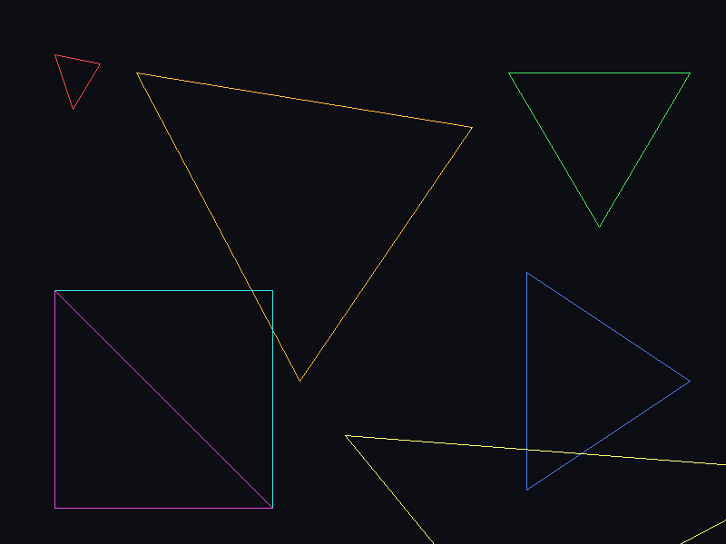 | 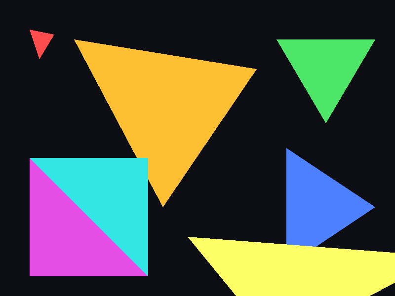 |  |

Las dos imágenes rellenas son píxel a píxel idénticas porque ambos algoritmos cubren exactamente los mismos centros. La diagonal compartida (cian/magenta) no tiene huecos ni solapes.

### Fundamento matemático

Centro del píxel `(x, y)`: `P = (x + 0.5, y + 0.5)`; `y` crece hacia abajo. Función de arista:

```text
E(A, B, P) = (Px - Ax)·(By - Ay) - (Py - Ay)·(Bx - Ax)      area2 = E(A, B, C)
```

- Si `area2 < 0` se intercambian B y C solo localmente, así **invertir el orden de los vértices no hace desaparecer el triángulo**. Si `area2 == 0` no se divide: triángulo degenerado, cero fragmentos.
- **Regla top-left** para empates (`E == 0`): la arista `A→B` acepta el punto si baja (`By > Ay`) o si es horizontal hacia la izquierda (`By == Ay` y `Bx < Ax`). Con ella dos triángulos adyacentes cubren cada centro de su arista común exactamente una vez.

**Baricéntrico** (`src/rasterization/barycentric.rs`): bounding box recortado al framebuffer; para cada centro se calculan `w_a = E(B,C,P)/area2`, `w_b = E(C,A,P)/area2`, `w_c = E(A,B,P)/area2` y se emite un fragmento si los tres pasan la regla de borde.

**Scanline** (`src/rasterization/scanline.rs`): por cada fila `sy = y + 0.5` se intersectan las aristas no horizontales con intervalo **semiabierto** `[min_y, max_y)` (un vértice sobre una fila se cuenta una vez); una arista horizontal sobre la fila decide la fila completa; el span `[xl, xr]` se recorre directamente y solo los píxeles de los extremos se clasifican con `E`. No recorre el bounding box ni llama al algoritmo baricéntrico (una prueba lee el código fuente para asegurarlo).

### Comparación de posiciones, no de imágenes

Para cada caso se comparan los conjuntos de pares `(x, y)` de ambos algoritmos y se verifica que no hay duplicados dentro de un triángulo ni píxeles fuera del framebuffer; al fallar, la prueba lista `only_in_barycentric` y `only_in_scanline`.

| Caso | Vértices | Resultado |
|---|---|---|
| T01 pequeño | (10,10) (18,12) (12,20) | idéntico |
| T02 grande | (10,10) (90,20) (40,85) | idéntico |
| T03 borde horizontal | (10,20) (70,20) (40,75) | idéntico |
| T04 borde vertical | (20,10) (20,80) (75,40) | idéntico |
| T05 orden inverso | T02 con C y B intercambiados | idéntico a T02 |
| T06 parcialmente fuera | (-15,20) (50,15) (40,115) | idéntico, todo dentro de 100×100 |
| T07 colineal | (10,10) (30,30) (50,50) | vacío en ambos |
| T08 vértice repetido | (20,20) (20,20) (60,50) | vacío en ambos |
| T09 vértices sobre centros | (10.5,10.5) (60.5,10.5) (10.5,60.5) | idéntico, 1275 píxeles |

Además: 300 triángulos pseudoaleatorios con semilla fija en cuatro viewports, las seis permutaciones de vértices, triángulos minúsculos, recorte por los cuatro bordes, coordenadas de 1e7, viewports de 0×0 y 1×1, NaN/inf, y la nave completa (708 caras: 173 500 fragmentos idénticos en ambos rellenos). Sin discrepancias.

### Benchmark (`cargo run --release -- --benchmark-triangles`)

Sin ventana. Se mide únicamente la generación de fragmentos (`rasterize_with_mode`, incluida la creación y almacenamiento del `Vec<Fragment>`) con `std::time::Instant` y `std::hint::black_box`; la carga de 207 triángulos se construye antes del cronómetro y se verifica la paridad de cobertura antes de medir. 10 rondas de calentamiento y **7 rondas medidas × 100 iteraciones por modo**, alternando modos; se reporta la **mediana**. Datos crudos: `docs/results/lab5/benchmark_raw.csv`; resumen derivado: `docs/results/lab5/benchmark_summary.csv`.

Entorno: Intel Core i7-13650HX, Fedora 43, rustc 1.97.0, release, 2026-10-21.

| Modo | Triángulos | Fragmentos / iteración | Mediana por iteración | Mín–máx por iteración | ns / fragmento |
|---|---:|---:|---:|---:|---:|
| FilledBarycentric | 207 | 858 033 | **13.95 ms** | 13.82–14.58 ms | 16.3 |
| FilledScanline | 207 | 858 033 | **5.26 ms** | 5.13–6.05 ms | 6.1 |

Ambos generan los mismos 858 033 fragmentos; scanline fue 2.65× más rápido en esta carga.

### Perfilado

No había `cargo-flamegraph`, `perf` ni `valgrind`; `samply` requiere cambiar `perf_event_paranoid` con sudo, lo que no se hizo. Se usó un **perfilador por muestreo de pilas** sin privilegios (`eu-stack` de elfutils cada ~10 ms sobre el modo `--benchmark-triangles --profile`), script y evidencia en `docs/profiles/`:

| Modo | Muestras | Marco hoja dominante | `memcpy` (extend del `Vec`) | Otros |
|---|---:|---|---:|---|
| barycentric | 356 | `fill_barycentric` 87.1 % | 11.8 % | realloc/malloc < 1 % |
| scanline | 375 | `fill_scanline` 76.5 % | 18.1 % | `ceil` 2.9 %, realloc/free ≈ 2 % |

Lectura: el baricéntrico gasta casi todo el tiempo evaluando tres funciones de arista en cada centro del bounding box, incluidos los que caen fuera; scanline casi no hace trabajo por píxel interior y por eso pesa más la copia de fragmentos al vector acumulado (`memcpy`) y el `ceil`/`floor` de los rangos, que son el siguiente cuello de botella. El crecimiento del `Vec` es visible pero menor al 3 % en ambos. Los porcentajes son proporción de muestras, no tiempo absoluto. Detalle en [docs/laboratorio5.md](docs/laboratorio5.md).

### Checklist Lab 5

- [x] R01 `Wireframe` reutiliza las tres llamadas a `line` (pruebas de regresión).
- [x] R02 `FilledBarycentric` independiente con bounding box y pesos.
- [x] R03 `FilledScanline` independiente, fila por fila.
- [x] R04 `TriangleMode` en `rasterize`, sin tocar ensamblaje ni fragment shader.
- [x] R05 Evaluación en centros `(x+0.5, y+0.5)`.
- [x] R06 Orden inverso y área cero manejados.
- [x] R07 Aristas horizontales y vértices sobre filas con regla consistente.
- [x] R08 Casos pequeño/grande, horizontal/vertical, inverso, recortado, colineal.
- [x] R09 Comparación de coordenadas `(x, y)` entre algoritmos.
- [x] R10 Medición solo de fragmentos, release, `Instant`, repeticiones y medianas.
- [x] R11 Conteo de fragmentos por algoritmo.
- [x] R12 Perfilador con evidencia real (muestreo de pilas).
- [x] R13 Una imagen por modo.
- [x] R14 Tiempos, perfil y explicación documentados.

---

## Vista interactiva de la nave (mejora opcional)

No es un requisito de los laboratorios: es una ampliación posterior al Lab 5 para explorar el OBJ real desde cualquier ángulo con los **mismos tres algoritmos**. Todo sigue en CPU: cámara orbital ortográfica propia, Z-buffer en el framebuffer y sombreado plano por cara. Raylib solo presenta la textura.

```bash
cargo run --release -- --scene ship --interactive --mode wireframe
cargo run --release -- --scene ship --interactive --mode barycentric
cargo run --release -- --scene ship --interactive --mode scanline
```

| Tecla | Acción |
|---|---|
| `←` `→` / `↑` `↓` | Orbitar / inclinar (según el tiempo entre cuadros) |
| `Q` / `E` | Alejar / acercar |
| `1` `2` `3` | Wireframe / baricéntrico / scanline, sin reiniciar la cámara |
| `R` | Restaurar vista inicial y zoom |
| `T` / `F` / `S` | Vista superior / frontal / lateral |

Misma vista oblicua (`--interactive --view oblique`) en los tres modos:

| Wireframe | FilledBarycentric | FilledScanline |
|---|---|---|
| 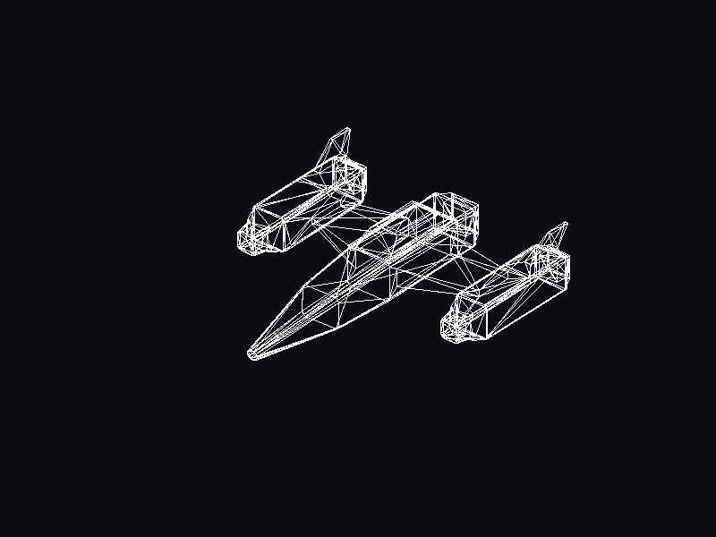 |  | 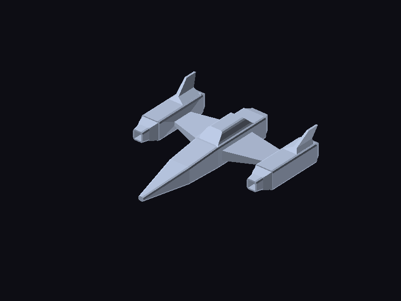 |

`--view oblique|top|front|side` fija el preset inicial (también sirve sin `--interactive` para capturas reproducibles con `--screenshot`). Los colores son un **sombreado calculado** a partir de la normal de cada cara y una luz direccional fija, no los materiales de Blender. La proyección es ortográfica (sin perspectiva) y el wireframe dibuja todas las aristas. Los dos rellenos siguen siendo independientes y producen la misma imagen con profundidad. Detalles, módulos y límites: [docs/interactive-views.md](docs/interactive-views.md).

---

## Demostración interactiva — Tres modos de rasterización

Además de las pruebas de cobertura y rendimiento, el renderizador permite explorar la nave espacial desde diferentes perspectivas mediante una cámara orbital implementada sobre nuestro pipeline de rasterización por CPU.

Los videos son salida real del programa, no capturas de escritorio ni animaciones externas. Cada fotograma lo produce `render_interactive` (el mismo que usa la ventana con `--interactive`) a partir del OBJ de 708 triángulos, moviendo la misma `OrbitCamera` por una trayectoria fija y suavizada: vista superior → oblicua → rotación horizontal → lateral → frontal → acercamiento → alejamiento → regreso a la oblicua. FFmpeg solo codifica los fotogramas del framebuffer a H.264 y añade el título y el nombre de cada fase. Todos los videos comparten modelo, resolución (800×600), 30 FPS, duración (32 s) y recorrido de cámara, así que se pueden comparar fotograma a fotograma.

### Wireframe

`triangle()` del Lab 4 dibuja cada cara con tres llamadas a `line()` (Bresenham) y los fragmentos se escriben sin prueba de profundidad: por eso se ven a la vez las aristas delanteras y posteriores del fuselaje, las alas y los motores. En la ventana: `--mode wireframe` o tecla `1`.

<a href="docs/videos/lab5/01-wireframe-interactive.mp4">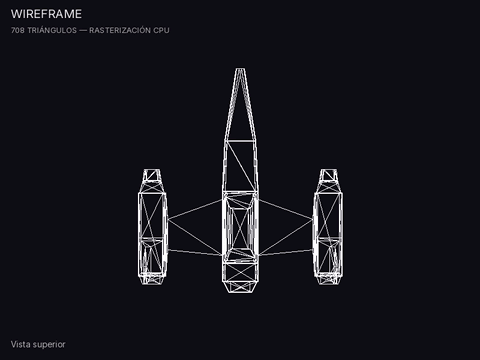</a>

▶ [Ver el video wireframe](docs/videos/lab5/01-wireframe-interactive.mp4) (MP4 H.264, 800×600, 30 FPS, 32 s, 11,9 MB). La animación de arriba es el mismo video en GIF a 480×360 y 15 FPS (6,1 MB).

### FilledBarycentric

Cada triángulo se recorre dentro de su caja delimitadora recortada a la pantalla. En el centro de cada píxel se evalúan las tres funciones de arista con la regla top-left, y los pesos baricéntricos interpolan la profundidad que decide el Z-buffer. El color es el sombreado plano por cara (normal del modelo y luz direccional fija), así que las caras posteriores quedan ocultas por las delanteras en todos los ángulos. En la ventana: `--mode barycentric` o tecla `2`.

<a href="docs/videos/lab5/02-barycentric-interactive.mp4">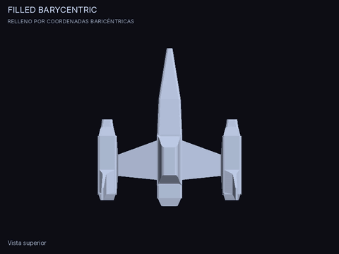</a>

▶ [Ver el video baricéntrico](docs/videos/lab5/02-barycentric-interactive.mp4) (MP4 H.264, 800×600, 30 FPS, 32 s, 1,8 MB). La animación de arriba es el mismo video en GIF a 480×360 y 15 FPS (3,2 MB).

### FilledScanline

El triángulo se recorre fila por fila: en cada línea de centros de píxel se calcula dónde la cruzan las aristas y se escribe el tramo horizontal completo. Solo los píxeles de los extremos se clasifican con la misma regla top-left. No llama al código baricéntrico y la profundidad se interpola con un plano en lugar de pesos. Con la misma cámara, los 960 fotogramas del framebuffer salieron idénticos byte a byte a los del video baricéntrico antes de codificarse (0 píxeles distintos), así que la equivalencia se comprobó con los datos y no solo a la vista. En la ventana: `--mode scanline` o tecla `3`.

<a href="docs/videos/lab5/03-scanline-interactive.mp4">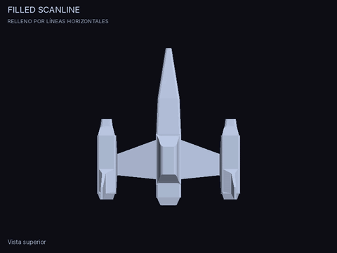</a>

▶ [Ver el video scanline](docs/videos/lab5/03-scanline-interactive.mp4) (MP4 H.264, 800×600, 30 FPS, 32 s, 1,8 MB). La animación de arriba es el mismo video en GIF a 480×360 y 15 FPS (3,2 MB).

### Galería y reproducción

| Modo | Video MP4 | Tamaño | Animación GIF | Tamaño |
|---|---|---|---|---|
| Wireframe | [01-wireframe-interactive.mp4](docs/videos/lab5/01-wireframe-interactive.mp4) | 11,9 MB | [01-wireframe-interactive.gif](docs/videos/lab5/01-wireframe-interactive.gif) | 6,1 MB |
| FilledBarycentric | [02-barycentric-interactive.mp4](docs/videos/lab5/02-barycentric-interactive.mp4) | 1,8 MB | [02-barycentric-interactive.gif](docs/videos/lab5/02-barycentric-interactive.gif) | 3,2 MB |
| FilledScanline | [03-scanline-interactive.mp4](docs/videos/lab5/03-scanline-interactive.mp4) | 1,8 MB | [03-scanline-interactive.gif](docs/videos/lab5/03-scanline-interactive.gif) | 3,2 MB |

Los tres son H.264 High, yuv420p, 800×600, 30 FPS y 960 fotogramas, con `faststart` para reproducción progresiva en el navegador. El wireframe pesa más porque sus líneas de un píxel cambian en cada fotograma y no se comprimen como las superficies lisas. Los GIF son conversiones directas de esos MP4 (480×360, 15 FPS, 64 colores, en bucle) para que el recorrido se vea animado en GitHub, que no reproduce MP4 dentro de la página.

Para recorrer las mismas vistas a mano en la ventana:

```bash
cargo run --release -- --scene ship --interactive --mode scanline
```

`T` vista superior, `R` vista oblicua inicial, `←` `→` rotación horizontal, `↑` `↓` inclinación, `S` lateral, `F` frontal, `E` acercar, `Q` alejar. `1` `2` `3` cambian de modo sin mover la cámara.

---

## Laboratorio 4 — Carga de modelos OBJ

### Objetivo

Según las instrucciones del Ing. Dennis, en esta parte del proyecto debíamos:

1. **Cargar un modelo desde un archivo `.obj`.**
2. **Recorrer todos los triángulos del modelo.**
3. **Obtener los vértices correspondientes a partir de sus índices.**
4. **Dibujar cada triángulo usando nuestra función `triangle(...)`.**
5. **Mostrar el modelo aproximadamente centrado en la ventana.**
6. **Mantenerlo completamente visible y con tamaño razonable.**
7. **No utilizar funciones automáticas de Raylib para cargar y dibujar modelos 3D.**

### Resultado

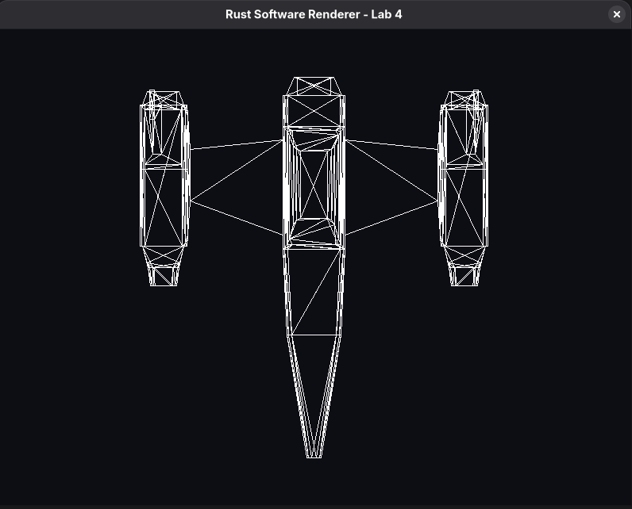

*Captura de la ventana del programa (`NaveBimotor`, vista superior X/Z, 708 triángulos dibujados como contornos).*

### Modelo utilizado

- **Archivo:** `assets/models/Laboratorio3.obj`
- **Modelo:** nave espacial triangulada (`NaveBimotor`, exportada desde Blender)
- **Conteos verificados:** 356 vértices, 2124 índices, 708 triángulos

Estos datos fueron validados en el cargador y en las pruebas automatizadas.

### Checklist Lab 4

- [x] El proyecto **compila y se ejecuta** correctamente.
- [x] El archivo **OBJ se carga correctamente** con un parser propio (líneas `v` y `f`, índices base 1 → base 0, formato `v/vt/vn` admitido, errores con número de línea).
- [x] Se **recorren todos los triángulos** y se obtienen sus **tres vértices por índices**.
- [x] Cada triángulo se dibuja con nuestra función **`triangle(...)`**, que reutiliza **`line(...)`** (Bresenham propio).
- [x] El modelo aparece **centrado**, con **tamaño razonable** y **completamente visible** (vista plana X/Z, escala uniforme, margen del 10 %).
- [x] **No se utilizaron** funciones automáticas de Raylib (`LoadModel`, `DrawModel`, `DrawMesh`, `DrawLine`, `DrawTriangle`); Raylib solo crea la ventana y presenta la textura del framebuffer CPU.
- [x] El repositorio contiene el OBJ, este `README.md` y la captura incrustada.

### Decisiones de diseño

- **Cargador OBJ propio**: lee `v` y `f`, ignora `vt`, `vn`, `mtllib`, `usemtl`, `o`, `s`, y extrae el índice de posición antes del primer `/`.
- **Geometría indexada**: `Mesh { vertices, indices }` separa *dónde están los puntos* de *cómo están conectados*; `expand_vertices` produce un `Vertex` por esquina de cara, en orden, para el ensamblaje por ternas.
- **Mapeo simple a pantalla**: el enunciado permite usar componentes del modelo con escala y traslación. Se eligió el plano X/Z (la nave es larga en Z y ancha en X); el bounding box proyectado se centra y se escala uniformemente. No hay perspectiva ni cámara.
- **Pipeline de cuatro etapas** como en las lecciones: `vertex_shader` → `primitive_assembly` → `rasterize` → `fragment_shader` → `framebuffer.point`.

Detalle en [docs/laboratorio4.md](docs/laboratorio4.md).

---

## Qué estamos construyendo

```text
Archivo OBJ / escena
   ↓
Vértices + índices
   ↓
Triángulos (primitive_assembly)
   ↓
Fragmentos: contorno (line) o interior (barycentric / scanline)
   ↓
Framebuffer CPU
   ↓
Pantalla (textura Raylib)
```

## Arquitectura implementada

```text
rust-software-renderer/
├── assets/models/Laboratorio3.obj          nave triangulada del Lab 3
├── assets/models/sphere.obj                esfera del docente, compartida por los tres cuerpos del Lab 6
├── docs/
│   ├── laboratorio4.md                     guía técnica Lab 4
│   ├── laboratorio5.md                     guía técnica Lab 5
│   ├── laboratorio6.md                     guía técnica Lab 6: shaders, fórmulas, parámetros, pruebas
│   ├── screenshots/lab6/                   01..04 cuerpos y esfera; 05..09 montajes de efectos
│   ├── videos/lab6/                        MP4 y GIF de los tres cuerpos y de los ocho efectos; encode.sh los regenera
│   ├── results/lab6/                       shader_benchmark.csv
│   ├── screenshots/lab4/                   final_render.png, 01-nave-wireframe.png
│   ├── screenshots/lab5/                   01..03 escena sintética; 04..06 nave oblicua interactiva
│   ├── interactive-views.md                cámara orbital, Z-buffer y sombreado (opcional)
│   ├── videos/lab5/                        videos demostrativos MP4 de la vista interactiva y sus GIF animados
│   ├── results/lab5/                       benchmark_raw.csv, benchmark_summary.csv
│   └── profiles/                           lab5-stack-sampler.sh, muestras y resúmenes
├── src/
│   ├── main.rs                             punto de entrada → app::run()
│   ├── app.rs                              ventana, teclado, CLI (--obj, --screenshot, --mode, --scene, --interactive, --view, --benchmark-triangles, --profile, --help) y despacho del Lab 6
│   ├── config.rs                           resolución, FPS, ruta del modelo, plano de vista, margen
│   ├── lib.rs
│   ├── geometry/                           Mesh, Vertex, demo.rs (escena de triángulos)
│   ├── io/obj.rs                           cargador OBJ propio
│   ├── pipeline/
│   │   ├── uniforms.rs, vertex_shader.rs   etapa 1
│   │   ├── screen_mapping.rs               vista plana XY/XZ (Lab 4) y proyección orbital (opcional)
│   │   ├── orbit_camera.rs                 cámara orbital ortográfica y presets (opcional)
│   │   ├── face_shading.rs                 sombreado plano por cara (opcional)
│   │   ├── primitive.rs                    etapa 2
│   │   ├── rasterizer.rs                   etapa 3: rasterize (wireframe) y rasterize_with_mode
│   │   ├── fragment_shader.rs              etapa 4
│   │   ├── render.rs                       render (Lab 4), render_with_mode (Lab 5), render_interactive
│   │   ├── surface.rs                      Lab 6: SurfaceSample, ShaderUniforms, NormalSource
│   │   └── shaded.rs                       Lab 6: render_shaded (culling, interpolación, shader en hilos, Z-buffer)
│   ├── rasterization/
│   │   ├── line.rs, triangle.rs            Lab 4: Bresenham y contorno de tres líneas
│   │   ├── mode.rs                         TriangleMode
│   │   ├── coverage.rs                     función de arista, orientación, regla top-left, rangos de centros, interpolation_weights (Lab 6)
│   │   ├── barycentric.rs                  relleno baricéntrico
│   │   └── scanline.rs                     relleno por scanline
│   ├── rendering/                          Fragment, Framebuffer (CPU, con Z-buffer opcional), Presenter (textura Raylib)
│   ├── benchmark/                          carga de trabajo, cronómetro, medianas, CSV, perfilado; shaders.rs (Lab 6)
│   ├── shading/                            Lab 6: math, noise, cycle, sdf (♠ ♦), sphere, lighting
│   └── celestial/                          Lab 6: cuerpos, parámetros, escena, CLI, visor, líneas de tiempo, grabación
│       ├── crown.rs                        The King's Crown
│       ├── entrance/                       Crimson Entrance: terrain, events, clouds
│       └── house.rs                        House of Cards
└── tests/                                  53 archivos de pruebas de integración + fixture
```

Raylib se usa únicamente para la ventana, los tipos `Vector2`/`Vector3`/`Matrix` y para presentar la textura final. Toda la rasterización es código propio.

## Cómo ejecutar el proyecto

Requisitos: Rust estable (probado con 1.97), Cargo y el crate `raylib = "5.5"` (en Fedora 43 compiló sin paquetes adicionales).

```bash
cargo run                                                     # Lab 4: nave en wireframe
cargo run --release -- --mode barycentric                     # nave rellena
cargo run --release -- --scene triangles --mode wireframe     # escena de comparación
cargo run --release -- --scene triangles --mode barycentric
cargo run --release -- --scene triangles --mode scanline
cargo run --release -- --scene triangles --mode scanline --screenshot captura.png
cargo run -- --obj ruta/otro_modelo.obj                       # otro OBJ triangulado
cargo run --release -- --scene ship --interactive --mode scanline   # vista interactiva (opcional)
cargo run --release -- --view top --mode barycentric --screenshot top.png
cargo run --release -- --benchmark-triangles                  # benchmark sin ventana → docs/results/lab5/*.csv
docs/profiles/lab5-stack-sampler.sh scanline 1000 /tmp/perfil # perfilado por muestreo de pilas
cargo run --release -- --scene crown                          # Lab 6: The King's Crown
cargo run --release -- --scene entrance                       # Lab 6: Crimson Entrance
cargo run --release -- --scene house                          # Lab 6: House of Cards
cargo run --release -- --benchmark-shaders                    # Lab 6: benchmark de shaders → docs/results/lab6
```

Una ruta inexistente, un OBJ inválido o un argumento desconocido terminan con mensaje de error y código de salida 1.

### Pruebas y validación

```bash
cargo test                                   # 643 pruebas (156 de los Labs 4-5 + 51 de la vista interactiva + 195 del Lab 6 + 241 del Camino al Proyecto 3)
cargo fmt --check
cargo check
cargo clippy --all-targets -- -D warnings
cargo build --release
```

Las pruebas cubren: configuración, malla e índices, parser OBJ, integración con la nave real, framebuffer, líneas, triángulos, shader de vértices, ensamblaje, mapeo a pantalla, pipeline, contratos del Lab 4, política de cobertura, baricéntrico, scanline, paridad T01–T09, estrés determinista, despacho de modos, escena, benchmark, perfilado, contratos finales del Lab 5 y, para la vista opcional, cámara orbital, proyección, controles, profundidad, Z-buffer, sombreado, presets y regresión. El Laboratorio 6 añade el oráculo de la nave (21 *hashes*), la esfera del docente, la interpolación, la etapa sombreada, el ruido y las SDF, la iluminación, cada cuerpo y cada efecto, la CLI, las líneas de tiempo, el benchmark de shaders, los contratos finales y la coherencia de esta documentación.

## Restricciones respetadas

- **No** se usa carga ni dibujo automático de modelos 3D de Raylib.
- **No** se agregó perspectiva 3D ni texturas. El Z-buffer y el sombreado plano existen solo en la vista interactiva opcional; `cargo run`, `--scene triangles`, el benchmark y el perfil del Lab 5 no los usan.
- **No** se agregaron crates adicionales: solo `raylib` y la biblioteca estándar.
- El Laboratorio 4 permanece intacto: `cargo run` sin argumentos sigue mostrando la nave en wireframe y sus 91 pruebas originales siguen pasando.
- Laboratorio 6: los tres cuerpos usan la misma `sphere.obj` del docente sin modificar. No se cargan imágenes, texturas ni materiales y no se agregaron modelos ni *crates*. Ninguna prueba de los laboratorios 4 y 5 se modificó, y la nave, sus tres modos, la cámara y el Z-buffer conservan su salida bit a bit (oráculo dorado).

## Autor

**Vernel Josue Hernández Cáceres** — Carné 24584

Universidad del Valle de Guatemala (UVG) — Gráficas por Computadora — 2026
