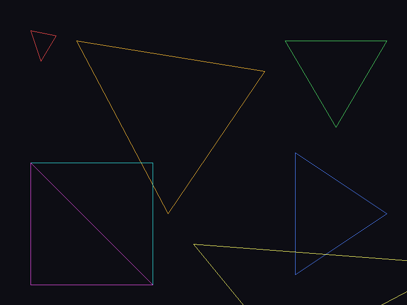
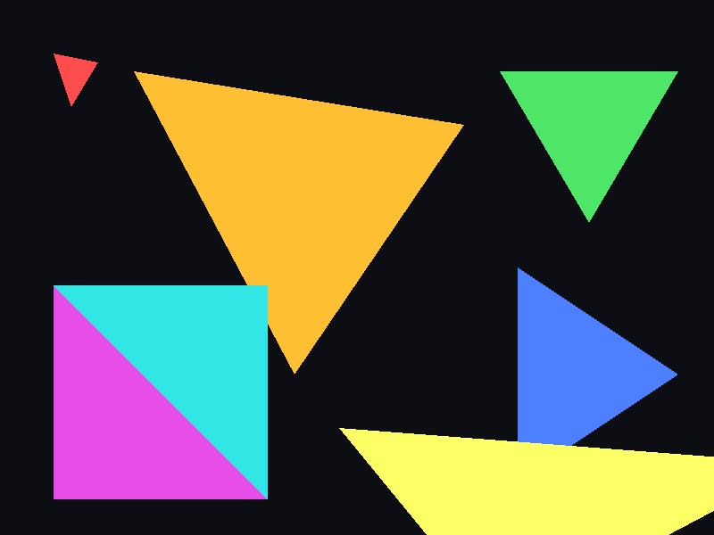

# Rust Software Renderer — Laboratorios 4 y 5

Proyecto del curso **Gráficas por Computadora** — **Universidad del Valle de Guatemala (UVG)**, segundo ciclo 2026

Rasterizador por CPU escrito en Rust. Esta rama (`lab5/triangle-filling`) contiene el **Laboratorio 4: Carga de modelos OBJ** (contornos) y, sobre él, el **Laboratorio 5: Filling triangles** (dos algoritmos de relleno, comparación de posiciones, benchmark y perfilado).

- [Laboratorio 5 — Filling triangles](#laboratorio-5--filling-triangles)
- [Laboratorio 4 — Carga de modelos OBJ](#laboratorio-4--carga-de-modelos-obj)
- [Arquitectura](#arquitectura-implementada)
- [Cómo ejecutar y verificar](#cómo-ejecutar-el-proyecto)
- [Autor](#autor)

---

## Laboratorio 5 — Filling triangles

### Objetivo

Según las instrucciones del Ing. Dennis, la función `triangle` que dibuja los tres bordes debía ampliarse para **generar también los fragmentos del interior**, con **dos algoritmos independientes** (coordenadas baricéntricas y líneas horizontales), conservando la opción de contorno, comparando las **posiciones** producidas por ambos, midiendo solo la rasterización en modo optimizado y usando un perfilador.

### Los tres modos

```rust
#[derive(Clone, Copy)]
pub enum TriangleMode {
    Wireframe,          // Lab 4: triangle() → 3 × line()
    FilledBarycentric,  // bounding box + pesos baricéntricos en (x+0.5, y+0.5)
    FilledScanline,     // intersecciones por fila + spans horizontales
}
```

El modo se pasa a la etapa de rasterización (`rasterize_with_mode(triangles, mode, bounds)`); el ensamblaje de primitivas y el procesamiento de fragmentos no cambian. `rasterize(triangles)` y `render(...)` del Laboratorio 4 siguen existiendo como wrappers del modo wireframe.

### Resultado: la misma escena en los tres modos

Escena controlada de siete triángulos (pequeño, grande, borde horizontal, borde vertical, dos que comparten una diagonal con colores distintos, uno recortado por la ventana), generada con `cargo run --release -- --scene triangles --mode <modo> --screenshot ...`.

| Wireframe | FilledBarycentric | FilledScanline |
|---|---|---|
|  |  |  |

Las dos imágenes rellenas son píxel a píxel idénticas porque ambos algoritmos cubren exactamente los mismos centros. La diagonal compartida (cian/magenta) no tiene huecos ni solapes.

### Fundamento matemático

Centro del píxel `(x, y)`: `P = (x + 0.5, y + 0.5)`; `y` crece hacia abajo. Función de arista:

```text
E(A, B, P) = (Px - Ax)·(By - Ay) - (Py - Ay)·(Bx - Ax)      area2 = E(A, B, C)
```

- Si `area2 < 0` se intercambian B y C solo localmente, así **invertir el orden de los vértices no hace desaparecer el triángulo**. Si `area2 == 0` no se divide: triángulo degenerado, cero fragmentos.
- **Regla top-left** para empates (`E == 0`): la arista `A→B` acepta el punto si baja (`By > Ay`) o si es horizontal hacia la izquierda (`By == Ay` y `Bx < Ax`). Con ella dos triángulos adyacentes cubren cada centro de su arista común exactamente una vez.

**Baricéntrico** (`src/rasterization/barycentric.rs`): bounding box recortado al framebuffer; para cada centro se calculan `w_a = E(B,C,P)/area2`, `w_b = E(C,A,P)/area2`, `w_c = E(A,B,P)/area2` y se emite un fragmento si los tres pasan la regla de borde.

**Scanline** (`src/rasterization/scanline.rs`): por cada fila `sy = y + 0.5` se intersectan las aristas no horizontales con intervalo **semiabierto** `[min_y, max_y)` (un vértice sobre una fila se cuenta una vez); una arista horizontal sobre la fila decide la fila completa; el span `[xl, xr]` se recorre directamente y solo los píxeles de los extremos se clasifican con `E`. No recorre el bounding box ni llama al algoritmo baricéntrico (una prueba lee el código fuente para asegurarlo).

### Comparación de posiciones, no de imágenes

Para cada caso se comparan los conjuntos de pares `(x, y)` de ambos algoritmos y se verifica que no hay duplicados dentro de un triángulo ni píxeles fuera del framebuffer; al fallar, la prueba lista `only_in_barycentric` y `only_in_scanline`.

| Caso | Vértices | Resultado |
|---|---|---|
| T01 pequeño | (10,10) (18,12) (12,20) | idéntico |
| T02 grande | (10,10) (90,20) (40,85) | idéntico |
| T03 borde horizontal | (10,20) (70,20) (40,75) | idéntico |
| T04 borde vertical | (20,10) (20,80) (75,40) | idéntico |
| T05 orden inverso | T02 con C y B intercambiados | idéntico a T02 |
| T06 parcialmente fuera | (-15,20) (50,15) (40,115) | idéntico, todo dentro de 100×100 |
| T07 colineal | (10,10) (30,30) (50,50) | vacío en ambos |
| T08 vértice repetido | (20,20) (20,20) (60,50) | vacío en ambos |
| T09 vértices sobre centros | (10.5,10.5) (60.5,10.5) (10.5,60.5) | idéntico, 1275 píxeles |

Además: 300 triángulos pseudoaleatorios con semilla fija en cuatro viewports, las seis permutaciones de vértices, triángulos minúsculos, recorte por los cuatro bordes, coordenadas de 1e7, viewports de 0×0 y 1×1, NaN/inf, y la nave completa (708 caras: 173 500 fragmentos idénticos en ambos rellenos). Sin discrepancias.

### Benchmark (`cargo run --release -- --benchmark-triangles`)

Sin ventana. Se mide únicamente la generación de fragmentos (`rasterize_with_mode`, incluida la creación y almacenamiento del `Vec<Fragment>`) con `std::time::Instant` y `std::hint::black_box`; la carga de 207 triángulos se construye antes del cronómetro y se verifica la paridad de cobertura antes de medir. 10 rondas de calentamiento y **7 rondas medidas × 100 iteraciones por modo**, alternando modos; se reporta la **mediana**. Datos crudos: `docs/results/lab5/benchmark_raw.csv`; resumen derivado: `docs/results/lab5/benchmark_summary.csv`.

Entorno: Intel Core i7-13650HX, Fedora 43, rustc 1.97.0, release, 2026-10-21.

| Modo | Triángulos | Fragmentos / iteración | Mediana por iteración | Mín–máx por iteración | ns / fragmento |
|---|---:|---:|---:|---:|---:|
| FilledBarycentric | 207 | 858 033 | **13.95 ms** | 13.82–14.58 ms | 16.3 |
| FilledScanline | 207 | 858 033 | **5.26 ms** | 5.13–6.05 ms | 6.1 |

Ambos generan los mismos 858 033 fragmentos; scanline fue 2.65× más rápido en esta carga.

### Perfilado

No había `cargo-flamegraph`, `perf` ni `valgrind`; `samply` requiere cambiar `perf_event_paranoid` con sudo, lo que no se hizo. Se usó un **perfilador por muestreo de pilas** sin privilegios (`eu-stack` de elfutils cada ~10 ms sobre el modo `--benchmark-triangles --profile`), script y evidencia en `docs/profiles/`:

| Modo | Muestras | Marco hoja dominante | `memcpy` (extend del `Vec`) | Otros |
|---|---:|---|---:|---|
| barycentric | 356 | `fill_barycentric` 87.1 % | 11.8 % | realloc/malloc < 1 % |
| scanline | 375 | `fill_scanline` 76.5 % | 18.1 % | `ceil` 2.9 %, realloc/free ≈ 2 % |

Lectura: el baricéntrico gasta casi todo el tiempo evaluando tres funciones de arista en cada centro del bounding box, incluidos los que caen fuera; scanline casi no hace trabajo por píxel interior y por eso pesa más la copia de fragmentos al vector acumulado (`memcpy`) y el `ceil`/`floor` de los rangos, que son el siguiente cuello de botella. El crecimiento del `Vec` es visible pero menor al 3 % en ambos. Los porcentajes son proporción de muestras, no tiempo absoluto. Detalle en [docs/laboratorio5.md](docs/laboratorio5.md).

### Checklist Lab 5

- [x] R01 `Wireframe` reutiliza las tres llamadas a `line` (pruebas de regresión).
- [x] R02 `FilledBarycentric` independiente con bounding box y pesos.
- [x] R03 `FilledScanline` independiente, fila por fila.
- [x] R04 `TriangleMode` en `rasterize`, sin tocar ensamblaje ni fragment shader.
- [x] R05 Evaluación en centros `(x+0.5, y+0.5)`.
- [x] R06 Orden inverso y área cero manejados.
- [x] R07 Aristas horizontales y vértices sobre filas con regla consistente.
- [x] R08 Casos pequeño/grande, horizontal/vertical, inverso, recortado, colineal.
- [x] R09 Comparación de coordenadas `(x, y)` entre algoritmos.
- [x] R10 Medición solo de fragmentos, release, `Instant`, repeticiones y medianas.
- [x] R11 Conteo de fragmentos por algoritmo.
- [x] R12 Perfilador con evidencia real (muestreo de pilas).
- [x] R13 Una imagen por modo.
- [x] R14 Tiempos, perfil y explicación documentados.

---

## Laboratorio 4 — Carga de modelos OBJ

### Objetivo

Según las instrucciones del Ing. Dennis, en esta parte del proyecto debíamos:

1. **Cargar un modelo desde un archivo `.obj`.**
2. **Recorrer todos los triángulos del modelo.**
3. **Obtener los vértices correspondientes a partir de sus índices.**
4. **Dibujar cada triángulo usando nuestra función `triangle(...)`.**
5. **Mostrar el modelo aproximadamente centrado en la ventana.**
6. **Mantenerlo completamente visible y con tamaño razonable.**
7. **No utilizar funciones automáticas de Raylib para cargar y dibujar modelos 3D.**

### Resultado


*Captura de la ventana del programa (`NaveBimotor`, vista superior X/Z, 708 triángulos dibujados como contornos).*

### Modelo utilizado

- **Archivo:** `assets/models/Laboratorio3.obj`
- **Modelo:** nave espacial triangulada (`NaveBimotor`, exportada desde Blender)
- **Conteos verificados:** 356 vértices, 2124 índices, 708 triángulos

Estos datos fueron validados en el cargador y en las pruebas automatizadas.

### Checklist Lab 4

- [x] El proyecto **compila y se ejecuta** correctamente.
- [x] El archivo **OBJ se carga correctamente** con un parser propio (líneas `v` y `f`, índices base 1 → base 0, formato `v/vt/vn` admitido, errores con número de línea).
- [x] Se **recorren todos los triángulos** y se obtienen sus **tres vértices por índices**.
- [x] Cada triángulo se dibuja con nuestra función **`triangle(...)`**, que reutiliza **`line(...)`** (Bresenham propio).
- [x] El modelo aparece **centrado**, con **tamaño razonable** y **completamente visible** (vista plana X/Z, escala uniforme, margen del 10 %).
- [x] **No se utilizaron** funciones automáticas de Raylib (`LoadModel`, `DrawModel`, `DrawMesh`, `DrawLine`, `DrawTriangle`); Raylib solo crea la ventana y presenta la textura del framebuffer CPU.
- [x] El repositorio contiene el OBJ, este `README.md` y la captura incrustada.

### Decisiones de diseño

- **Cargador OBJ propio**: lee `v` y `f`, ignora `vt`, `vn`, `mtllib`, `usemtl`, `o`, `s`, y extrae el índice de posición antes del primer `/`.
- **Geometría indexada**: `Mesh { vertices, indices }` separa *dónde están los puntos* de *cómo están conectados*; `expand_vertices` produce un `Vertex` por esquina de cara, en orden, para el ensamblaje por ternas.
- **Mapeo simple a pantalla**: el enunciado permite usar componentes del modelo con escala y traslación. Se eligió el plano X/Z (la nave es larga en Z y ancha en X); el bounding box proyectado se centra y se escala uniformemente. No hay perspectiva ni cámara.
- **Pipeline de cuatro etapas** como en las lecciones: `vertex_shader` → `primitive_assembly` → `rasterize` → `fragment_shader` → `framebuffer.point`.

Detalle en [docs/laboratorio4.md](docs/laboratorio4.md).

---

## Qué estamos construyendo

```text
Archivo OBJ / escena
   ↓
Vértices + índices
   ↓
Triángulos (primitive_assembly)
   ↓
Fragmentos: contorno (line) o interior (barycentric / scanline)
   ↓
Framebuffer CPU
   ↓
Pantalla (textura Raylib)
```

## Arquitectura implementada

```text
rust-software-renderer/
├── assets/models/Laboratorio3.obj          nave triangulada del Lab 3
├── docs/
│   ├── laboratorio4.md                     guía técnica Lab 4
│   ├── laboratorio5.md                     guía técnica Lab 5
│   ├── screenshots/lab4/                   final_render.png, 01-nave-wireframe.png
│   ├── screenshots/lab5/                   01-wireframe.png, 02-barycentric.png, 03-scanline.png
│   ├── results/lab5/                       benchmark_raw.csv, benchmark_summary.csv
│   └── profiles/                           lab5-stack-sampler.sh, muestras y resúmenes
├── src/
│   ├── main.rs                             punto de entrada → app::run()
│   ├── app.rs                              ventana, CLI (--obj, --screenshot, --mode, --scene, --benchmark-triangles, --profile)
│   ├── config.rs                           resolución, FPS, ruta del modelo, plano de vista, margen
│   ├── lib.rs
│   ├── geometry/                           Mesh, Vertex, demo.rs (escena de triángulos)
│   ├── io/obj.rs                           cargador OBJ propio
│   ├── pipeline/
│   │   ├── uniforms.rs, vertex_shader.rs   etapa 1
│   │   ├── screen_mapping.rs               vista plana XY/XZ, centrado y escala
│   │   ├── primitive.rs                    etapa 2
│   │   ├── rasterizer.rs                   etapa 3: rasterize (wireframe) y rasterize_with_mode
│   │   ├── fragment_shader.rs              etapa 4
│   │   └── render.rs                       render (Lab 4) y render_with_mode (Lab 5)
│   ├── rasterization/
│   │   ├── line.rs, triangle.rs            Lab 4: Bresenham y contorno de tres líneas
│   │   ├── mode.rs                         TriangleMode
│   │   ├── coverage.rs                     función de arista, orientación, regla top-left, rangos de centros
│   │   ├── barycentric.rs                  relleno baricéntrico
│   │   └── scanline.rs                     relleno por scanline
│   ├── rendering/                          Fragment, Framebuffer (CPU), Presenter (textura Raylib)
│   └── benchmark/                          carga de trabajo, cronómetro, medianas, CSV, modo de perfilado
└── tests/                                  23 archivos de pruebas de integración + fixture
```

Raylib se usa únicamente para la ventana, los tipos `Vector2`/`Vector3`/`Matrix` y para presentar la textura final. Toda la rasterización es código propio.

## Cómo ejecutar el proyecto

Requisitos: Rust estable (probado con 1.97), Cargo y el crate `raylib = "5.5"` (en Fedora 43 compiló sin paquetes adicionales).

```bash
cargo run                                                     # Lab 4: nave en wireframe
cargo run --release -- --mode barycentric                     # nave rellena
cargo run --release -- --scene triangles --mode wireframe     # escena de comparación
cargo run --release -- --scene triangles --mode barycentric
cargo run --release -- --scene triangles --mode scanline
cargo run --release -- --scene triangles --mode scanline --screenshot captura.png
cargo run -- --obj ruta/otro_modelo.obj                       # otro OBJ triangulado
cargo run --release -- --benchmark-triangles                  # benchmark sin ventana → docs/results/lab5/*.csv
docs/profiles/lab5-stack-sampler.sh scanline 1000 /tmp/perfil # perfilado por muestreo de pilas
```

Una ruta inexistente, un OBJ inválido o un argumento desconocido terminan con mensaje de error y código de salida 1.

### Pruebas y validación

```bash
cargo test                                   # 156 pruebas
cargo fmt --check
cargo check
cargo clippy --all-targets -- -D warnings
cargo build --release
```

Las pruebas cubren: configuración, malla e índices, parser OBJ, integración con la nave real, framebuffer, líneas, triángulos, shader de vértices, ensamblaje, mapeo a pantalla, pipeline, contratos del Lab 4, política de cobertura, baricéntrico, scanline, paridad T01–T09, estrés determinista, despacho de modos, escena, benchmark, perfilado y contratos finales del Lab 5.

## Restricciones respetadas

- **No** se usa carga ni dibujo automático de modelos 3D de Raylib.
- **No** se agregó z-buffer, texturas, iluminación ni perspectiva 3D.
- **No** se agregaron crates adicionales: solo `raylib` y la biblioteca estándar.
- El Laboratorio 4 permanece intacto: `cargo run` sin argumentos sigue mostrando la nave en wireframe y sus 91 pruebas originales siguen pasando.

## Autor

**Vernel Josue Hernández Cáceres** — Carné 24584

Universidad del Valle de Guatemala (UVG) — Gráficas por Computadora — 2026
